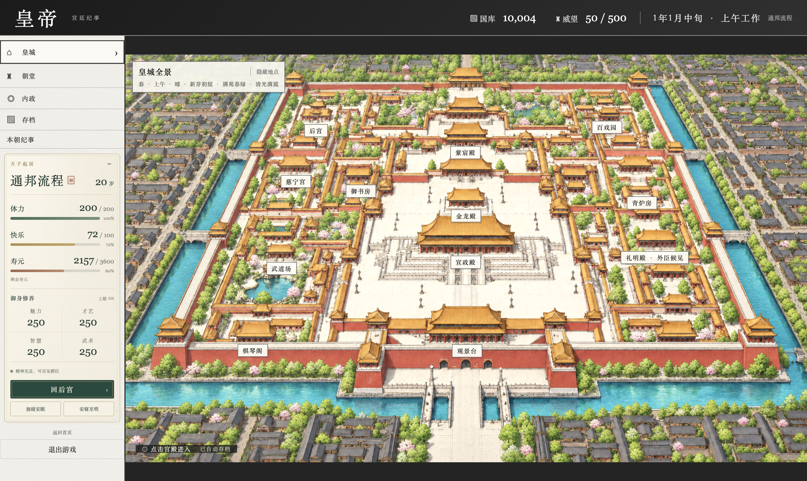
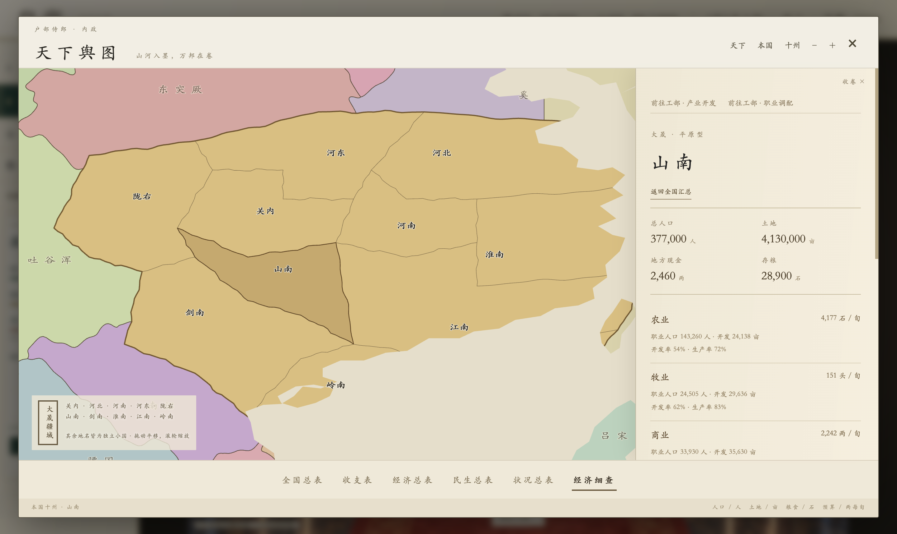
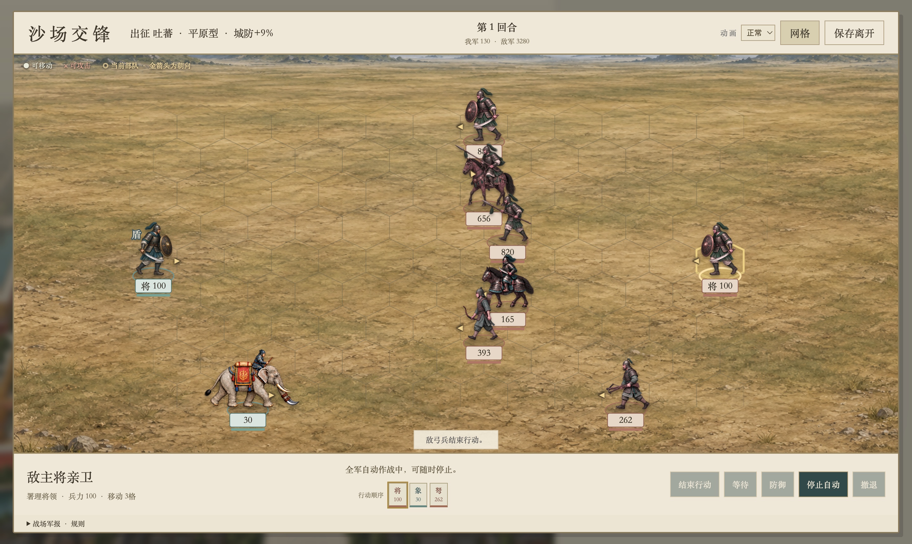
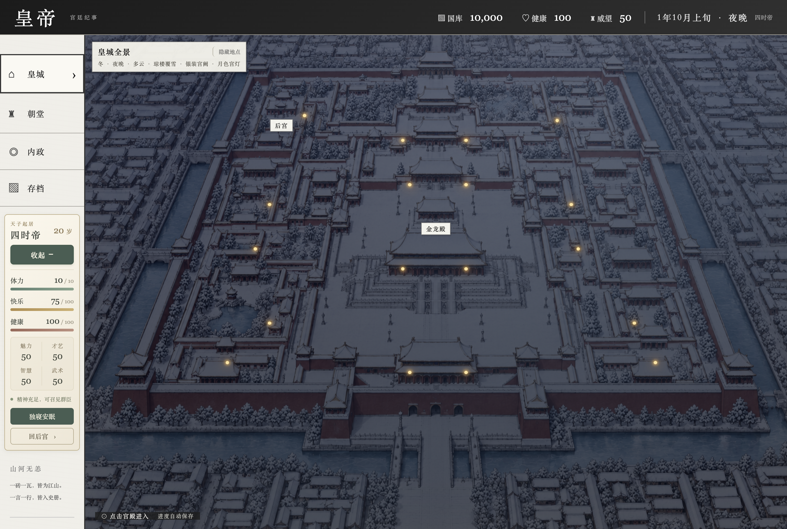

# 皇帝

一款以古代帝王生活为题材的中文单机策略养成游戏。你将从皇城出发，召见群臣、治理州郡、接待外使、调兵征战，在国政与起居之间安排每一旬，延续自己的王朝。

游戏采用纸卷质感界面与中式宫廷美术，提供皇城、朝堂、天下舆图和战场等场景，支持macOS 与 Windows 桌面运行，也可通过浏览器预览。



## 游戏特色

- **临朝理政**：在朝堂召见宰相、六部官员与将军，办理财政、吏治、营建、礼仪和军务。
- **经营天下**：查看本国十州与周边诸国，管理产业、收支、粮食、人口、地方预算和灾后恢复。
- **选贤任能**：通过制举选才、任免与地方委任，让官员能力参与国家治理。
- **通使四方**：邀请外国使臣入京，商议贸易、条约、和亲、纳贡及外交关系。
- **沙场交锋**：编配九兵种军备，进行六角格回合战斗，处理城防、占领与收复。
- **宫廷起居**：安排修习、休息、后宫、狩猎、巡游与微服出行，兼顾体力、快乐和寿元。
- **四时流转**：皇城随春夏秋冬、一天六阶段和天气变化呈现不同景象。
- **王朝延续**：推进国政长策与特殊工程，培养宗室，经历继位与终局评价。
- **本地存档**：自动保存进度，支持存档文件导入、导出与备份。

## 游戏截图

以下图片来自开发过程中的实际运行与验收，界面和数值会随版本继续调整。

### 朝堂召见

群臣分班列席，点击人物召见；御案呈上本旬奏折，也可铺开山河图，点州调粮、调兵与营建。


### 天下舆图

从全国总览深入州郡，查看地方人口、土地、存粮和产业。



### 沙场交锋

在六角格战场调动部队，选择攻击、防御、等待或自动作战。



### 冬夜皇城

四季场景配合时辰光照，冬夜可见积雪与宫灯。



## 快速开始

安装 Node.js 22 或更新版本后，在项目目录执行：

```sh
npm ci
npm start
```

启动后创建角色，进入皇城；已有进度可选择继续游戏。

直接试玩新版朝堂：

```sh
npm run preview:court
```

首次启动直接进入新朝堂，后续继续该试玩进度。试玩使用独立临时存档目录，不影响正常游戏进度。详细操作见[朝堂交互首版](docs/immersive-court-preview.md)。

如需浏览器预览：

```sh
npm run dev
```

随后访问本机预览地址：<http://localhost:5173>。该命令需要本机已安装Python 3。浏览器与桌面应用分别保存游戏进度。

项目包含较多人物与场景图片，首次下载需要一定时间与磁盘空间。

## 基本玩法

1. **进入皇城**：点击宫殿或左侧导航，前往朝堂、内政及其他场所。
2. **召见群臣**：点击朝堂官员听奏，再选择要办的事务；听奏和查看不消耗行动，落旨后才依原规则扣除。
3. **查看国情**：在内政舆图选择本国或州郡，查看收支、经济、民生与地方状况。
4. **安排起居**：办事会消耗体力，合理安排修习与休息，避免体力耗尽。
5. **推进时日**：每旬包含早上、上午、中午、下午、傍晚和夜晚六阶段；离开宫殿推进阶段，夜间休息后进入下一旬。
6. **备份进度**：在“存档”面板导出存档文件，需要恢复时再导入。

## 本地打包

macOS 版本：

```sh
npm run build:mac
```

Windows 版本：

```sh
npm run build:win
```

安装包生成于 `dist/`。建议在对应系统上构建与验收；当前未配置应用签名，macOS 版本也未配置公证。

## 开发与验证

项目使用Electron 与原生网页技术，界面和游戏逻辑由模块化脚本组成。

| 路径 | 内容 |
| --- | --- |
| `src/` | 游戏状态、玩法规则、界面与样式 |
| `assets/` | 人物、场景、字体和战斗素材 |
| `tests/` | 业务规则测试与桌面交互验收 |
| `scripts/` | 数据检查、平衡分析与素材处理脚本 |
| `docs/` | 玩法规则、数据说明与开发记录 |

运行类型契约检查与业务测试：

```sh
npm test
```

桌面界面验收与长线平衡检查：

```sh
npm run test:desktop
npm run test:playability
npm run test:balance-ui
npm run test:court-play
npm run test:court-fiscal
npm run test:court-personnel
npm run test:court-justice
npm run test:court-diplomacy
npm run test:court-negotiation
npm run test:court-garrison
npm run test:court-campaign
npm run test:court-defense
npm run test:court-royal
npm run test:court-special
npm run test:court-honors
```

桌面验收需要可访问图形界面的本机会话。本轮类型契约和业务回归结果见发展平衡第二版复验报告；桌面验收覆盖指定窗口与交互流程，不代表所有操作系统均已完成验收。

## 玩法与数据文档

- [数据字典](docs/data-dictionary.md)
- [存档版本兼容](docs/save-compatibility.md)
- [旬结算顺序](docs/turn-settlement.md)
- [内政数据模型](docs/domestic-model.md)
- [皇帝与后宫](docs/emperor-harem.md)
- [地方治理与游戏进程](docs/p01-governance-and-progression.md)
- [长期玩法实施说明](docs/longterm-development.md)
- [平衡规则与复验](docs/balance-v1-2026-10-17.md)
- [发展、经济与战斗资源原始检查（2026-10-21）](docs/development-balance-audit-2026-10-21.md)
- [22项问题的修复方案与完整复验](docs/development-balance-fixes-2026-10-21.md)
- [从头复测记录：扩大桌面回归存在9组失败](docs/development-balance-retest-2026-10-21.md)
- [整体平衡再检查：8项问题、40组场景及解决方案](docs/game-balance-complete-review-2026-10-21.md)
- [8项整改与最终复检：55条路线、39,960旬及恢复方案](docs/game-balance-fixes-2026-10-21.md)
- [玩家容错调整：增加冗余与58条路线复测](docs/player-cushion-2026-10-21.md)
- [当前版新局完整复测：118条路线、战灾容错与恢复方案](docs/player-tolerance-retest-2026-10-21.md)
- [战后恢复与出征核阅修复：3项修复、142条路线完整复测](docs/army-recovery-fixes-2026-10-21.md)
- [玩家操作新局复测：48条路线、连续战争与自然灾害、5项解决方案](docs/player-operations-retest-2026-10-21.md)
- [战后恢复五项修复：51条新局路线、债务战备与续批、完整验收](docs/player-recovery-fixes-2026-10-22.md)
- [人物随机生成失败修复：全库可达、116张立绘、904项回归通过](docs/random-portrait-generation-fix-2026-10-22.md)
- [整体平衡再次检查：148组、65,340旬、2项问题与解决方案](docs/game-balance-complete-recheck-2026-10-22.md)
- [两项平衡修复与新局复测：分批恢复基本兵力、地方军备对账、913项回归](docs/balance-two-fixes-2026-10-22.md)
- [战灾债务组合复测与修复（最新）：93条路线、3项补齐、恢复建议与922项回归](docs/player-combined-recovery-2026-10-22.md)
- [外国使臣美术说明](docs/envoy-art/README.md)

## 项目状态与素材

项目处于持续开发阶段，玩法、平衡和界面仍在迭代。宫城及部分人物美术使用人工智能图像生成工具制作，历史参考素材与旧版素材不一定参与实际运行或打包。字体授权说明保留在字体素材目录中。

仓库暂未提供开源许可证；代码、图片、字体及参考资料的使用范围应分别以相应授权为准。
