# 皇帝 · Emperor

**临朝理政，经营天下，也过好自己的帝王一生。**

《皇帝》是一款中文单机策略养成游戏。你可以在皇城安排起居，在宣政殿召见群臣，经营州郡、招揽人才、通使四方，再把真正招募的将领与编成的军队带入军阵卡牌战场。钱粮、人口、军备与个人状态会共同影响王朝的走向。

游戏使用中式宫廷场景、纸卷簿册和人物立绘，提供 Electron 桌面运行与浏览器本地预览，支持 macOS、Windows 打包。

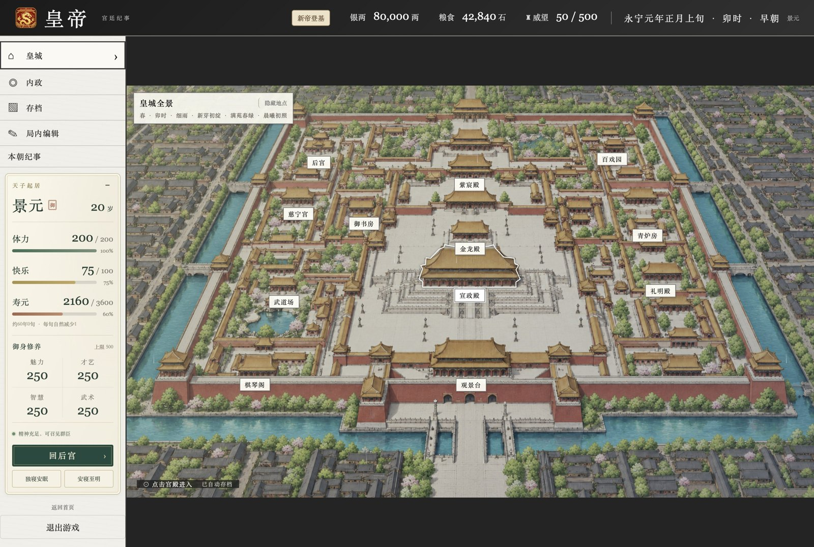

[快速开始](#快速开始) · [新手怎么玩](#新手怎么玩) · [玩法与实机截图](#玩法与实机截图) · [存档与局内编辑](#存档与局内编辑) · [开发与打包](#开发与打包)

## 你可以做什么

| 方向 | 当前玩法 |
| --- | --- |
| 朝堂理政 | 点击官员召见，听取奏报，办理财政、吏治、礼仪、军务与营建事务 |
| 经营州郡 | 查看天下舆图，安排产业、用工、分期开发、土地转用、扩城和地方治理 |
| 财政民生 | 核定赋税、调配钱粮、补助地方，处理灾害、债务和长期收支 |
| 选贤任能 | 开科求贤、查阅人物、任免官职、委派地方治理、研习与封赏 |
| 外交通使 | 查看诸国关系，安排使臣、谈判、贸易及条约 |
| 军阵交锋 | 编配将领、兵员与九类兵种军备，自动形成牌组，进行回合制卡牌战斗 |
| 帝王起居 | 修习、安寝、后宫相伴、狩猎、巡游、微服出行与炼丹 |
| 王朝传承 | 管理宗室与储君，推进特殊工程，积累本朝纪事并迎接终评与继位 |

## 快速开始

### 从源码运行桌面版

准备 Node.js 22 或更高版本及 npm，然后执行：

```sh
git clone --depth 1 https://github.com/fenghlkevin/emperor.git
cd emperor
npm ci
npm start
```

项目包含较多人物、场景和截图资源，首次下载与安装需要一些时间。浅克隆可避免同时下载完整提交历史。

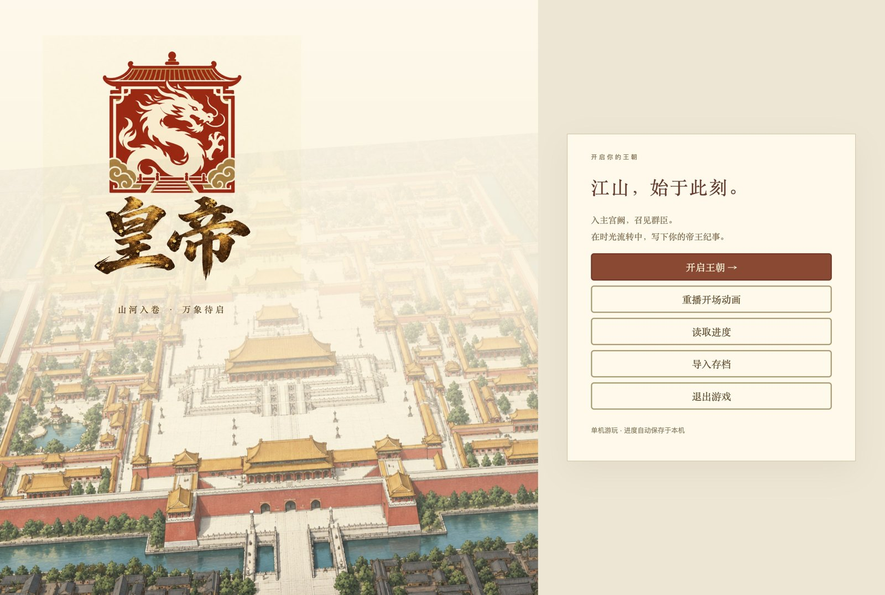

### 浏览器本地预览

本机安装 Python 3 后，在项目目录运行：

```sh
npm run dev
```

打开 [http://localhost:5173](http://localhost:5173)。桌面应用和浏览器分别使用各自的本地存档。

## 新手怎么玩

### 1. 开启王朝，选择难度

填写**君主名号、国号和年号**，再选择难度：

| 难度 | 初始银两 | 适合的体验 |
| --- | ---: | --- |
| 新帝登基 | 80,000 两 | 更充裕的起步资源，适合熟悉朝政、经营与战斗 |
| 励精图治 | 30,000 两 | 兼顾发展与风险，需要认真安排预算和军备 |
| 力挽狂澜 | 22,000 两 | 更紧张的开局，更考验财政、用兵与恢复节奏 |

难度还会影响营建、征募、军备、人才与外部压力；进入游戏后，可点击顶部难度入口查看本局规则与可用援助。

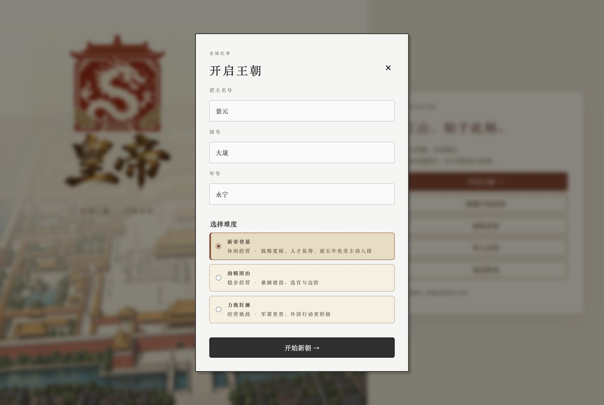

### 2. 先看国情，再安排投入

先通过“内政”了解人口、产业和钱粮，再到朝堂查阅财政与地方情况。初期可以按这个顺序展开：

1. 查看国库、存粮、收入与支出，弄清本局的资源余量。
2. 查阅官员能力，为中央与地方安排合适的人选。
3. 选择一两个州做产业开发，确认土地、用工和预算能够支撑计划。
4. 熟悉出征核阅与牌组预览，再决定是否发动战争。
5. 办完朝政后安排修习、休息或出行，兼顾君主状态。

### 3. 把握旬与起居节奏

游戏以“旬”推进，一年为 36 旬；每旬内分六个时段安排朝政与生活。宫殿和事务会受时段、体力及当前事件影响，夜间安寝会推进到下一旬。

不同操作的消耗并不相同。查阅信息时先看清预览，落旨、执行或确认前核对钱粮、劳力和体力；推进下一旬后，再检查收入、工程与军备恢复的变化。

## 玩法与实机截图

以下画面采集自当前版本的真实桌面界面。军阵、战后恢复和本朝终评使用独立演示存档；巡游事件画面来自同版本的实机验收记录。

### 朝堂：从召见群臣到落旨办事

进入宣政殿，点击官员听奏，再选择具体事项。御案会呈现待办奏折与相关入口；人物能力、任职和国家状况会参与实际治理。


### 财政：钱粮要看得见，也算得清

通过财政簿册核对税收、国库与地方情况，结合支出安排赋税和补助。持续扩军、营建和开发都会占用资源，经营时要同时关注眼前可用银两与后续收支。

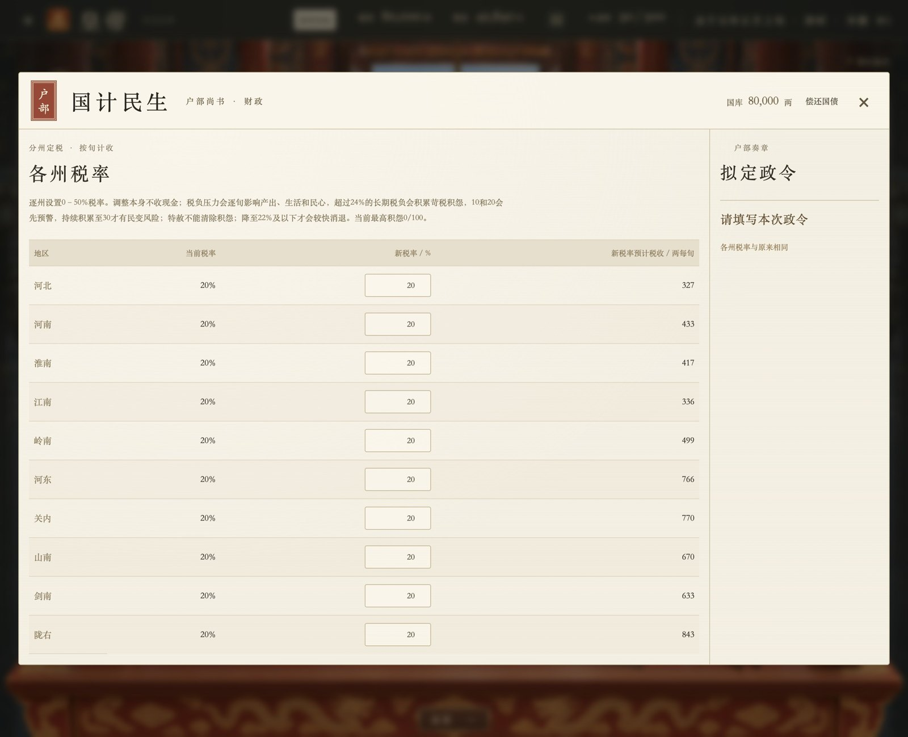

### 内政与营建：发展要有土地、劳力和预算

天下舆图可以切换范围、选择国家或州郡，查看地方状况。发展页面提供普通营建、产业开发、土地转用、城州扩建、分期开发和用工调整等事项。

分期计划会持续占用预算与劳力。安排前先检查可用土地、用工余量和现金保留线；执行后可以继续查阅施工状态，调整安排或停止计划。

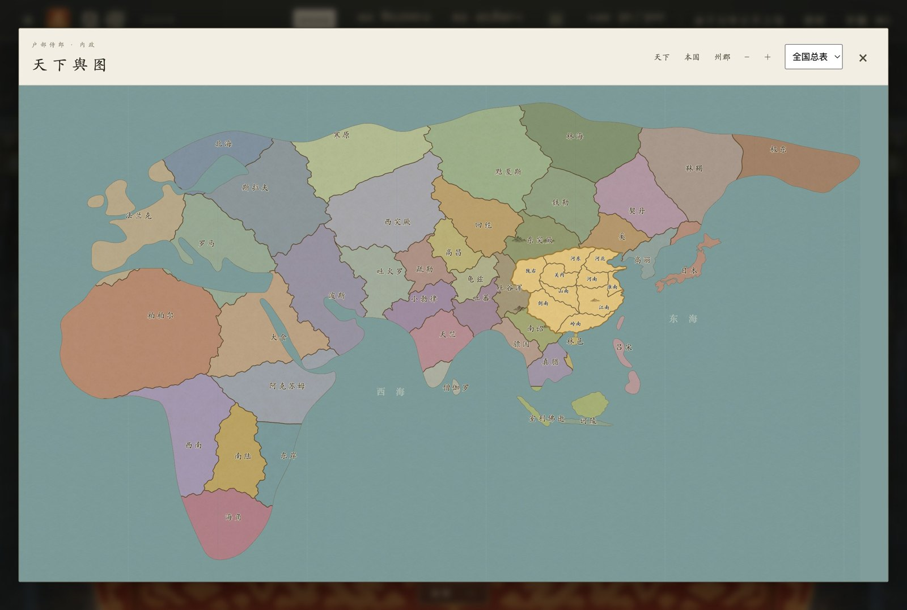


### 人才与官职：招到人，还要用对人

在吏部查阅人物能力与履历，安排官职、地方委任和治理预算，也可以开科求贤、组织研习或办理封赏。军阵中的人物同样来自实际取得和部署的将领。


### 外交：先了解诸国，再决定进退

通过舆图选择国家，查看关系与相关情况，再安排通使和谈判。贸易、条约、边境与军事选择都会影响下一步行动，出征前可以先比较外交途径。

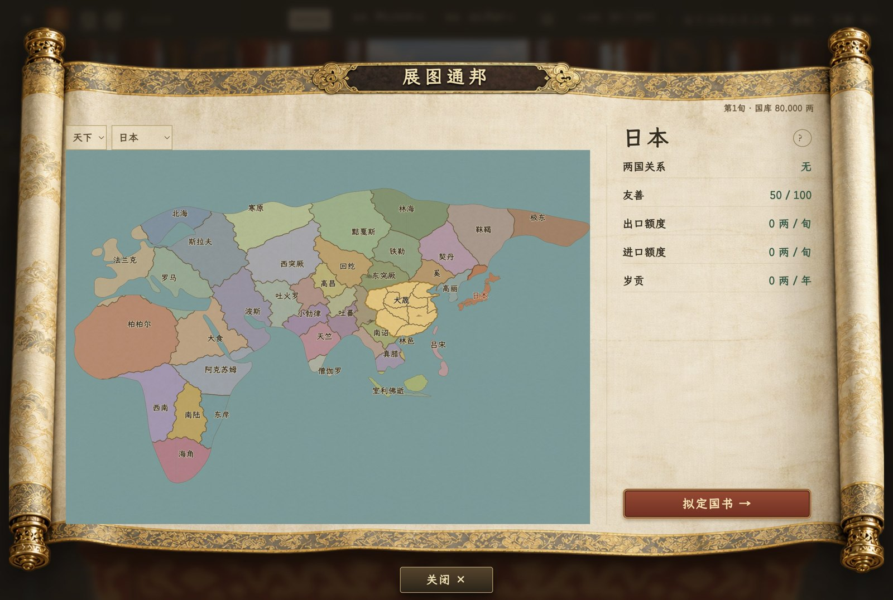

### 军阵卡牌：将领、部队和军备共同决定战局

当前军阵战斗采用轮流行动的卡牌交锋。本场牌组由实际部署的部队、将领及军备形成，不能仅凭打开人物牌册就任意使用所有人物。

基本操作：

1. **出征前核阅**：检查兵力、将领、军备和补给，查看本场牌组及属性来源。
2. **选择起手**：开局可以替换起手牌，随后进入正式交锋。
3. **花费军令出牌**：每个己方回合军令刷新并逐步增长，安排好部队和计策的使用顺序。
4. **选择合法目标**：点击或拖动卡牌，根据高亮与预览选择部队、主将或技能目标。
5. **交令结束回合**：点击“交令”或使用 `E`，也可按需开启自动战斗。
6. **结算真实战果**：胜负、伤亡与生还军备会回到国家账目；卡牌治疗不会复活实际阵亡士兵。

普通部队通常需要等到下个己方回合才能攻击；护卫、突袭、护甲盾、冻结等状态会改变合法目标或行动方式。遇到不确定的效果，可以查看卡牌详情、“本场牌组”与交战记录。

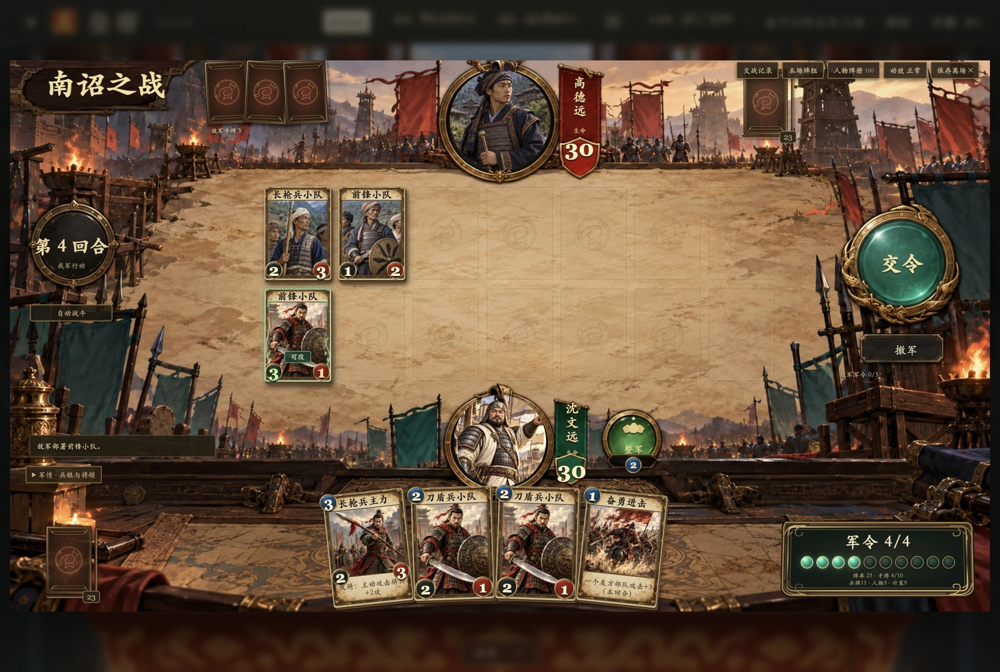

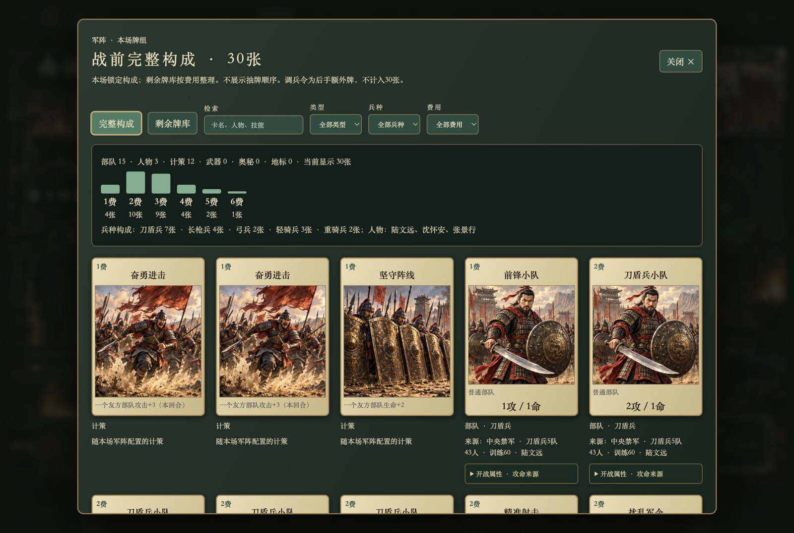

### 战后恢复：让军队重新具备出征能力

恢复页面会列出兵员、装备、训练缺口与相应成本。根据预算授权分批恢复，并查看现金保留线、进度和暂停原因，再安排下一次出征。


### 宫廷生活与出行：经营的不只有国库

在后宫查阅名册、册封和相伴，积累人物纪事；也可以安排修习、狩猎、巡游或微服出行。出行事件提供不同选择，部分人物与故事需要满足地点和情境条件才能遇见。


### 特殊工程与王朝终评：留下这一朝的结果

特殊工程需要持续投入，宗室与储君关系到王朝延续。本朝纪事会积累治理与战争记录；本朝结束后，可以查看终评、历史类比及继位相关结果。

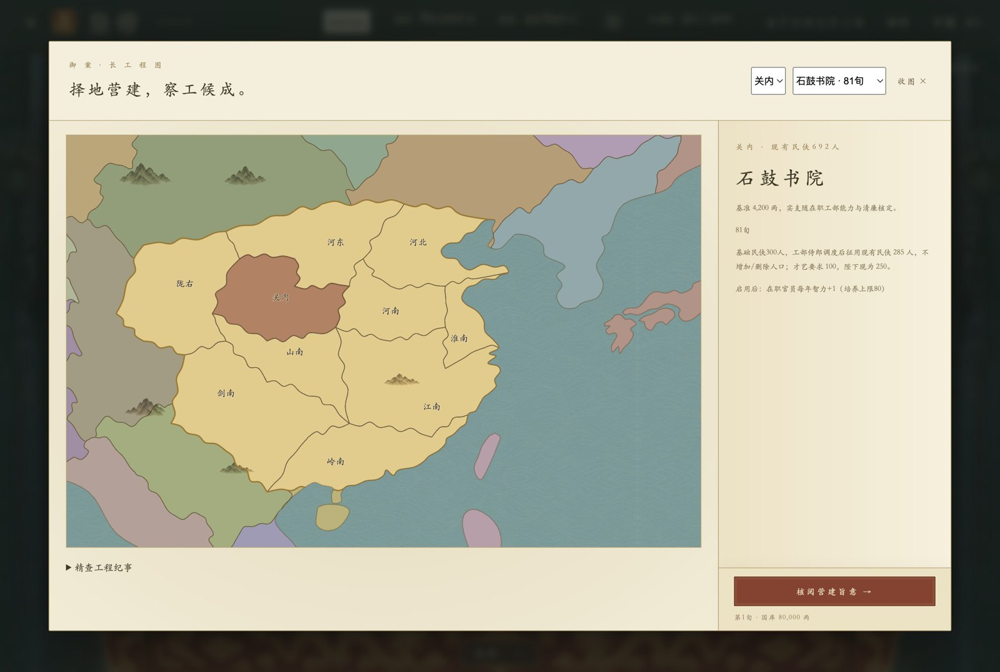

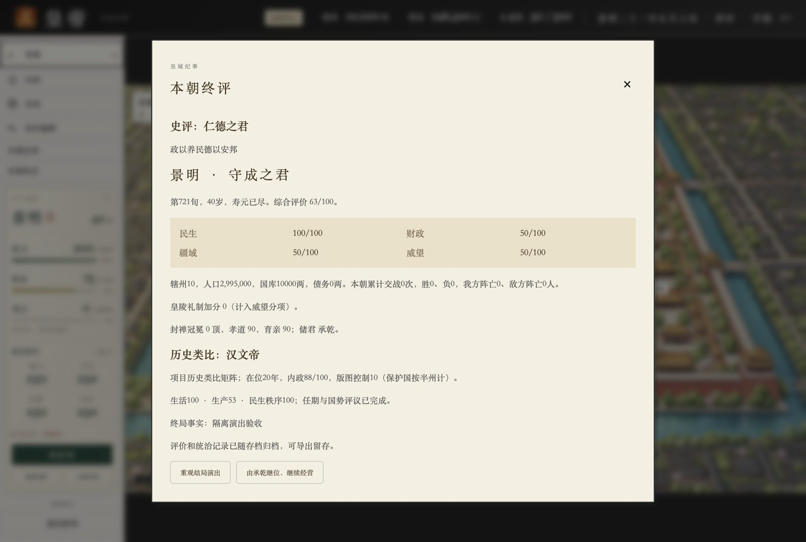

## 存档与局内编辑

### 保存、读取与备份

游戏提供 **1 个自动存档位和 10 个手动存档位**。在“存档”中可以命名并保存手动进度，也可以导出、导入 JSON 存档文件。

建议在长期工程、重要出征或尝试不同路线前保留一个手动存档；跨设备或跨运行环境迁移进度时，使用导出与导入。


### 局内编辑器

“局内编辑”可查看并调整文武人物、州郡和国家的部分数据，适合体验不同局势或验证玩法。修改需要先核对预览，再确认应用；界面支持撤销上一次编辑。

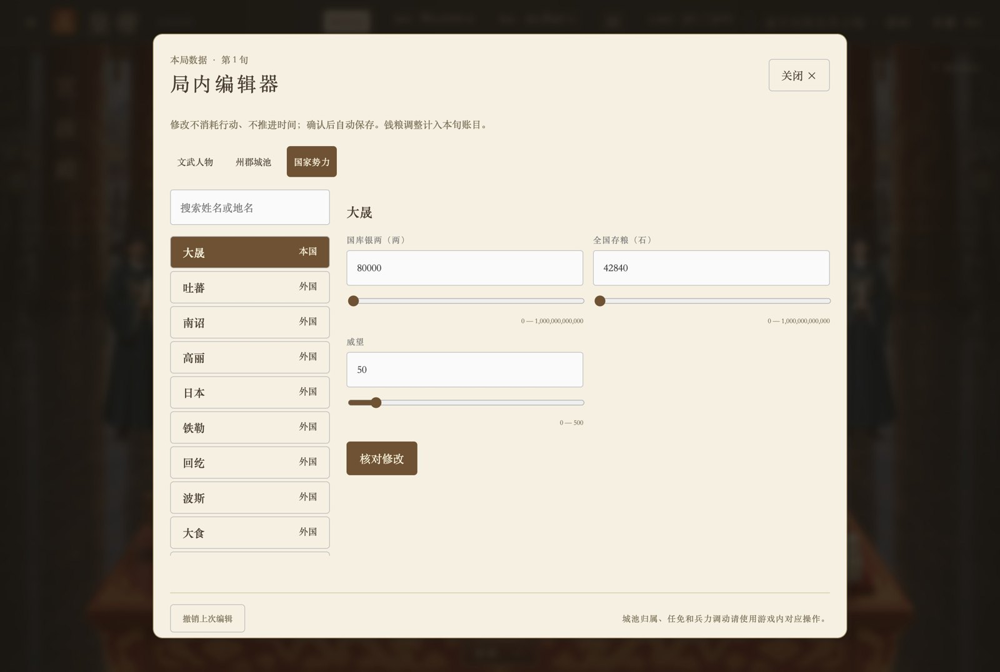

## 开发与打包

项目使用 Electron、原生 HTML/CSS 与 JavaScript ES Modules，游戏逻辑、存档契约和界面分别组织在模块中。

| 路径 | 内容 |
| --- | --- |
| `src/` | 游戏规则、状态、人物数据、界面和样式 |
| `assets/` | 场景、人物、卡牌、字体与制作参考素材 |
| `tests/` | 规则回归、存档兼容和桌面交互验收 |
| `scripts/` | 数据契约、平衡分析、预览及素材处理工具 |
| `docs/` | 规则文档、设计记录和实机截图 |
| `docs/screenshots/readme/` | 本页使用的截图 |

运行验证：

```sh
# 数据契约检查与业务规则测试
npm test

# 桌面启动、导航、存档续玩与布局验收
npm run test:desktop
```

本地打包：

```sh
# 输出未安装的应用目录
npm run pack

# macOS 安装包
npm run build:mac

# Windows 安装包
npm run build:win
```

构建产物位于 `dist/`。macOS 构建当前未配置签名与公证；Windows 产物应在 Windows 环境另行验收。本页截图来自 macOS 桌面运行。

## 进一步了解

- [游戏数据字典](docs/data-dictionary.md)
- [旬结算顺序](docs/turn-settlement.md)
- [存档版本与兼容](docs/save-compatibility.md)
- [国家与地方内政模型](docs/domestic-model.md)
- [全国钱粮与资源](docs/national-resources.md)
- [皇帝、后宫与宗室](docs/emperor-harem.md)
- [军阵卡牌规则与生产卡表](docs/card-battle-release-design.md)
- [战后恢复与出征核阅](docs/army-recovery-fixes-2026-10-21.md)

## 项目状态与素材

项目仍在持续开发，规则与界面会继续调整。部分场景和人物美术使用 AI 图像生成工具制作；历史参考与制作资料另行保留，不全部参与运行或打包。

项目授权标记为 `UNLICENSED`。字体授权见 [LXGW 真楷授权说明](assets/fonts/OFL-LXGWZhenKai.txt)。
