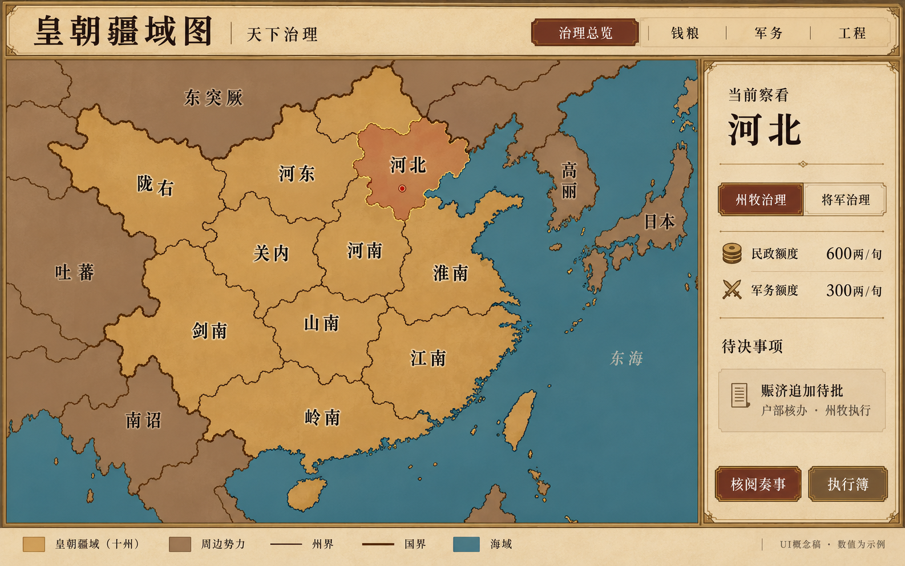
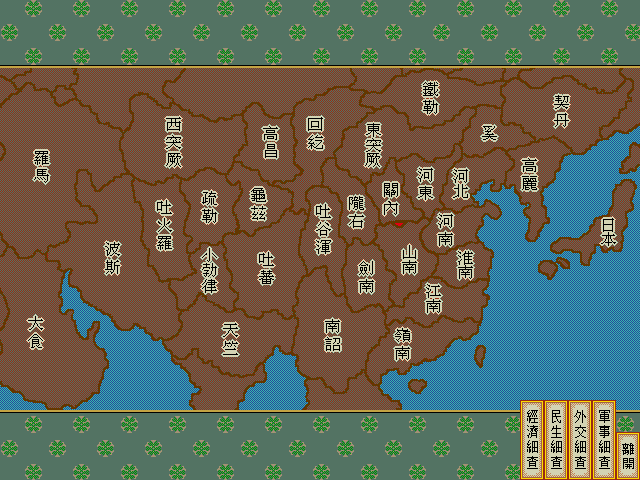
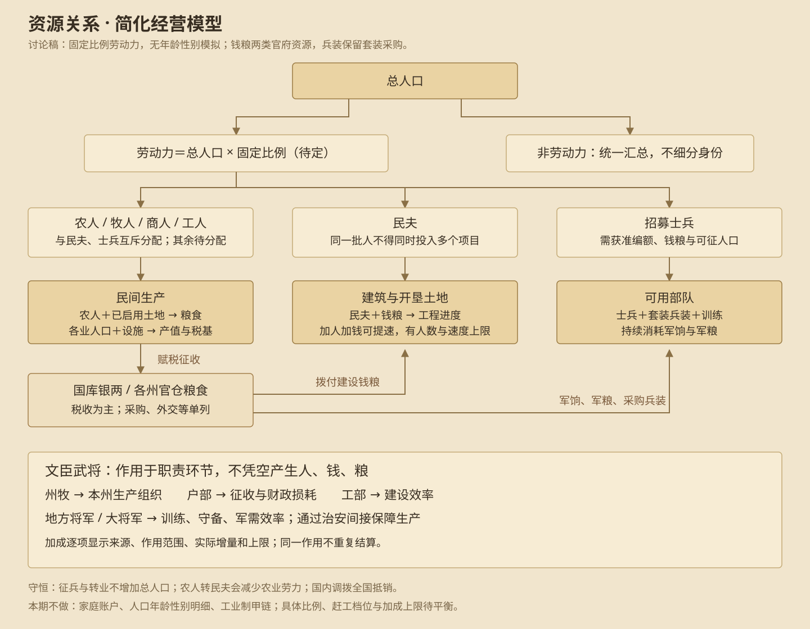

# 《皇帝》治理、资源经营、朝堂交互与舆图改版方案

日期：2026年10月18日（北京时间）  
版本：讨论稿 v2（已确认补入资源、自动调配与赶工民心规则）  
状态：整理当日讨论；尚未进入开发。已确认的方向作为后续设计依据，文中的建议参数、项目目录及执行细节仍需核定。

## 1. 讨论目标与现有问题

让官员职责、地方日常治理、皇帝裁决、地图观察和每旬反馈形成完整玩法，而不只是把各项功能放进菜单。

用户首先指出的问题：

- 地图底图、边界效果不好，部分画面模糊，部分信息堆叠过多。
- 业务按钮压在地图上，地图面积小、操作栏过大。
- 地图文字不清晰，操作按钮布局和对齐不统一。
- 原定侍郎只读、尚书可办事的职责没有贯彻，宰相入口涉及过多他部工作。
- 地方将军的作用不明确，缺少练兵、巡防等中央功能下放。
- 人物、地图、政务和时间推进尚未完整串联。

后续检查由开发方主动完成，不能依赖用户逐页发现问题。

## 2. 已确认的核心方向

1. 任命州牧、将军后，默认承担地方相应日常事务。
2. 皇帝设置预算、优先级，保留重大事项裁决权。
3. 民政、军务可以分别收回管理权，由皇帝亲理。
4. 地方在授权预算内可以自行进行日常建设、补充兵装。
5. 扩军、跨州调兵、大工程、超预算事项必须上奏，获准后执行。
6. 侍郎只负责核阅与奏报；尚书办理本部事务；宰相统筹协调、督办。
7. 地图采用无山川底图，业务操作移至图外，强化地图面积和文字可读性。
8. 舆图保留DOS《皇帝》启发的赭色陆地、蓝色海域与古代界面风格，重绘可信的海岸与自然州界。
9. 最新重绘概念图的整体方向已获认可，先保存方案，再继续讨论，暂不开发。

## 3. 中央与地方职责

| 职位 | 负责事项 | 交互边界 |
| --- | --- | --- |
| 皇帝 | 任免、预算、优先级、治权、重大裁决 | 可亲理，也可授权日常治理；批准须有具体对象、资源与时效 |
| 宰相 | 国势汇总、跨部协调、未决与逾期督办 | 看摘要和进度，具体办理转主管部门，不包揽各部操作 |
| 吏部尚书 | 官员考察、任免方案、接任、考绩、治权变更 | 呈请皇帝批准任免与治权调整 |
| 户部尚书 | 财政、粮源、拨款、跨州救济 | 核办改税、追加预算、调粮、特别征收 |
| 兵部尚书 | 军籍、编额、兵装采购规则、全国军事调拨 | 核办扩军、跨州调兵调装、出征资源 |
| 大将军 | 中央军训练、京畿巡防、军事评议、奉旨指挥 | 与兵部资源管理分工，重大部署呈请皇帝 |
| 工部尚书 | 营建标准、大工程、跨州工程协调 | 核定工程必要性、总价、工期及维护负担 |
| 刑部尚书 | 调查、违法核查、案件审理 | 重大案件与刑罚呈请裁决 |
| 礼部尚书 | 外交接洽、条约履约、国家礼仪 | 缔约、解约、和亲、贡赋等呈请裁决 |
| 各部侍郎 | 本部账册、事实核对、风险与奏报 | 只读；不提供修改、采购、任命、调拨或落旨入口 |
| 州牧（当前系统称刺史） | 保粮、赈济、产业、民生、获准的日常建设 | 只在本州职责、额度及目标内自主决策 |
| 地方将军 | 本州练兵、巡防、守备、核定兵装补齐 | 不自行扩军、跨州调动或出征 |

州牧/刺史的界面名称后续统一，不新增两套同义岗位。同一功能从人物、奏折、地图或簿册进入，职责和权限必须一致。

## 4. 任命、治权与交接

- 任命确认页同时展示所继承的预算、目标和优先级；任命与日常授权一起确认，不额外要求开启委任。
- 民政、军务分别设置“地方治理／皇帝亲理”，允许只接管一项。
- 收回治权不等于免官：官员仍在任并可奏报，停止相应新的自动决策。
- 皇帝手动办一次事不自动收回长期授权；已执行内容须被后续自动规划识别，避免重复购粮、采购和建设。
- 自然生产、口粮、既有军饷、维护和已经批准的在建承诺继续；停建、取消命令单独决定。
- 换官继承本州政策、目标和未完成任务；历史结果保留实际经办人，不改写成新任业绩。
- 官位空缺暂停对应自主决策，基础守备继续，吏部提出接任；如设置署理，必须明示身份、权限与期限。
- 失地立即停止对应授权；收复后重新确认任职与治权，避免旧委任隐式恢复。

## 5. 自主办理的具体边界

### 5.1 民政与日常建设

州牧可以在本州购粮赈济、维持粮储目标，按发展方向办理农业商业开发及合理职业调整；职业调整不能变相增加士兵。

日常建设采用“项目目录＋规模限制”，不能仅凭金额判断。必须同时满足：

- 属于地方可办目录，且确有民生、容量或发展需求。
- 全项目总价连同可预见治理损耗，在当次可用额度内。
- 后续维护负担可以承担，无冲突工程和重复无效建设。
- 遵守施工名额、灾时停工、工期及收益启用规则。

建议目录：粮仓、市场、衙门、适当规模的农商开发等。城墙、行宫、特殊工程、跨州工程列入重大项目目录；其他项目超过规模限制也必须上奏。具体目录和阈值待核定。

禁止把同一项目拆单绕过限制；不能部分扣款后形成未经批准的欠款。大工程获准后按批准的总额与工期执行，不逐旬重复申请。

“维修”目前不作为已承诺的新机制；确需引入时，另定消耗、效果和适用对象。

### 5.2 兵装补充与扩军

- 补装目标由现有合法驻军人数与既定兵种配置决定。
- 库存、出战占用、已采购在途、已批准未完成的兵装均纳入核算，避免重复采购。
- 缺装20份、预算可买30份，也只补20份；额外储备默认0，皇帝可批准储备目标。
- 维持既定配置的本地合法采购可自主执行；兵装到位不增加兵员。
- 新增士兵和补回阵亡兵员，建议统一按招募处理，均须奏准；是否另设常备编额内补员授权，留作后续讨论。
- 大规模改变兵种配置须奏准，不能借“补装”将步兵改造成骑兵。
- 跨州调兵、调装、出征、改变中央禁军部署须中央核办。
- 特殊兵装不能绕过合法产地；无法本地采购时，由兵部提出采购及调拨方案。
- 战时新增需求与已占用资源统一核验，不能重复分配。

### 5.3 所有自主事务的共同条件

职责允许、治权有效、目标未满足、资源合法、预算充足、无任务冲突，全部成立才执行。预算余额不构成无效建设、囤装或重复行动的理由。

## 6. 预算、优先级与目标

全国治理总额度 → 各州额度 → 民政/军务分项额度，共同约束，并保留国库保留线。

- 额度是上限，实际执行才扣款，未用额度留在国库，不自动发到地方。
- 固定军饷、维护等既定义务与新增治理开支分列，并让玩家看到合计负担。
- 专项追加关联具体事项，不能重复发放，也不默认永久提高每旬额度。
- 地方不能自行挪用其他分项或别州额度、突破保留线、举债、提高税率或特别征收。
- 不能用尚未到账的预计收入支付当前事务。
- 下调预算时先展示已有承诺与影响，不能悄悄取消项目。
- 全国资源不足先保障救命粮与必要守备，再结合风险与等待时长分配，避免后序州长期饥饿。

建议民政方向：保粮安民、兴农积粮、发展工商。建议军务方向：巡防安境、练兵备战、整补守备。

优先级必须带目标和停止条件：达标不重复花钱，低粮暂停非必要军务，灾时优先救急。优先级不能突破预算、权限及资源硬约束。

## 7. 上奏条件、处理与去重

| 类别 | 触发 | 地方行为 | 呈报去向 |
| --- | --- | --- | --- |
| 权限外请求 | 扩军、跨州调兵调装、出征、大工程、改税等 | 未获准不执行；提出方案而非先办后报 | 对应主管部门核办 |
| 超预算请求 | 有必要事务无法在授权内完成，需追加资源 | 不越支、不拆单；提供缺口与替代方案 | 户部，相关部门会核 |
| 风险急奏 | 授权内救济后仍缺粮、入侵、严重守备缺口、重大灾情、叛乱风险 | 继续权限内可行救急，同时及时上奏 | 户部、兵部等 |
| 官位空缺 | 离任、致仕、收押、死亡等 | 暂停对应新自动决策，保留基础运转 | 吏部 |
| 持续受阻 | 有必要的一般事务长期无合法可行方案 | 先排队并记执行簿；建议连续3旬后升级 | 对应主管部门 |
| 无需办理 | 目标满足、设施无边际收益、无新增需求 | 停止，不制造奏折 | 执行簿 |

“连续3旬”为建议参数。普通项目本旬余额不够先暂缓；紧急风险不等待三旬。超预算与持续受阻之间以必要性和时效区分，避免每笔普通等待都上奏。

每件奏事包含：事实依据、实际已做措施、资源缺口、方案、承办人、执行时点、不处理的后果。

同一问题只建立一件持续事项，后续更新原件。批准、限额批准、改议、留中、否决分别记录；否决后同案不反复催批，风险仍可查看，出现新事实再呈请。风险升级、方案变化或到约定复查时间时再次提醒。

一件跨部事项指定一个主办部门，其他会核；宰相协调，不生成多份重复裁决请求。

## 8. 每旬执行与反馈

以下为目标流程，不代表当前代码已如此执行；财政、灾害和供粮的精确先后需专项验证。

1. 核对授权、在任者、预算、占用资源、已批命令和在建承诺。
2. 更新灾情、失地、离任等情势，重新检查任务资格。
3. 在供粮结算前执行获准救济，实际不足部分才计算缺粮后果。
4. 按明确到账时点结算基础收支、生产、口粮和持续义务。
5. 按文武职责与优先级执行日常发展、建设、补装、训练、巡防。
6. 推进既有工程与持续任务；本次新开项目不同时增加施工进度，完工与收益启用分开记录。
7. 生成实际结果、暂缓原因、待决事项及下旬计划。

每笔资源只计一次，失败不留半笔交易，读档不重复执行；委任自动行动不逐项扣皇帝体力。皇帝亲自发令遵循统一行动规则。

反馈分三层：

- 执行簿：谁、何时、在哪、做什么、实支多少、实际变化及暂缓原因。
- 每旬摘要：主要变化和异常，不要求逐项确认日常成功事项。
- 御案待决：需要皇帝裁决的事项；桌面可以只呈重点，但全部未决始终可查，急奏不能因展示上限消失。

## 9. 地图设计定稿方向

### 9.1 最新重绘概念图（已认可方向）



采用 imagegen 内置工具生成，属于美术与UI讨论稿，非已实现界面。保留赭色陆地、蓝色海域、纸色侧栏与古代界面感；去掉山川，重绘海岸、半岛、岛屿和自然走势的州界。

图中政策、按钮、数值和地名布局用于表达方向，不构成规则或历史测绘定稿。制作可交互地图时，须建立共享边界和完整拓扑，不能直接把生成图当作可点击疆域数据。

更正此前聊天中的一次计数误判：本图实际已标出河北、河南、淮南、江南、岭南、河东、关内、山南、剑南、陇右十州，并非九州。后续仍须核验地名位置、辖区面积与边界关系。

### 9.2 DOS原版参考



来源：仓库内原版资源分析产物 `reverse/emperor/resource-analysis/exports/MAPNULL/` 的已解码位平面与资源自身调色板。参考赭色陆地、蓝海、深色疆界、描边地名和周边诸国关系；不沿用树纹装饰、低分辨率和地图内业务按钮。

### 9.3 轮廓与边界

- 国土、海岸有可信大轮廓和适度细节，明确海湾、半岛、岛屿及大陆走势。
- 州界依据地理关系和历史区域组织自然走势，不使用直线拼块、Voronoi玩具拼图，也不通过机械加锯齿伪造自然感。
- 相邻州共用同一条边，无缝隙、重叠、重复描边；海岸、国界、州界和选中边界分级。
- 地图无山川、河流绘画、森林、地形阴影；边界可参考地理依据，但不把依据画成装饰。
- 邻国稍弱于本国专题，选中状态克制，路线和风险除颜色外还有线型、形状或文字区别。

### 9.4 布局与文字

- 桌面内容区地图目标约75%，右侧约25%；比例随窗口和内容验证，不硬性牺牲可读性。
- 地图只放疆域、地名、必要状态和路线。购粮、任官、预算、采购、拟旨、落旨等操作在图外。
- 侧栏默认摘要，复杂表单进入办理步骤；返回保留选州、专题、地图位置与草稿。
- 小窗口详情下置或按需展开，不把地图缩成难点的小图。
- 地名按区域形状横排或竖排，稳定字号与衬底，先隐藏次要标签，不靠无限缩字容纳全部信息。
- 实际、预测、拟议清晰分开：库存是事实，缺粮是预测，虚线路线是尚未执行的草案。

### 9.5 专题与不同地图

天下层看国家、国界、首都与重大军情；全国层看州名、州界、当前专题主要指标；地方层看当前州、邻州及相关任务，账册在侧栏。

| 地图 | 主要观察内容 | 图外办理 |
| --- | --- | --- |
| 全国治理 | 治权、在任文武、风险、待决事项 | 预算、优先级、治权、奏事 |
| 钱粮 | 缺粮余粮、预测与调运关系 | 购粮、调粮、财政核阅 |
| 军务 | 驻军、训练、缺装、守备 | 配装目标、预算、调拨申请 |
| 工程 | 在建、停工、完工待启用 | 工期、大工程、停建 |
| 外交 | 国家、关系、边境、往来 | 国书、条约、履约 |
| 出征 | 边境、来源、目标、路线 | 编成、兵装、出征核定 |
| 战场 | 单位、地形、行动范围 | 移动、攻击、战术 |

各地图共享选择、标签和边界规范，不共享一整套信息堆叠。军营先选驻地再看兵种，不把全兵种库存采购和历史流水全部塞在地图旁。

## 10. 玩法串联示例

河北出现缺粮预测 → 州牧在权限和额度内先救济 → 仍不足则持续奏事呈户部 → 皇帝从地图定位并核阅 → 户部提出追加或跨州调粮方案 → 皇帝拟旨、核对、落旨 → 地方落实 → 钱粮地图与执行簿反映实际变化 → 后续复奏是否解决。

将军发现既定刀盾兵配置缺装20份 → 核查库存、占用、在途与额度 → 本州可合法采购则补20份 → 更新配装状态并入簿；若涉及扩军、兵种变化或跨州资源则转兵部呈请。

## 11. 当前实现检查发现与后续主动审查

以下来自当日代码和流程阅读，尚非全部实机验证：

| 已发现情况 | 相关位置 | 后续要求 |
| --- | --- | --- |
| 侍郎查阅入口进入可办理界面，职责限制未贯彻 | `src/court-play-ui.mjs`、`src/app.mjs` | 入口及实际提交统一约束 |
| 地方将军官位存在，自动练兵仍使用州牧能力 | `src/personnel.mjs`、`src/governance.mjs` | 文武执行、能力与历史分离 |
| 兵部与大将军共用采购、军营和出征任务 | `src/court-play-ui.mjs` | 明确资源行政与军事执行分工 |
| 自动救济位于供粮及缺粮后果之后 | `docs/turn-settlement.md`、`src/governance.mjs` | 救急时序重新验证 |
| 年度兴农独立于地方委任开关 | `src/state-development.mjs` | 区分官府决策、民间发展与亲理范围 |
| 缺粮、灾情、工程只取部分州，奏事最终截前三件 | `src/court-agenda.mjs` | 完整事项集合与御案摘要分离 |
| 战后恢复未体现地方将军作用 | `src/occupation.mjs` | 核定文武责任与缺将影响，另做平衡 |
| 军营地图受固定高度、密集兵种区及小字号挤压 | `src/court-garrison.css` | 与全部地图统一进行布局验收 |

主动检查范围还包括：外交往返与履约、科举揭榜、中央长期训练、官员致仕和交接、占领收复、长期工程、宗室与终局。逐项确认入口、职责、资源、生效时点、暂缓原因、追溯与返回上下文；不能仅以功能能点通替代完整玩法验收。

## 12. 后续开发前验收情景与待核定项

应覆盖：

- 任命即接管、分项收回、换官交接、空缺、失地与收复。
- 缺装只补缺口，预算不足暂缓不扣款，特殊产地不绕过，无效建设不执行。
- 工程全价核定、维护负担、同项目不拆单、已批承诺不被预算修改暗中取消。
- 同案跨旬不重复奏报，留中保留风险，否决不反复催批，急奏不被展示上限隐藏。
- 钱粮兵装实际守恒、失败回滚、重复提交及读档不重复执行。
- 各地图初始状态、全州异常、长名称、多路线、失地占领、高分屏、大小窗口及缩放。
- 地图与账册、侧栏、执行簿一致；标签无碰撞，国州界闭合，点击与显示一致。

待核定：日常/重大项目目录与规模阈值、预算默认值、发展及军备目标、风险阈值、三旬提醒参数、伤亡补员是否开放编额内授权、维修是否独立建模、战后将军影响、财政与救急精确时序、地图拓扑和历史合理性。

## 13. 资源经营的简化原则（本轮确认）

本节至第19节为后续讨论经用户确认后正式补入。与前文及早期草图有差异时，以本轮约定为准。确认的是设计方向，具体比例、价格、阈值和效果系数仍待平衡；不代表代码已实现。

- 人口不模拟年龄、性别和家庭；用固定比例划分劳动力与非劳动力，非劳动力只保留汇总数。
- 劳动力分配为农人、牧人、商人、工人、民夫、士兵和待分配人口，各岗位互斥。
- 土地属于建设项目，“开垦土地”与其他建筑统一走建设、预算、施工管理；土地记亩、设施记座，统计时不混加。
- 增加民夫和额外经费可在一定范围内加快施工，最终速度有上限；同批民夫不能被多个工程重复使用。
- 工业暂不进入军备制造链，兵装继续以完整套装花钱采购，不新增矿石、铁料、武器、盔甲制造流程。
- 民间生产形成税基，官府钱粮以赋税为主，用于建设、军事和行政。民间产值不是国库，民间收成不是官仓存粮。
- 地方官按优先级自动分配人口；皇帝可以手动干预。粮食与基本生产底线优先于发展、征兵和建设。
- 官员加成集中解释来源、作用环节、实际效果与上限，避免把全部文武做成相同的产出加成卡。
- 赶工有民心代价，不能仅靠加钱无限抵消。

## 14. 人口、钱粮、兵甲、建设与官员关系



此图表达资源投入、征收和官员作用关系，具体执行边界以正文为准；赶工另须遵守第18节的民心限制。

### 14.1 人口与岗位

```text
劳动力 = floor(总人口 × 固定劳动力比例)
非劳动力 = 总人口 − 劳动力
待分配劳动力 = 劳动力 − 农人 − 牧人 − 商人 − 工人 − 民夫 − 士兵
```

劳动力比例为统一游戏参数，60%仅可作演示，不是正式数值。非劳动力不再按老人、小孩或性别建立子系统。

转业、征兵和征用民夫不增加总人口；出生、死亡、迁徙才改变总数。中央禁军若已计入某州兵籍，不可再计一次。人口减少导致岗位总量超过劳动上限时，必须重新安排并报告，不能出现负余额。

普通工种调整不强制增加职业培训费用、技能树和独立转业粮耗。士兵保留征募、训练、配装的必要区别。

### 14.2 土地与生产

有农人且有已启用农田才形成有效农业产能；有田无人会闲置，有人无田不无限增产。建议用人地匹配约束统一产出：

```text
有效耕作面积 = min(已启用耕地, 农人数 × 单人耕作能力)
民间粮食产出 = 有效耕作面积 × 基础亩产 × 有效生产系数
```

开垦属于建筑建设，完工启用后才增产。市场、粮仓、衙门等设施改善商业、存储、秩序和效率，不替代人口。牧业、商业、工业同样受有效岗位或生产条件约束；界面提示缺人、缺地或容量已满，无需玩家手算公式。

### 14.3 民间生产、赋税与官府资源

民间生产 → 按规则征收钱税/粮税 → 国库/官仓 → 建设、军事、治理。民间只需汇总产出与税基，不模拟逐户交易。

钱税、粮税分别说明；田赋征粮或折银必须明确，同一份税不能双重入账。官府粮食展示为全国官仓合计与各州库存，本期不强制增加实体中央粮仓。

所有人口都需要生活口粮；民间自给口粮参与当地缺粮判断，但不从官仓重复扣除。官仓承担核定军粮、工程补给、赈济与损耗；同一人同一期间不能两边重复供养。民夫基本口粮与工程额外补给也要区分。

采购、出售、外交、战利等若保留，应单列来源，不冒充赋税。国内钱粮调拨全国抵销。地方预算是授权上限，不是发放时先扣一次、执行时再扣一次。

### 14.4 士兵与兵装

招募同时核验可用劳动力、批准编额、征募费用与粮食保障；持续消耗军饷与军粮。人数、训练、配装分别展示，招来的人不会自动带装并成为同等数量的合格战兵。

套装兵装继续采购，补装按实际缺口计算；工业维持民间产值与税基作用，暂不制造兵甲。扩军、跨州军务和特殊产地限制沿用前文。

## 15. 地方自动人口调配

### 15.1 先算底线，再用富余

每次自动安排前核查人口、有效农田、预期产粮、民间口粮、官仓储备、在建承诺、已批征募以及当前灾情，计算：最低保留农人、其他行业基本生产人数、可调配富余劳动力。

农人保留量依据实际人地产能和粮食目标计算，不单独锁死为人口百分比。目标保留适当粮食余量，不以刚够当旬为标准；保障几旬、何种库存安全线待定。灾情与效率变化必须重新评估，国库有钱不等于粮源一定可得。

其他行业保留基本生产，不能为冲单项指标抽空牧业、商业或工业。极端缺粮且最低人手仍不足时，记录不可行缺口、请求援助，不承诺自动调配能凭空解决。

### 15.2 每旬调配顺序

1. 保留基本生产人口，处理实际和迫近缺粮。
2. 在底线允许的前提下，安排已批准任务的必要人手；冲突时暂缓并复奏。
3. 按地方优先级安排富余人手。
4. 没有有效岗位或需求时，允许保留待分配人口，不为“用完人口”制造项目。

先使用待分配劳动力，再从富余或低效岗位调整。兴农补农业缺口与开垦，工商方向在粮食稳定后发展工商，备战优先训练、补装与守备；备战不授予自行征兵权限。

### 15.3 稳定性与多任务约束

- 正常单旬调配设人数/比例上限，小幅预测波动不触发全州反复转业。
- 一般缺口持续达到调整条件再调配，紧急缺粮走应急处理；具体持续旬数与阈值待定。
- 完工释放民夫后先补生产缺口，再决定新任务，不能无间断征用同批人赶新工程。
- 多个普通建设、开垦、大工程统一登记人力占用；单旬结算不得重复使用。
- 官员能力主要改善组织、效率和损耗，不突破人口或粮食硬约束。

### 15.4 建设、征兵与灾时回调

开工或征用前预览对农业、其他基本生产和钱粮预测的影响。普通建设劳力不足时等待、缩减人手或降低施工档位；大工程呈请时说明劳力来源和机会成本。

已批准的征兵在实际执行时重新检查条件，条件变坏不得机械强征。灾害导致原安排不可维持时，暂停新开工、取消赶工、必要时减少常规施工投入，把可释放人手调回生产；不自动遣散已成军士兵。需要裁军、援助或改变重大承诺时上奏。

## 16. 皇帝手动调整与地方授权

皇帝可设置工种目标人数，并选择“交地方继续调配”或“保持此人数”。手动一次调整不自动收回全部治权。

- 总量不超劳动力、同一人不重复占用是硬限制。
- 自动地方安排必须遵守粮食、基本生产和民心底线。
- 皇帝手动突破生产安全线时，预览须显示预计缺粮、减产、民心影响及已批准补粮安排，再明确确认。
- 已确认保持的人数不能下一旬被自动悄悄改回；风险恶化时上奏请求修改。
- 总人口下降、失地等导致人数目标物理上不可满足时，硬限制优先，报告目标未达，不伪造人力。
- 对已锁定人数、在建承诺和手动命令，自动安排统一识别，避免重复征用和相互覆盖。

民政、军务亲理/委任仍分别控制；收回自动决策权不自动抹除仍在任官员的正常本职效率。

## 17. 建设、开垦与有上限的赶工

普通建筑、开垦土地和特殊工程共用基础施工关系：民夫、钱粮投入形成进度。每项显示总工量、已完成量、实际投入、每旬进度和预计剩余旬数。

| 档位 | 投入与速度 | 条件 |
| --- | --- | --- |
| 常规 | 标准投入，正常推进 | 基础条件不足时减速或停工 |
| 增派 | 更多民夫及额外经费，适度加速 | 有富余劳力、预算、粮食与民心空间 |
| 赶工 | 更多人手与更高费用，接近最终速度上限 | 高强度或长期安排须呈请 |

人和钱同时满足才提速；人数超过项目容量不再提速。官员效率与施工档位共同受最终速度上限约束，不能叠出无限速度。UI中的1倍/1.5倍/2倍为示例，不是正式参数。

基础工程支出、预付费用与额外赶工费分别计算，已预付不重复扣；额外费用建议按实际赶工旬支付。本旬支付不足时不收半笔赶工费，回落至可承担档位并复奏，基础条件也不足则停工。降档行为需在批准预览中说明。

农人转民夫造成的减产须可预览；有钱但抽调后突破保粮底线，地方不得赶工。地方可在授权内给日常项目短期增派，高强度、长期、超预算或突破民心底线须上奏；批准针对具体项目、强度与期限，不是无限期征用许可。

## 18. 赶工与民心

界面建议以“民心”表达现有民忠指标，不新增另一个相近数值；命名映射与旧界面兼容后续统一。

赶工同时付出额外经费、占用劳力、生产机会成本和民心压力。压力主要由征用比例、施工强度和连续赶工时长决定。

| 情况 | 目标效果 |
| --- | --- |
| 合理投入、常规施工 | 不仅因正常建设额外扣民心 |
| 适度增派 | 小幅压力，足额报酬和供粮可缓解 |
| 高强度赶工 | 明显压力，连续多旬逐渐加重 |
| 缺粮、欠薪仍维持赶工 | 额外恶化，地方不得自行维持 |

额外花钱改善待遇可以减轻影响，但不能完全消除高强度劳役代价。停止赶工后压力逐旬缓解，民心按正常规则恢复，不立即返还全部损失。

同州工程合并计算劳役强度，不能拆成多个小项目规避代价；更换项目或换官也不应清空本州连续劳役压力。已经作为农人调出造成的减产照常计算，不能只扣民心而忽略生产损失。

民心偏低、灾情未稳、粮食不足时，地方自动停止赶工；工程能否转常规继续须另验基础条件。若皇帝拟强制继续，应明确呈现风险、范围与期限，不默认为自动授权。

批准预览显示：投入人数、额外银粮、预计提前旬数、民心影响、是否接近底线、降档和停止条件。每旬复奏解释本旬是否赶工、实际付出、民心变化和下旬安排。

## 19. 每旬收支与官员加成 UI


此图为内置imagegen生成的讨论概念稿，继承舆图配色风格；没有新增民心提示与自动人口调配控件，后续UI细化须按第15—18节补齐，不能将早期图视为完整定稿。

### 19.1 收支口径

界面分“本旬实绩／下旬预计／历史旬报”。主界面展示现有余额、最近实际净变化、下旬预计净变化；银两和官粮各自显示期初、收入、支出、净变化、期末。

预测复用实际计算规则，含已批准持续计划，不把尚待批准的追加、征募或工程提前计入。实际来自真实结算与执行流水，查看不触发结算；欠支新增债务与现金实付分开。

图中全国银两算例：50,000＋12,000−5,000−3,000−1,500＝52,500两，净增2,500两。官粮算例：30,000＋8,000＋1,000−5,000−1,000−500＝32,500石，净增2,500石。

该图仅演示报表结构与加减，不指定购粮单价；购粮的实际银两成本须单列并与入粮数量配对核验。不能直接按图中“其他支出”替代正式采购明细，也不能把图的示例支出套用当前价格。国内调拨全国抵销，民间自给口粮不重复扣官仓。

### 19.2 官员效果来源

| 人员 | 主要作用环节 | 边界 |
| --- | --- | --- |
| 州牧 | 本州生产组织与执行效率 | 不无视人地容量和生产底线 |
| 户部尚书 | 征收效率、财政损耗 | 生产与征收分开，不将全部税基当作入库 |
| 工部尚书 | 工程组织和建设效率 | 与赶工共同受最终速度上限约束 |
| 地方将军 | 本州训练、巡防、守备、明确的军需效率 | 通过秩序间接保障生产，不通用增产 |
| 大将军 | 中央训练与军事组织 | 不替代兵部资源行政 |
| 宰相 | 协调督办与明确的行政效果 | 不再额外叠万能生产倍率 |
| 侍郎 | 核阅、事实与风险提示 | 只读，不为填充面板增加一层通用倍率 |

同一环节的增减建议先汇总再限幅，生产效率、征收效率、减损分别列明，同一个来源不能重复计入相同作用。显示官员身份、作用地区、在任有效状态、生效时点、原始效果、上限与最终实际增量；调任不改写历史。

右侧为独立本州产粮算例：基础1,000石，州牧+8%、中央政策+4%、设施+8%，合计+20%，未触及上限时为1,200石。此为民间产出，不是全国赋税；征收另算。所有百分比均为说明用参数。

### 19.3 自动安排与赶工反馈

选州可查看人口总量、劳动比例、各岗位人数、锁定目标、最低保留量、可调人数和实际项目占用。默认只展示关键结果，详细公式按需展开。

示例复奏：“河北粮食保障不足，本旬未新增民夫，市场维持常规施工。”“河南短期增派，预计提前完工，本旬额外支银、民心承压，下旬恢复常规。”每条包含实际人数、银粮、生产变化、民心变化与原因，不编造未发生结果。

### 19.4 替换早期建议与待核定项

不做人口年龄性别、家庭账户和复杂职业技能模拟；土地统一进入建设；工业到兵甲制造推迟；固定旬工程需向统一人力与赶工约束设计收束。上述为目标变化，现有代码保持原状。

待平衡参数：劳动比例、人地承载、基本生产保留量、粮储安全目标、调配上限与波动容忍、钱粮税制、军粮工程供给、施工容量、赶工费用档位与最终速度上限、民心压力与恢复、官员能力映射与增益限幅。

补充验收：人口不超配、跨项目不重复占人、基本生产不被自动抽空、缺粮自动撤回非必要劳役、已批征募执行前复验、手动锁定不被悄悄覆盖、不可满足目标明确复奏、赶工钱人双约束与限速、多项目不规避民心、停止赶工不瞬间回血、完工释放劳力、税粮不双重入账、国内调拨抵销、加成不重复、实绩预测分开。

## 附录：当日交互讨论源稿

保留以下会话可视化源片段用于追溯，早期图不代表最终视觉选择。这些是会话运行环境使用的HTML片段，部分轮播交互依赖宿主，不保证直接双击与会话效果一致；正文两张PNG可在普通Markdown阅读器直接显示。

- [最初朝堂与舆图分区](prototypes/court-ui-discussion.html)
- [中央地方治理 v2](prototypes/governance-discussion-v2.html)
- [自主边界与治理 v3](prototypes/governance-discussion-v3.html)
- [清爽平色舆图：较简单，后续已调整](prototypes/clean-atlas-ui.html)
- [DOS配色交互舆图：风格认可，轮廓后续重绘](prototypes/dos-inspired-atlas.html)

最新概念图生成方式：内置 imagegen，参考原版地图；要求保持现有配色和图外办理，重绘自然海岸、十州共享边界和周边国家，不加山川。生成图仅用于讨论，不替代最终矢量地图、数据与实际功能验收。

## 20. 全部操作界面的空间与按钮约束（最新补充）

所有操作界面尽量消除无意义留白、冗余按钮与重复入口，把空间优先留给地图、关键数据、当前操作和实际反馈。此要求覆盖全部界面及已经完成的页面，不只适用于后续新页面。

- 清理固定高度占位、空操作栏、无内容容器和过大的页头/页脚；内容区应使用剩余空间，不无故截断表格、地图与办理内容。
- 当前步骤不需要的按钮、重复跳转和无变化的保存操作避免占据主操作区；必要的关闭、返回、确认及风险提示仍须可找到。
- 低频说明、历史明细和辅助操作按需展开，优先完整显示当前关键数值、状态和办理结果。
- 保留必要留白、正常字号和可点击区域，不能通过缩小字、挤压按钮或隐藏重要信息实现紧凑。
- 对已完成的旬报、普通营建/开垦、特殊工程等逐页回查并修改；后续开发同步执行，不将明显空间浪费统一推迟到最后。
- 验收看实际窗口截图与操作：有效内容区域是否增加，关键内容是否减少不必要滚动，按钮是否对应真实需要；记录仍未清理的页面，不以单页完成代替全界面完成。

### 20.1 功能切换并入标题栏右上角（最新补充）

类似“普通营建 / 产业开发 / 职业调配”的多功能切换，优先放在标题栏右上角，与标题共用一行，不再为页签单独预留整行高度。特殊工程、关闭等入口合理分组，明确当前选中项，保留键盘操作和正常点击尺寸。功能较多或窄窗口放不下时采用紧凑菜单，不能压住标题或缩小字硬塞。此要求同样覆盖已经完成的所有相关界面，逐页调整并用实际界面验证内容空间增加。

## 21. 官员效果首轮实施参数（待平衡）

- 州牧本州四业生产：能力50为中点，每点影响0.2%，最终调整限±10%。仍先受实际岗位、人地承载、完工启用时间约束；无人无地不会凭官员产出。
- 户部尚书：同样映射征收效率±10%；低于50清廉时每点产生0.1%征收损耗，最多5%。钱粮分别计算，田赋先保民间口粮，损耗不冒充官仓收入；不在全国总账再加一次相同官效。
- 工部尚书：能力至少75时提供0.5工量/旬组织增益，和投入档位共同受2工量/旬及剩余工量限制。有该增益时1.5倍人手已能达到2倍进度，不再提供浪费的2倍人手选项，既有最高档授权也按足够投入减量收费；灾停不能靠官效绕过。
- 大将军中央训练：加强训练基础10、官效后单次最多17；长期训练基础2、官效后每旬最多3，最终训练值100。原有训练保底单独记录，不混作本旬官员新增效果。地方将军继续负责本州日常训练，采购调拨出征由兵部核办。
- 宰相、侍郎没有通用生产倍率；缺位没有虚构官员来源。生效公式、能力/清廉和当旬身份存入实际结果，后续调任不重写历史。原资源旧档保持原模式；新制王朝采用带版本标记的官效规则，不补造过往归因。

以上为首轮可运行参数，最终平衡须结合连续旬验收；不得将讨论图中的示例百分比直接当作已经核定的平衡参数。

## 22. 编队人数简化与共同上限（2026-10-18补充）

- 新制每队最多10000人（最新约定，取代此前1000人），主将亲卫、普通子队、敌军和援军采用相同单队上限，不按官职另设容量。
- 每队实际可编人数取“10000、本源剩余士兵、同兵种剩余完整装备”中的最小值；其他队已拟用的兵员和装备扣除后计算。缺装守军仍按既有乡勇规则，不凭空生成装备。
- 数量用紧凑选择器提供1、50、100、200、300、500、750、1000、2000、3000、5000、7500、10000等可行档及当前可编满额，已有草稿人数仍可保留。换兵种时不足则降低人数；不能绕过核阅层提交超额队伍。
- 超过战场队数容量的兵员留营，不因拆队丢失、无偿补装或被重复占用。战略战力/损失核算仍覆盖实际全军，不能把单次战场容量当作全国军力。
- 编队→核阅→再布阵保持目标、将领、兵种及人数；核阅时禁改草稿，落印才真正执行。本次实机验收不落印出征。
- 旧规则及已经开始的历史战斗保留可读/可复核，不回写历史编队。新制新战场记录队限版本并检查敌我初始人数。


## 23. 兵力规模与养兵成本（最新授权）

- 每队上限10000人，敌我、亲卫、援军一致，暂不按官职区分；城市不设固定兵力硬上限。仍由真实人口、保粮和基本生产底线、装备、钱粮与扩军审批限制实际扩充。
- 驻防全兵籍持续负担钱粮，出征另外计算额外补给；留营不免驻防成本。中央军作为来源州兵籍的一部分只计一次，不能中央与地方重复收军费、重复扣口粮。
- 兵员由生产岗位转入军队时，预测同时反映少掉的生产/赋税与增加的军费及官仓口粮。人口没有凭空增加，不重复扣全人口口粮和军人口粮。
- UI用紧凑数据行显示“建议可养兵力、现有兵力、扩军后每旬钱/粮净额”，可展开不足原因和估算依据；不增加复杂运输或军需岗位操作。建议值根据当前收入、基本官府开支、保粮底线计算，是预算提示而非城市硬上限，不能把消耗库存维持的短期规模说成长期可养。
- 军费、军粮与出征额外补给参数须结合初始十州和扩军后的连续多旬情境平衡。避免仅将人数上限放大而让战争没有资源压力，也不为提高成本凭空加征税收。展示预测必须与实际结算共用规则并核对。
- 旧账本及已开始战斗不回写；新队限扩大不自动扩充已有队伍或补发装备。测试核阅、取消与草稿返回，不实际出征。

### 23.1 首轮军费参数与结算边界（需继续验收）

- 新制驻防动态军需为每人每旬0.028两（1000人28两、10000人280两），原固定军事/官府开支仍按预算列明；不是把动态部分当军费总额。旧资源规则仍0.025两，历史旬账不重算。中央军包含在来源州兵籍中，动态费用只按各州兵籍合计一次。
- 日常口粮仍沿用全人口统一基础口粮，兵员与民夫由官仓承担，民间人口先保口粮再征粮；不另把军人基础口粮叠加到总人口需求。征兵转岗位时官民口粮承担变化由同一资源模型计算。
- 新制主动出征额外一次整备每人0.1两、补给每人0.01石（10000人1000两/100石）。这是行军整备及额外补给，日常驻防费用继续；战斗回合不另代表经济旬。核阅展示，发令才扣，失败不扣，国库/中央来源州官仓不足拒绝，不自动借债或购粮。旧规则及已经开始的历史战斗不补扣。
- 主动出征及敌方战略动员已共用新制额外补给费率，敌方另保留2000两战略储备门槛。守城军事费用说明、盟军出征补给、完整平衡场景与界面验收仍待补齐，不能把上列参数当最终验收结论。

### 20.2 地图轮廓质量与几何一致性（用户截图纠正）

不加山川不等于大幅削减地理细节。蓝海赭土配色保留，但海岸、半岛、岛屿和州界须有可信的结构与细节，不使用明显直角外框、折纸岛屿或机械波浪代替地形轮廓。沿海疆域与底图海岸必须共用采样边线，禁止两套外缘错位产生棕色残片、双线、三角尖角。内陆州界仍按游戏行政区划设计，共享一次定义，避免裂缝、交叠；点击与显示使用同一几何。全国、军营、治理和世界/出征图统一追溯同一几何来源，逐一实际验收，不以单张改善冒充全图完成。
