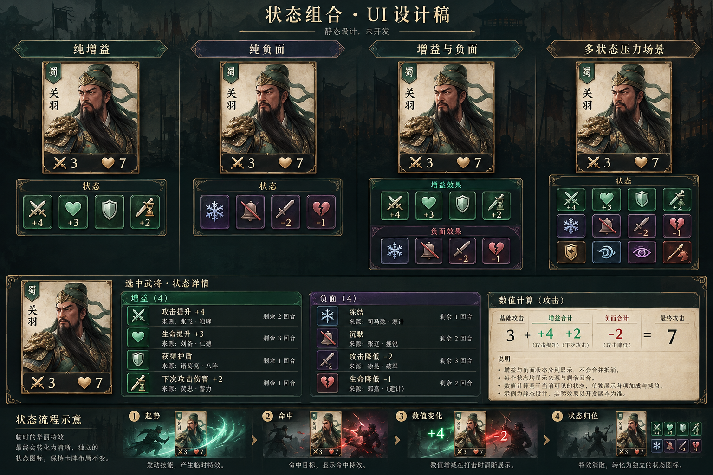
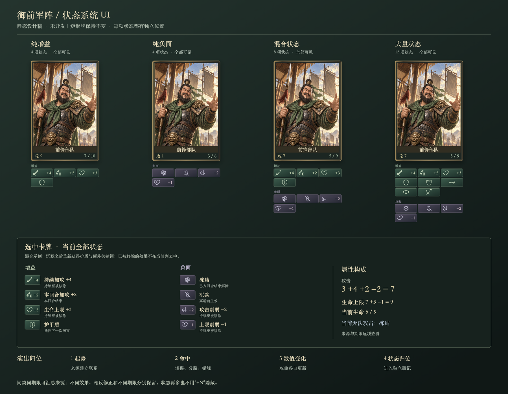
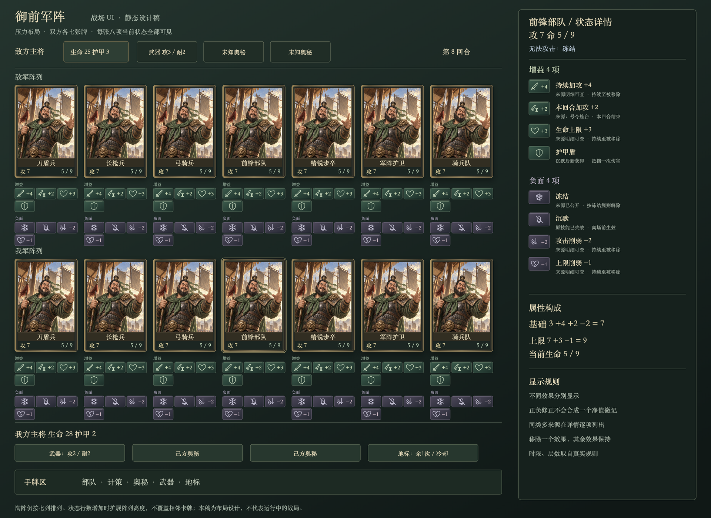

# 战斗卡牌状态 UI 完整设计

日期：2026-10-25。交付阶段：静态 UI 设计评审，未开发。

本方案取代前几轮预览中关于组合状态、持续包边和椭圆目标牌的方案。现有 HTML 预览与游戏代码不作修改。武器、地标和奥秘沿用既有卡牌类别及规则，只在本设计中统一信息位置和状态显示。

## 一、设计目标与视觉方向

解决两个问题：不同增益与负面状态必须能同时辨认；最终状态需要有统一、克制的材质，避免金框、冰框和多个光效互相覆盖。

保留矩形牌、人物插画、名称、攻命数值。持续状态使用独立的军令徽记，固定在卡下的“状态区”；强烈光效只在施加、触发和解除的短时演出出现。最终卡框保持普通材质，不因获得多个状态而变成不同整框皮肤。

推荐方向为“墨青战场、旧铜牌框、玉釉军令徽记”。旧铜有细拉丝和暗面，玉釉只用于小面积图标，浅绢用于规则文字。状态区为低反光深色底，正面使用玉绿/暖金点缀，负面使用冷蓝/灰紫/暗赭点缀。颜色辅助识别，图形、数值和名称共同表达含义。

不保留上一版的整圈冰晶、宝石金框、叶子和巨大封字。状态数量增加时增加独立徽记，不增加覆盖人物的材质层数。

## 二、完整交付图

- `battle-ui-concept.png`：美术方向图，包含战场、人物和整体材质；文字与规则为概念占位。
- `status-system-concept.png`：组合状态的美术方向图与演出分镜；细节以精确稿和本文为准。
- `battle-ui.png` / `battle-ui.svg`：精确战场布局，包含敌我单位、主将、手牌、武器、奥秘、地标及右侧状态详情。
- `stress-layout.png` / `stress-layout.svg`：双方各七张牌、每张八项状态的满阵压力布局。
- `status-system.png` / `status-system.svg`：精确四类组合状态组件稿、详情组织方式及演出步骤。
- `prompts.json`：本轮内置 ImageGen 的完整提示词，便于后续沿同一方向细化。

概念图用于确认美术气质；精确 SVG/PNG 用于确认徽记数量、顺序、计算和满阵布局。两者用途不同，概念图中的来源、期限、卡牌类型及数值占位不能直接作为生产规则。精确布局中的重复人物插画只用于比较状态，并非要求不同兵种共享一张立绘。以下规范是信息与交互的准则。

## 三、卡牌的固定区域

| 区域 | 内容 | 同时存在多个状态时的处理 |
| --- | --- | --- |
| 牌框及插画 | 牌类、阵营、人物识别 | 牌形和主体保持稳定，不承担状态汇总 |
| 名称区 | 卡名 | 不压“封”“盾”等大字，不与徽记抢位置 |
| 规则区 | 原有技能与关键词摘要 | 沉默使被移除的原技能划线；新获得的技能另列状态，不整张变灰 |
| 数值区 | 当前攻击、当前生命/生命上限 | 只显示最终真实数值；详情给出构成 |
| 卡下状态区 | 每一种当前生效的附加效果 | 全部独立显示，按组换行，不叠图、不轮播、不以“+N”隐藏 |
| 操作区 | 是否可攻击、选择提示 | 冻结等导致不可攻击时显示明确原因，不能只靠改变光效颜色 |

状态区属于该卡的布局范围。其背景和框线轻于主卡，视觉上像随卡携带的军令附签，不做一排粗边按钮。

## 四、状态徽记与组合规则

### 4.1 单个徽记

标准尺寸参考：32–38px 宽、24px 高。左侧为 14–16px 独立图形，右侧为数值或期限小标。图标采用同一套细浮雕笔触，不混用 emoji、线框图标和照片纹理。无数值的状态用完整图形表达，名称在焦点提示和详情中显示。

每个徽记有正常、新获得、即将到期、被移除四个设计状态。常态无循环发光；新获得时短促亮边，之后回到哑光。

### 4.2 分组与顺序

先正面组、后负面组，分别占据独立的连续行；两组都有内容时，用细短分隔线和小型正/负标识区分。只有一组时不保留另一组的空行。

正面组：持续加攻、临时加攻、生命上限、护甲盾、额外关键词。负面组：冻结、沉默、降攻、降低生命上限，以及规则中真实存在的其他状态。分组内顺序固定，新状态不会把旧状态随机挤到另一处。

### 4.3 多来源、混合与相反修正

1. **不同种类全部保留。** 加攻、加生命、盾、冻结、沉默同时存在时，五个徽记同时可见。
2. **同属性相反修正分别保留。** 攻击 +4 与攻击 −2 分别显示；最终攻击在数值区计算。不能只剩一个“净增益 +2”。
3. **持续与临时加攻分开。** 两者图形不同，临时效果含小沙漏角标，详情写明“本回合结束”。
4. **同种、同期限、同正负方向可合并数值。** 三个持续加攻来源可显示一个“加攻 +6”；详情逐条列出三个来源，不虚构为三个不同效果。
5. **相同图形但解除条件不同，分开显示。** 例如两个不同期限的强化，不用一个模糊倒计时混在一起；符号和期限角标区分。
6. **只显示真实共存的效果。** 沉默已经移除的护盾或关键词不再显示。沉默之后新获得的护盾按实际规则重新出现；不为了展示漂亮而保留已失效状态。
7. **当前生命恢复不是持续状态。** 治疗只播放命中、更新数值，并在近期变化/记录中留下来源，不永久增加“回血”徽记。持续回复若未来加入，应按其真实规则单列。
8. **来源不等于效果种类。** 武器、地标、人物牌造成的同类状态沿用相同徽记；来源在详情中区分。

### 4.4 所有状态可见的空间处理

标准战场卡下每行三枚徽记，支持自然增加行。设计图至少覆盖 4、8、12 枚状态。12 枚为压力展示数量，不是功能上限。

同一阵列以状态行数最多的卡决定该阵列高度，各卡数值底线对齐。状态增多时扩展阵列高度并重新分配战场纵向空间，不盖住相邻卡、不缩小图标直到无法辨认。超出可用战场高度时，战场整体采用受控纵向浏览；状态区自身不做滚动容器，也不隐藏多余徽记。

数值较长时徽记加宽、减少该行列数；不显示省略号或截掉正负号。尺寸小于标准时保持至少 14px 的图形和 11px 数值，不把无限数量硬塞进固定高度。

## 五、全量状态视觉字典

| 当前效果 | 徽记形状与材质 | 数值/期限 | 常态辅助表现 |
| --- | --- | --- | --- |
| 持续加攻 | 向上完整刀锋，暖金镶边 | +N | 攻击数字使用强化色；不留全卡金罩 |
| 临时加攻 | 风刃与小沙漏，琥珀釉面 | +N、期限角标 | 与持续加攻并列 |
| 增加生命上限 | 完整玉心与上箭头，青玉 | +N | 生命上限独立于当前生命 |
| 护甲盾 | 闭合盾面，浅金釉面 | 无数字；真实规则若可叠层才有层数 | 状态徽记存在即表示可抵挡；常态不套第二张卡框 |
| 额外护卫 | 盾与城垛 | 按实际规则 | 与原生护卫区分，详情说明“额外获得” |
| 额外突袭 | 双斜风刃 | 按实际规则 | 不自行等同于本回合一定可攻击 |
| 额外潜行 | 收束眼纹与薄雾 | 按实际规则 | 状态徽记保留；可见性遵守敌我信息权限 |
| 额外反骑 | 枪尖与马蹄 | 按实际规则 | 不与慑马共用同一图形 |
| 额外慑马 | 被压制的马首 | 按实际规则 | 固定独立位置 |
| 额外破盾 | 裂开的盾面 | 按实际规则 | 不与护甲盾使用相同轮廓 |
| 冻结 | 六角霜晶，冷蓝薄釉 | 显示真实解除条件；无固定回合数则不造倒计时 | 可攻击提示改为“冻结，无法攻击” |
| 沉默 | 收束的铃口与斜封线，灰紫银边 | 持续条件见详情 | 原技能文字划线，数值、人物不整张灰掉 |
| 降攻 | 向下断刃，暗赭 | −N | 与加攻并列，不能只变红数字 |
| 降低生命上限 | 裂玉心与下箭头 | −N | 不表现成一次普通伤害 |
| 真实延迟效果 | 封签与触发条件形状 | 条件/次数来自规则 | 目前不新增中毒、灼烧等不存在的玩法 |

主将护甲、武器耐久、地标次数不混入部队生命图标，见第十节。

## 六、必须画出的组合场景

| 场景 | 卡下可见内容 | 数值与动作信息 |
| --- | --- | --- |
| 纯增益 | 持续加攻 +4、临时加攻 +2、生命上限 +3、护甲盾 | 四枚同时出现；攻击和生命按实际结算变化 |
| 纯负面 | 冻结、沉默、降攻 −2、降低生命上限 −1 | 四枚同时出现；明确冻结导致不能攻击 |
| 混合八项 | 上述四项正面和四项负面 | 八枚同时显示；示例中盾等为沉默后新获得，避免展示规则矛盾 |
| 十二项压力 | 混合八项再加入四种引擎允许共存的额外关键词 | 按正负分组共五行徽记，保持卡列边界；以真实合法样本代替互斥组合 |
| 加攻与降攻抵消 | 持续加攻 +4、降攻 −4 | 两枚保留；最终数值可等于基础值，不能因此清空徽记 |
| 多来源同类 | 同期限三个来源共 +6 | 一枚 +6；详情有三条来源 |
| 同类不同期限 | 持续 +2、本回合 +2 | 两枚、不同期限角标 |
| 部分解除 | 八项中仅移除冻结 | 其余七项留驻，冻结位置收起；不得全部重播或全部消失 |
| 只有治疗 | 当前生命恢复 3 | 数值变化，无新增永久状态徽记 |
| 阵亡/离场 | 当前附加状态结束 | 所有附签随原卡离场，不能留在场位附着给新卡 |

插画、文字、数值始终可读。冻结与盾在瞬时演出中可以短暂包裹目标，最终都归到独立状态徽记，避免一种厚重材质遮住其他状态。

## 七、详情面板与交互设计

### 7.1 打开方式

鼠标悬停单枚徽记显示短名称、强度、期限；键盘焦点得到相同信息。点击任意徽记或整条状态区，打开该卡的完整状态详情，焦点定位到对应效果。触控不依赖悬停，整条状态区提供足够大的点击范围。

点卡牌主体保留卡牌查看/操作语义，状态区点击不触发攻击或出牌。正在选择攻击目标时，状态查看与选目标必须在视觉和交互上明确区分。

### 7.2 面板信息

顶部为卡名、当前数值和行动状态。下面按“增益”“负面”分组，每条包括：

- 独立图形、完整名称、强度或触发条件。
- 来源卡或主将/地标名称；公开信息范围内的施加方。
- 生效时点、解除条件、是否本回合结束消失。
- 同类合并时的各来源数值；被沉默移除时进入“已失效”记录，不混在当前有效列表。

属性构成单列。例如攻击：基础 3 + 持续加攻 4 + 本回合加攻 2 − 削弱 2 = 7。生命：当前 5 / 上限 9；上限由基础 7 +3 −1 得到。当前生命按实际状态展示，不因为上限变为 9 就强制显示满血。

有冻结时，即使攻击 7 也写“当前无法攻击：冻结”。有多个限制时逐项列出，不用单个优先状态覆盖其他原因。旧存档若未记录来源，写“来源未记录”，不能猜一个来源卡名。

### 7.3 大量状态详情

卡下始终保留全部当前效果。右侧详情的来源明细可以纵向浏览，因为它是辅助详情而非战场唯一入口；当前效果名称和正负分组仍完整可达。面板固定在场外，不遮住选中卡、邻卡和关键目标。

## 八、动效分镜设计（仅规格，不实现）

演出分为四段：起势、命中、数值变化、状态归位。目标是短时有冲击，结束后干净、可对战。

| 段落 | 建议时长 | 画面与信息 |
| --- | --- | --- |
| 起势 | 180–260ms | 来源牌/人物特征亮起，细能量束建立来源与目标关系 |
| 命中 | 220–360ms | 加攻为金色刃光冲击；生命为青玉旋流；冻结为短促冰爆；沉默为声音与光线向内收束 |
| 数值变化 | 180–260ms，可与命中重叠 | 每项实际变化抵达自身数值位置，局部弹动，牌形不改变 |
| 状态归位 | 220–320ms | 对应光点收进卡下各自徽记；新徽记短亮后变哑光 |

同一次多效果施放共用起势；各命中按实际结算先后错开约 70–100ms，重叠播放，不用三个完整过场把时间乘三。持续状态始终可见，新演出不能把旧状态区擦掉或换成另一套整框。

群体效果共用一次来源演出，每张目标卡自己的数值与徽记分别更新。视觉承载拥挤时降低粒子密度，不能省略不同效果。护盾抵挡、临时强化到期、净化解除分别仅动对应徽记。减少动态效果模式直接显示数值和独立状态，不摇动、不闪爆。

## 九、尺寸与布局

### 9.1 桌面战场

1440px 级别参考：战场主体约 1020px，右侧详情约 300px，其余用于间距。单位满阵时仍为七列，标准卡宽根据可用区域取约 118–132px，不以增加卡宽掩盖状态拥挤问题。每列的状态区只在自己的卡宽内换行。

两方阵列分别采用独立的统一行高。状态多的阵列变高时，英雄、手牌与回合操作使用独立布局区域，避免任意绝对定位的徽记压住手牌。全屏战斗模式优先分配空间给双方单位和状态，而非侧边装饰。

### 9.2 较窄窗口

约 1000px 时，完整详情改为用户主动打开的下方详情面板；场上状态不收成“+N”。仍须保留每个类型的图形、数值和可点击详情入口。

约 800px 且双方满阵、状态很多时，提供战场放大/纵向查看方式；宁可让用户移动查看战场，也不把所有图标缩到无法辨认。正式设计验收要用“双方七卡、每卡至少八项状态”的场景，不能只验一张巨大展示牌。

### 9.3 卡片放大详情

放大后每个徽记增加完整名称，来源与期限在旁展开。这个放大界面用于阅读，不替代战场上的所有状态可见要求。

## 十、奥秘、武器、地标与本系统的整合

- **奥秘**：布置槽保留共用密封外观，敌方隐藏种类不泄露。揭示后产生的护甲/伤害进入目标的数值与公开记录；不让一个奥秘牌背占据部队状态格。
- **武器**：主将旁独立武器槽，攻击和耐久固定分开。可攻击、已攻击、替换和耗尽是武器槽状态。武器赋予的真实持续增益才进入受益单位的状态区。
- **地标**：建筑卡占用现有场位，底部显示次数和冷却/就绪，不使用生命珠。营地治疗只有治疗演出与数值变化；旌台临时加攻落入目标的临时加攻徽记，期限明确为本回合。
- **主将**：护甲始终在主将护甲位置显示，若存在可展示的附加效果则使用同一状态区规则。不得把主将数值护甲与部队一次性护甲盾画成相同计量物。

六张卡的新插画目前作为方向草稿使用。本轮设计重点是组合状态的完整 UI，不继续修改六张卡的数值、规则和库存行为。

## 十一、交付验收标准

1. 矩形牌保持矩形，卡名、人物、数值可读。
2. 在四、八、十二项样本中，每种当前效果都有独立可见位置。
3. 增攻、降攻、临时与持续分别可辨；净值相同不隐藏来源效果。
4. 不使用整圈材质换皮作为多状态的主要表达，不因状态多而叠出数层厚框。
5. 每种图形与材质统一，微缩后仍有轮廓差异，正负不限于颜色区分。
6. 时限、层数和来源只取自规则，不能随美术补造。
7. 卡下无“+N”隐藏、轮播、局部滚动；空间不足时使用已定义的战场布局调整。
8. 七卡满阵、多状态、狭窄窗口均须有静态稿/最终验收，不只看单卡特写。
9. 动效与最终状态分别评审：动效允许强烈，结束后状态区安静、完整、可读。
10. 设计确定后另行实现；本次不修改游戏代码和既有 HTML 预览。

## 十二、后续调整：撤回 V6，探索卡面常驻动态

用户在全技能叠加场景中否定 V6 卡下密集徽记方案，已经撤回本轮正式战斗接入。保留 V6 预览作为对照；不将这套布局继续交付。用户随后要求增益和负面以卡内特效呈现，并明确要求施加后持续有动画，不能用静态贴图叠加。

新探索在 `docs/previews/card-surface-effects-v7/index.html`，独立于正式战斗。十二种状态各自有固定位置、运动时间与清理开关：攻击位金色刃光、生命位青玉光流、临时强化余烬、金色能量盾、护卫合拢甲片、突袭风痕、潜行雾丝、反骑枪芒、冻结生长冰晶、沉默旋转封印、攻击紫红裂隙和生命红色破损脉冲。施加结束后每种效果仍按自己的轨迹运动，移除某种状态只关闭对应发射器。

青金增益边框与紫色负面边框独立保留，混合状态有内外两层细边框。原有三张整圈冰壳、金框及爆点素材不用于此预览。人物脸部保持空白保护区，卡名与攻血数值在动态层上方。可用全技能、单项开关、定格/继续、重新施加、强度滑杆以及双方七卡满阵检查组合效果。当前仍为待用户评审的动画设计，不代表正式战斗已采用。

## 十三、V7 已获认可并接入正式战斗

用户认可 V7 后授权接入游戏。本次正式战斗使用与预览共享的 `card-battle-surface-renderer.mjs`，由 `card-battle-surface-effects.mjs` 统一管理时钟、可见性、画布尺寸与清理。所有效果留在原有 5:7 卡牌内部，不增加卡下徽记或场位高度。卡名、攻血数值和交互指示位于动态层上方。

实际状态来自存档中的卡片与公开动作历史：持续/临时攻击、生命上限修正、护甲盾、冻结、沉默和额外关键词。加攻与降攻等相反来源在净值抵消时仍可分别呈现；缺少完整历史时只显示已保存的真实净修正，不补造效果。额外慑马、破盾及临时削弱也有各自的独立动效。

命中前使用前一时刻的卡片和公开历史，实际命中时加入新效果与一次入场演出。施加完成后持续循环，消费护盾、状态到期、沉默移除旧效果和离场均同步清理；存档重开恢复当前状态。攻击和拖拽中的卡牌副本也绘制同一套动态。窗口不可见、牌册/牌组遮挡时停止刷新；关闭战斗释放时钟和观察器。减少动态效果模式保留静态状态轮廓与双边框。战斗规则、卡表和保存格式未改变。

验收覆盖真实施法生命周期、双方七卡满阵、1440/1000/800 窗口、人物卡双边框、关闭清理、鼠标点击与拖拽。正式状态验收记录在 `docs/card-battle-state-effects-validation.json` 和 `docs/card-battle-status-validation.json`。

## 十四、操作反馈与待命辨识修正

提示文本变化原本会重建整场 DOM，让手牌卡面重新进入悬浮/扇形过渡。现在普通提示只更新独立文字节点；场景渲染继续保留连接中的手牌容器、同一张卡的点击区域、卡面与既有插画，仅更新改变的属性、费用和内容。真实出牌/抽牌仍按原有顺序增减和重新排布手牌。

己方场上部队使用正式 `cardAttackStatus` 判断行动能力：刚登场的普通部队显示动态沙漏与“待命”，下个己方回合转换为绿色角部流光和“可攻”；突袭直接显示“可袭”，已经攻击显示“已攻”，被冻结和零攻击也有对应文字。状态表现不改变数值或规则，也不遮住攻血。减少动态效果时保留状态字样。

回合按钮更名为“交令”，无障碍名称及悬停说明保留“结束己方回合”的明确含义。文字与光效按背景玉盘内圈中心（横向约90.993%、纵向约36.769%）对齐，而非装饰外框中心。1440/1000/800窗口均校验文字中心。

新增 `tests/card-battle-controls-desktop.cjs`（`npm run test:card-battle-controls`），覆盖连续提示更新的节点与像素稳定、选择与取消、待命动态、正式引擎回合恢复、已攻击与突袭区别、玉盘居中和减少动态效果模式；记录位于 `docs/card-battle-controls-validation.json`。

## 十五、卡面特效辨识度与亮度调整

小卡上的状态线条按实际像素密度保留最低线宽和粒子尺寸，并增加窄暗衬线，使亮纹在浅色或复杂插画上仍可辨认。护盾与沉默持续保留中心轮廓，外围能量仍独立循环。用户查看后要求再亮一点，因此继续小幅增强光点、流光与局部光晕的透明度和辉光；各状态位置、卡片比例、人物保护区与动画轨迹保持原设计。

`tests/card-battle-surface-readability.cjs` 覆盖十五种效果、80/96/144 像素卡宽与 1/2 倍像素密度，共九十种组合，比较多个稳定时刻的可见度及持续运动，并验证全状态叠加时人物中央保护区没有绘制。结果保存在 `docs/card-battle-surface-readability-validation.json`。真实战斗可通过 `npm run preview:card-effects` 打开独立试玩，具备组合增益、冻结、沉默及五张可施放的真实技能牌。

## 十六、卡牌详情改为图文面板

详情面板采用深绿底、细金边的横向布局。左栏复用当前卡片的真实插画，集中显示费用、攻击、生命／耐久／设施次数；部队另有实际生还进度、训练与来源。右栏展示名称、技能与规则，增益、负面和冻结以青绿、紫色、冰蓝的独立状态块区分。图标复用卡面动效定义，每项保留真实说明与持续时间；数值计算和人物背景可展开，状态过多时在面板内滚动，面板不超出战场边界。

部队、人物、计策、武器、己方奥秘及地标共用详情外观。敌方隐藏奥秘不泄漏；地标撤下按钮仍走正式动作。鼠标短暂停留后展开，移入面板可以操作、滚动；关闭按钮和 Escape 收起详情。开始拖拽时关闭，并避免渲染后的短暂悬停挡住主将目标。样式由独立的 `card-battle-inspect.css` 管理，动态属性通过 DOM 设置，遵循既有内容安全策略。

`npm run test:card-battle-inspect` 验证实际插画、独立状态、计算展开、关闭、1440/1000/800 窗口、全状态滚动、只读状态及武器／奥秘／地标真实来源；结果在 `docs/card-battle-inspect-validation.json`。原生试玩可使用 `npm run preview:card-effects -- --card-details`，直接打开新版详情。

## 十七、瞄准线保留虚线并增强对比

用户否定连续霓虹光轨，并明确虚线可以保留。当前版本采用朱红短虚线、深色衬线与轻微暖色高光，友方目标采用青玉色；小型双翼箭头替代大三角，合法目标显示细角标。虚线缓慢朝目标移动，减少动态效果模式保持静态可见。轨迹从卡面外缘起笔，使用实际指针坐标；拖拽捕获指针后仍可跟随，取消时清空全部图层。展示层不拦截鼠标，不改变目标合法性或技能结算。

`npm run test:card-battle-aim` 验证颜色、虚线动画、合法与非法目标、友方技能、卡外起点、原生拖拽／取消、减少动态效果及三个窗口尺寸；结果在 `docs/card-battle-aim-validation.json`。完整鼠标战斗流程亦已复核。`npm run preview:card-effects -- --card-aim` 可直接打开有瞄准线的试玩。
