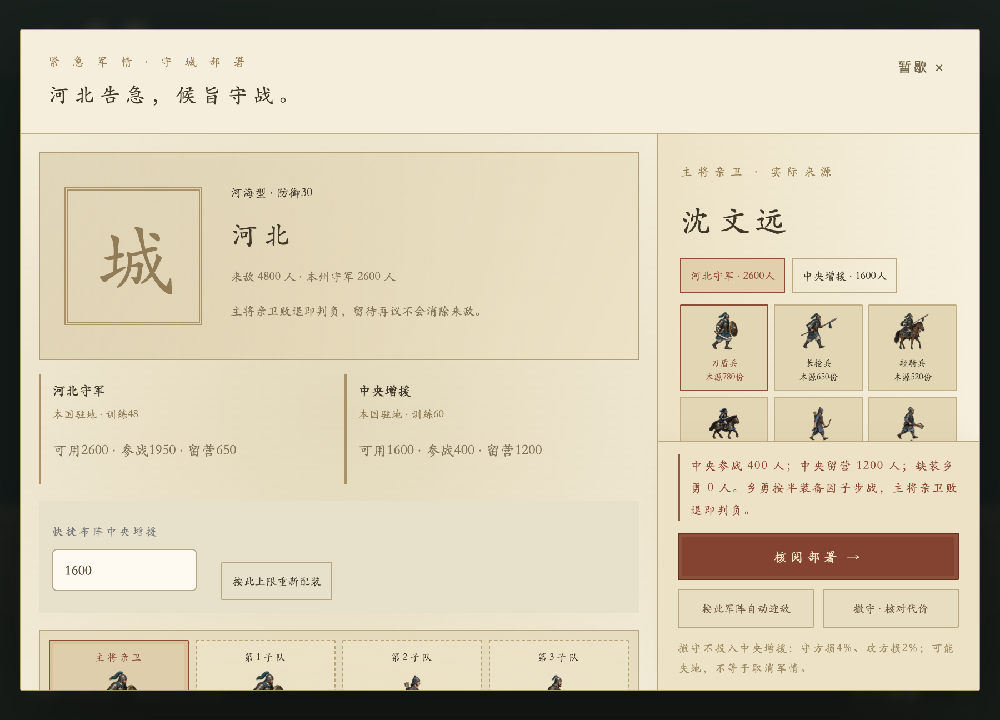

# 朝堂游戏化交互验收 · 2026-10-18

分支 `feat/immersive-court`。首版 `12928ab`；主交互与反馈收尾至 `4fdb7a6`，本报告随最终验收提交。所有测试使用隔离存档，无正式存档迁移、安装覆盖、推送或合并。

## 实现与验收范围

| 路径 | 实现与实际验证 |
|---|---|
| 财政 | 州图税率/多州补助/普查/加征，真实代价与风险；正常跨旬后实收/实付/欠支国债及当前预算分开呈报 |
| 人事 | 真实人物/现任候任能力对照、调任/封赏/外调、地方预算委任；下一旬实际治理复奏及制举揭榜→退朝录用 |
| 刑案 | 实际调查、证据与资金、在押人物、处置分支和案件回执 |
| 外交 | 国图选国→国书→下旬抵京→退朝接见→条约/贸易/贡银/双向和亲；真实结算复奏 |
| 军务 | 库存/占用/产地、采办/募兵遣兵/携装调拨、将领编成、出征守城与原六角格战场；真实战后归营报告 |
| 国政 | 宗室亲授/赐名/立储，12类长工程、分段/停工/停建/完工及次旬启用，封禅/禅让/升仙与终评继位 |
| 节奏 | 零至三份真实奏折，无事不凑数；免费查阅/预览、快捷办理、玩家主动退朝、留待再议保留风险 |

主要路径经过人物、物件和地图操作；精确数字与旧精册仍按需可查。普通产业开发、祭祀、民政、军援、任期等补充规则保留原入口，不以其精册入口冒充新增场景。未接入 AI 对话，没有新增持久化字段、类型、兼容版本或旬结算公式；原寿元、财粮、兵装价格与危机恢复规则保留。

## 最终验证

- 501项业务测试、24组运行时/负例类型契约通过。
- 当前分支统一执行11组主要场景 Electron 验收全部通过：fiscal、personnel、justice、diplomacy、negotiation、garrison、campaign、defense、royal、special、honors。每组保留真实成本、取消、保存失败回滚/重试、防重复及适用的跨旬/读档检查。
- 原朝堂全流程、零奏折三尺寸、连续8旬立即/召见后退朝通过；有效隔离安稳存档免费查阅、可退朝，无软锁。
- 新增 `npm run test:court-priority`：7条实际入口（户部人物、御案舆图、国库概览、召见名册、主动退朝、本朝纪事、军情奏折）优先守城；界面稳定后窗口仍打开，留待再议不消除待决军情，查阅不写档。
- 危机恢复验证自然低快乐来敌、低健康/零体力应战或撤守及战后续旬。
- `test:longterm`、`test:balance-ui` 通过；实际正常新局36旬及108旬长线数值模拟通过。基线108旬样本国库39166、国债0；额外开工/委任和缺粮压力情景沿用原有经济风险，不保证任何策略均可获胜。
- 1440宽、900×680、390宽关键按钮与地图/人物可操作检查通过；截图逐批查看，最终复看安稳御案与紧急守城。日志汇总 `outputs/immersive-court/final-acceptance/`，场景截图在 `docs/screenshots/court-immersive-*.png`。

## 证据的边界

守城/终局/工程临界测试明确使用隔离受控场景，验证真实规则与完整界面链；没有宣称自然新局已玩满50年、统一世界或正常手动施工540旬。进攻实机验证完整出征、读档续战、主动撤退与归营，未宣称赢下该战。工程540旬完整推进及次旬启用有领域验证。未进行正式安装包发布验收，本次交付为可运行源码分支与独立试玩入口 `npm run preview:court`。

