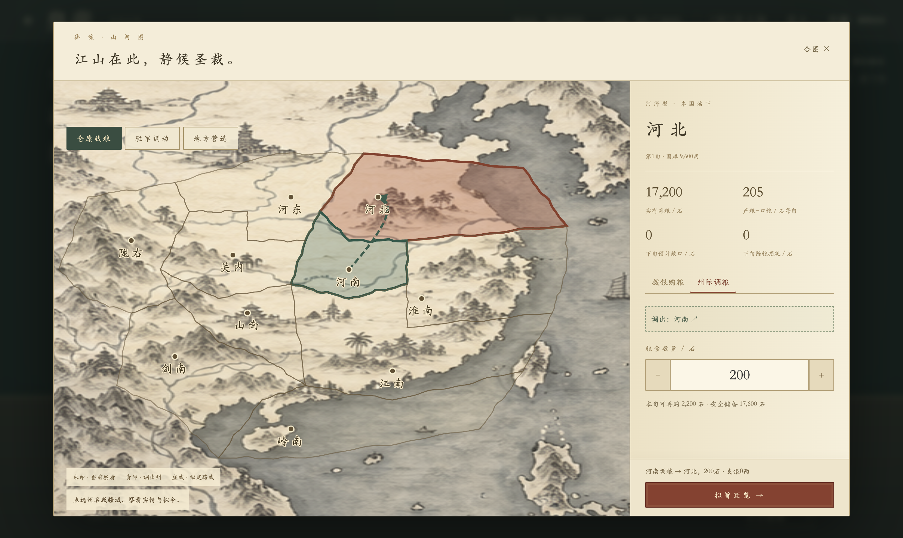
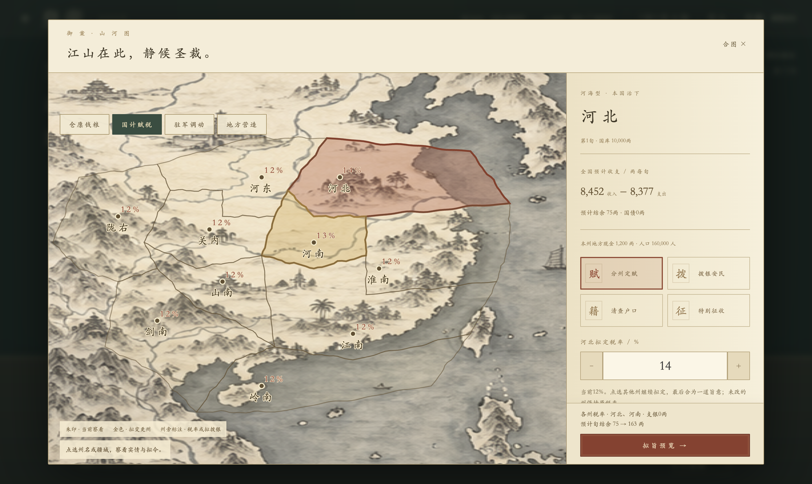
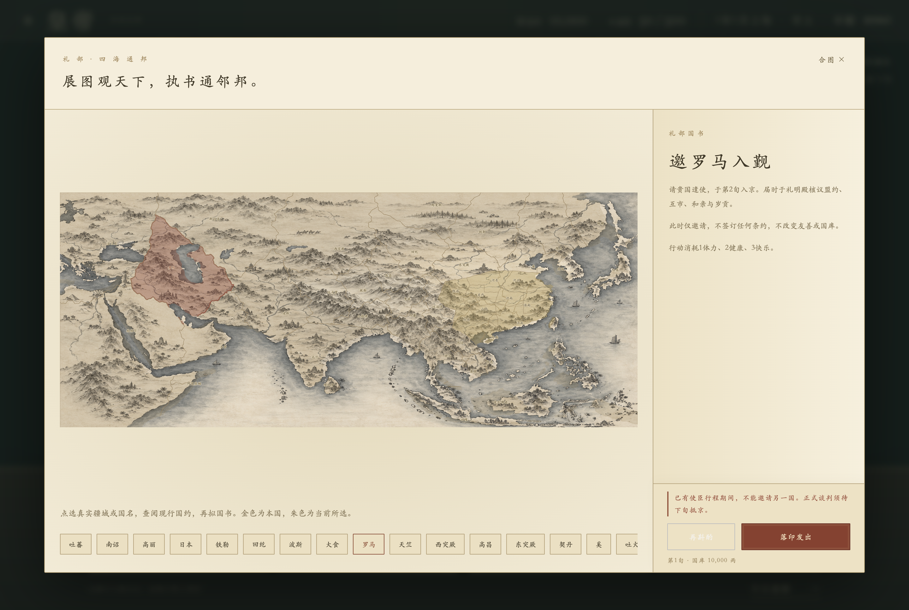
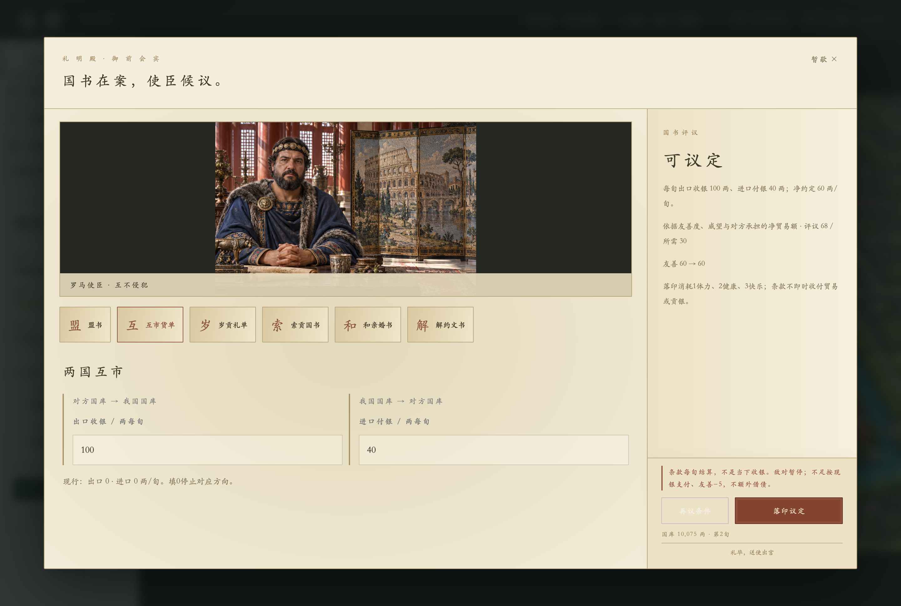

# 朝堂交互首版

开发分支：`feat/immersive-court`。目标是把朝堂的主要交互从部门菜单转到殿中人物、御案奏折和可操作的山河图。本版不使用大模型或自由对话，所有奏事由当前存档中的实情和固定文案生成。

## 直接试玩

```sh
npm run preview:court
```

首次启动以正常开局资源直接进入朝堂。独立存档位于系统临时目录下的`emperor-court-preview-v1`，后续启动继续该试玩进度。正常`npm start`也采用新朝堂，但仍使用正常游戏存档。

## 操作路线

1. 点击殿中人物，查看官员立绘、当前本部奏报和可办理事项。找不到人物时可点御案右侧“传召群臣”，包括空缺官位的署理入口。
2. 御案只放三份奏折。真实军情、京城失守、缺粮、灾情优先；其次呈现财政缺口、在建工程和陈粮耗损。安稳时提供兵籍、营造和仓廪查阅，不制造虚假灾难。
3. 展开奏折后可以亲察此事，也可以留待再议。留待再议不清除实际风险；奏折随实际状态重新生成，不另建一个重复的事件队列。
4. 点“展开舆图”，选州后切换仓廪、赋税、驻军或营造图层。朱印是当前州，青印是调出州，虚线是拟定路线。地图地区与现有十州疆域、人口和权属共用数据。
5. 购粮：选目标州、定数量、拟旨预览，再落印颁旨。调粮：选择“州际调粮”，点“调出”后在地图选另一州。
6. 调兵：选择目标州，再选调出州或中央禁军。当前图上快捷令只调兵员，不携装备，界面明确提醒；完整兵装调拨仍在兵部簿册。
7. 营造：选州、选建筑，查看现有数量、费用与工期，再拟旨。受灾或已有工程时不能重复开工；施工和完工继续使用原有旬结算。
8. 国计赋税：在地图上逐州拟定税率或补助，切换州和图层保留未颁草稿，可撤回单州安排。多个州最后合为一道旨意；拟旨按钮旁直接显示后续旬结余或国库变化。也可选清查户口或特别征收，先看真实人口变化与代价再颁旨。
9. 召见吏部后进入铨选席：点官印、选人物，对照现任能力后拟任；原任转待命。恩赏去留办理加衔、晋爵及永久外调；地方治理选择真实州牧、委任与预算；开科后下旬揭榜，退朝进入既有制举会场录用。
10. “今日退朝”返回皇城，沿用原阶段推进。左上角菜单收纳起居、存档、本朝纪事与完整簿册，不再常驻占据朝堂画面。

## 本轮边界

主朝堂、人物召见、奏折、购粮、调粮、税率、多州补助、普查、特别征税、人事任免、封赏、地方委任、科举衔接、刑案裁决、外交国书与谈判、兵员调拨和普通营建已有新的完整操作链。完整兵装编队、出征守城和特殊工程仍从召见后的相应入口进入原有簿册；没有把这些复杂模块全部重画，也没有删除已有功能。原始财政与全国报表继续作为查账工具保留。

查阅和预览不扣资源。提交使用现有`executeRelief`、`executeKitCommand`、`startConstruction`与`commitGame/persistCandidate`，正常办公仍消耗1体力、2健康、3快乐。失败不发布候选状态，可以重试；成功回执拦截重复落印。紧急军务保留此前的低属性恢复通道。没有新增持久化字段或更改兼容版本。

## 实测

- `npm test`：483项业务测试、24组运行时类型契约检查通过；新增奏事优先级、确定性、只读和真实工程进度测试。
- `npm run test:court-play`：真实开局召见、奏折查阅、购粮400两、州际调粮守恒、中央调兵100人、市场营建500两、预览取消、保存失败重试、重复落印、完整13官位传召、起居抽屉、退朝和读档通过。
- 同一界面测试检查1440宽、900×680和390宽布局，断言拟旨按钮位于弹窗可视范围内；信息区可滚动，拟旨与落印控制固定在底部。
- 市场开工后，实际连续安寝跨旬，遇灾按正常规则停工，样本第10旬完工；图上的建筑数量由3变4，在建记录清空。
- `npm run test:court-fiscal`：实际创建新局，税率草稿跨州/图层/撤回、多州补助、普查新增生产人口、特别征税的地方现金和民忠/安定变化、取消、保存失败重试、防重复、跨旬与读档通过。1440宽、900×680、390宽检查御批按钮与加征风险始终可见。
- `test:longterm`：通过新召见入口验证工程、取消/失败重试、宗室立储与继位。
- `test:balance-ui`：寿元、采购、粮耗、财政说明与存档回归通过。
- `test:crisis-recovery`：低快乐、低健康、零体力下的应战与撤守通过。
- `electron tests/court-exit-desktop.cjs`：连续8旬立即退朝/召见后退朝与保存阶段通过。

隔离测试的记录与各尺寸截图位于`outputs/immersive-court/`，不使用玩家的正常存档目录。

## 实机画面




## 财政交互补齐

财政预估直接使用既有财政命令的只读副本，不另造一套税收/补助公式；不更改价格、税率门槛、公共服务费或存档格式。地图草稿仅为界面暂存，颁行后清空该类已提交安排，关闭窗口则丢弃未颁草稿。高于25%的税率与特别征税的实质风险在御批旁固定展示，原始预算和各州明细按需展开。

本次真实新局样本：河北14%、河南13%，其他州原税率保留；补助河北200/河南300两；普查拨银5000两、登记29950名生产人口，不增加士兵；特别征税入库2060两。四次颁旨后国库6560两、体力196、健康92；跨至第2旬、读档后四条财政记录和税率保留。证据在`outputs/immersive-court/fiscal/`。



## 人事交互补齐

铨选席展示真实中央/地方官位、现任与拟任立绘、六项能力差值及可筛选的全部在朝人物。任命后原任待命，殿中人物随实际官位刷新；加衔与晋爵展示真实支银、忠诚变化及后续俸禄对旬结余的影响。永久外调风险固定在御批旁。

地方委任使用真实州牧与治理损耗，预算和国库保留线按需展开；委任不即时凭空扣款，继续由下旬既有自动治理结算。制举筹备支银500两，下旬才生成真实候选，退朝后进入原有制举会场多人录用，沿用工作阶段与体力规则。没有新增持久化字段、兼容版本或结算规则。

`npm run test:court-personnel` 使用隔离新局，验证真实任命/原任待命/殿中形象、封赏扣费、永久外调、委任撤回/预算、取消、保存失败重试、防重复、跨旬揭榜、退朝录用、读档。实际检查1440宽、900×680与390宽，御批及永久外调风险固定可见；截图已查看。证据在 `outputs/immersive-court/personnel/`。


## 刑案交互补齐

召见刑部可进入听案席，直接点案卷核阅真实发现旬、当前忠诚、在押与结案状态；不编造口供、贪污或物证。密查仍由既有忠诚和刑部能力规则执行，经费本次支出后每旬继续拨付，不足自动停止；可设为0停止，保留已发现记录。

收押、处斩与释放各有明确分支与拟旨确认。收押后原职空缺，天牢显示真实服刑旬数、性格、累计忠诚及下旬预计变化；释放为民不复职，处斩不可撤销。特赦按真实各州人口预估归籍，明确治安代价与每旬一次，不冒充释放天牢。成功复奏使用实际命令与原始历史记录，保留查账入口。

`npm run test:court-justice` 以隔离新局完成密查拨款、取消、保存失败/重试、防重复、收押、实际跨旬服刑、释放、处斩、特赦、停止密查与读档，检查1440宽、900×680与390宽的御批/风险可见性。未新增存档字段、类型、版本或结算规则。测试日志、结果及截图位于 `outputs/immersive-court/justice/`。


## 外交第一批：世界图与国书

礼部“展图通邦”使用现有世界疆域与实际权属选国，也可点国名或国印。右侧展示现行条约、贸易额度、贡银方向、和亲与按需展开的财用/实际履约。国书有免费预览和取消，落印只登记下一旬来访，不提前改变条约、友善或国库；沿用真实办公消耗。已有行程不能重复邀请，抵京前不能会面，抵京后可退朝进入真实礼明殿会场。

`test:court-diplomacy` 验证地图与国名选择、取消、失败回滚/重试、防重复、国约未提前生效、跨旬抵京、读档与退朝会面；检查1440宽、900×680、390宽截图。地图海岸裁切沿用现有地理数据。没有新存档字段或规则。

第一批完成选国—国书—行程—接见入口。第二批已补齐下述使臣国书提案，外交主路径已接通。



## 外交第二批：使臣国书提案

礼明殿以真实来访使臣完整场景和御案文书办理：四种盟约、解除条约、双向贸易、纳贡/索贡及双向和亲。点文书拟定条件，再查看真实规则给出的评议、友善变化与代价。被拒绝可改议，原约保留；待落印时锁定条款，防止预览和执行不一致。暂歇保留来访，送使才清除真实行程。

所有提案使用既有 `quoteNegotiation/executeDiplomacy`，办公原子保存复用原流程。贸易按旬、贡银按正月上旬实际转账，不制造即时收入；付款不足及敌对暂停规则保留。和亲进入真实宗室/后宫，年满16岁、未婚在宫、非储君人选才可出嫁。精确条款、人口、婚姻和履约仍可按需精查。没有新增持久化字段、兼容版本或结算规则。

`test:court-negotiation` 实际隔离新局完成国书邀请、跨旬抵京、暂离重进、缔约、贸易、拒绝与成功索贡、纳贡、迎娶与公主出嫁、解约、送使、再次跨旬真实贸易履约和读档，覆盖预览取消、空值、保存失败/重试、防重复及三尺寸御批风险。`test:envoy-visits` 已更新为该现行路径，避免继续操作已被替换的表单。完整480项业务、24组类型契约，以及通邦地图和原朝堂实际回归通过。

样本：第2旬议定出口100/进口40两每旬、我国岁贡50两；罗马公主入宫、长乐出嫁，解约保留贸易。第3旬实际出口收100、进口付40两；条款与后宫读档保留。岁贡正月上旬与双边现金守恒另有领域测试，截图日志在 `outputs/immersive-court/negotiation/`。



## 军务第一批：军营与武库

兵部“点检各营”和“采办军装”进入军营舆图，州图和全部本国驻地印签选营（包括已占领外域驻地），中央禁军单列。点现有九兵种图像查看真实库存、占用、可用人份；点兵种拟定采购或携行数量，多个兵种合为一道军令。原山河图裸兵快捷令仍保留，完整携装调动请使用军营入口。

采购沿用完整套装价格与真实稳定产地限制；招募每人4两，不赠装备，训练按来源加权；遣兵只动空闲人员，装备留营且不退征兵费用。共同调拨可在州图选调出/调入，兵员、人口与所有所选装备按实际来源守恒，出战占用不能调走。中央与京城地方库存各自显示，避免重复计算。预览使用现有军令的只读副本，落印沿用真实序号与原子保存，没有新存档字段/版本或结算规则。

`test:court-garrison` 以隔离新局验证刀盾10份+长枪20份采购320两、募兵100人400两及遣回、中央↔河北100人携刀盾70/长枪30份往返、取消、空值、保存失败回滚/重试、防重复、三尺寸御批风险、跨旬和读档；库存/占用/产地与守恒另有3项领域预览测试。实际截图与日志位于 `outputs/immersive-court/garrison/`。

本批未完成编成、出征和守城新交互，军务总项继续保持未完成。原六角格战场不变。


