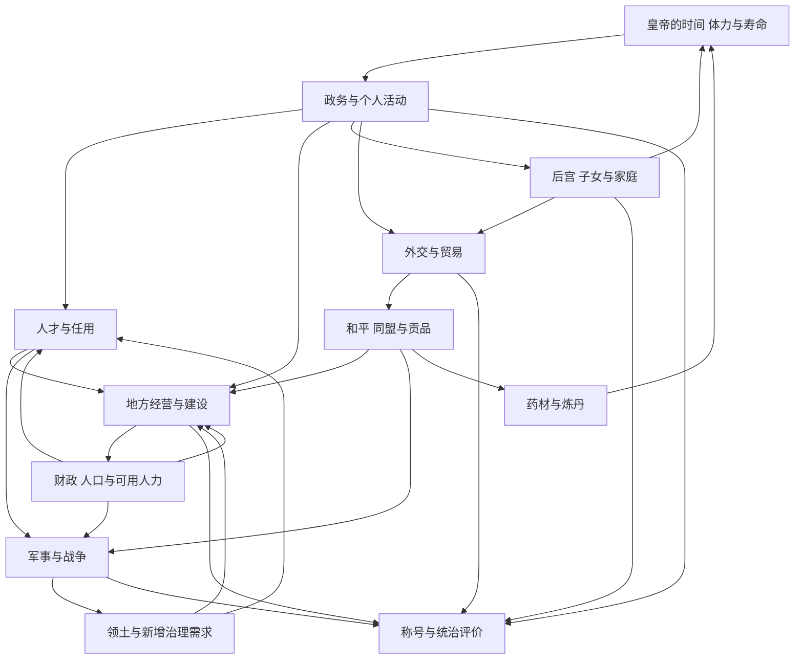

# 皇帝游戏玩法与系统设计文档

P0细化方案：[P0内政与财政开发方案](P0内政与财政开发方案.md)（规则、依赖、试行参数与验收标准；尚未编码）。

当前实现对照：[当前项目功能差距与开发优先级](当前项目功能差距与开发优先级.md)（2026-10-16；源码与测试核对，不改变原版证据等级）。

版本：0.1。整理日期：2026-10-16。对象：全崴C&E的DOS《皇帝》。用途：统一游戏玩法理解、解释系统之间的关联，为后续设计讨论提供依据。

《皇帝》将国家经营与皇帝一生放在同一个进程里：玩家用有限的时间、体力、寿命和国家资源处理政务、培养人物、经营家庭与安排外交战争，最终获得个人成就及统治评价。发展国家能改善皇帝的选择条件，皇帝的成长与活动又会影响国家事务。

本版汇总已收集的网络攻略及用户原文。早先的反汇编、DOS函数实验和当前项目实现不作为本版规则依据；不把后续改版、同名作品或现代化建议写成DOS原版事实。系统覆盖完整，精确公式与边界仍有显式缺口，因此本版是玩法与系统设计分析文档，尚非可逐项照搬的完整复刻规格。

## 1 阅读标记与来源去重

### 1.1 四类结论

|标记|含义|可以怎样使用|
|---|---|---|
|【攻略共识】|去重后至少两组材料在所述功能方向相近，暂未见直接反例|用来建立玩法框架；不代表概率、阈值或全版本已验证|
|【单篇记载】|只有一组明确说明，或可读上下文不足以独立印证|保留来源与适用条件，不直接固定为规则|
|【冲突】|方向、数值、口径或操作描述不一致|并列记录，引用第10节编号|
|【设计归纳】|根据已收集玩法解释目标、依赖与取舍|用于设计讨论，不冒充原作者设计书|

【待补】表示缺少足够网页证据，集中列在第11节。多篇攻略建议同一种玩法，并不自动证明它是机制上的唯一或最优解。成功案例也不等于必要条件。

### 1.2 去重后的资料组

|组别|内容与入口|来源边界|
|---|---|---|
|A|[用户提供的十节攻略](sources/user-guide-2026-10-16.txt)|作者、目标版本未注明；本版主要基础资料|
|B|[扶苏实用攻略及心得技巧][B]|2004年首帖及同帖后续回复；有原作者后续订正|
|C|[杂志攻略转录][C]|转载链注明何宇明、1997年《电脑玩家》第67期；未核对杂志原页|
|D|[青衫按地点讲解的攻略][D]|页面署名明确，初次发表日期与目标版本不明|
|E|[详细结局内政军事心得][E]|位于汇编后段，原作者待查|
|F|[2006年玩家讨论][F]|按回帖者和段落区分；其中不少材料与A、E重合|

博客园、3DM、痞客邦、奥米加汇编、围炉等页面按具体段落归组，同文转载、简繁转换和删节不增加证据数量。混编网页不能整体视为一个作者的统一观点；同源数字被改写时保留差异。F与A、E重合的段落也不重复计票。详细传播关系见 [来源登记](网络攻略来源与去重.md)。

贴吧访问受限，部分新攻略目前只有标题摘要，不作为正文证据；没有声称完成全吧采集。本文不根据转载数量判断哪篇正确。

## 2 游戏目标与核心循环

### 2.1 玩家同时面对三个目标层次

|层次|玩家关心的问题|主要反馈|
|---|---|---|
|眼前维持|今天还有没有体力，地方是否失序，外敌是否来犯|皇帝状态、报表、奏报和事件|
|中期发展|怎样增加生产、培养人才、建成设施并安排外交|地方发展、国库、可用人物与条约|
|一生成就|怎样兼顾个人能力、家庭表现、国力和版图|称号、封禅、皇冠、历史评价与终局|

【设计归纳】玩家可偏重治理、收集、扩张或长期成就，但这些方向共用资源。战争成功可能增加治理负担，追求寿命可能需要保留贡药关系，家庭活动也会占用处理国事的机会。

### 2.2 一次完整决策循环

1. **查看局势**：观察皇帝状态、财政、地方生产民生、官员、驻军及对外关系。
2. **选择重点**：优先处理当前风险，或推进开发、建设、人才与个人成长目标。
3. **分配资源**：安排钱、兵、民夫、官员和皇帝的活动机会。
4. **执行行动**：上朝发令、任命调派、修习休息、家庭互动、出游或炼丹。
5. **处理反馈**：跟进工程、调令、外交答复、灾情、出生、战争等结果。
6. **重新评估**：根据资源与局势变化调整，逐步累积长期成果。

这是攻略行为的组织方式，不表示所有命令立即生效，也不承诺每次循环具有固定日历长度。

### 2.3 时间与行动的边界

【攻略共识】活动受时段、体力与人物状态约束，年龄与寿命又构成长局期限。办事成本、恢复和时间推进必须分别观察。[A]、[D]

【待补】网络资料尚不足以统一“菜单点击、完成活动、回合、旬、月”的精确映射，也不足以给出所有生产、费用、事件的完整结算顺序。本文不把当前项目的时段规则或此前程序研究补入空白。

【冲突】读档被分别描述为加速业务、损伤训练或推进日期，不能作为普通时间推进规则，见Z05。待生效命令应与已落实结果区分。

## 3 系统关联与共享资源

### 3.1 核心关联图

下图是【设计归纳】，箭头表示玩法依赖，不代表已经恢复的数值公式。



### 3.2 共享资源

|资源|主要用途|系统间的取舍|
|---|---|---|
|时间与活动机会|政务、修习、休息、家庭、出游|发展国家与培养皇帝争取同一段统治时间|
|体力|执行各类事务|高效率办事需要恢复活动支持|
|健康与快乐|维持皇帝状态，受到活动事件影响|不能只看当前体力决定能否持续工作|
|剩余寿命|支撑长期经营|恢复、活动与延寿构成长期安排问题|
|国家资金|建设、军备、外交、人物与行政开支|长期发展和短期应急竞争预算|
|职业人口与开发条件|地方生产基础|人口增长可能要求持续开发和补建设施|
|士兵与民夫|驻军、出征、工程|建设与军事动员竞争可用人力|
|官员|治理、训练、出征与替补|同一人才不一定能同时满足多个岗位|
|药材|恢复、能力提升、延寿|短期属性收益与长期生命资源竞争材料|

【单篇记载】A将军队和民夫之和描述为受上限约束的徭役总数；具体上限算法、人口口径和转移规则待补。[A]

### 3.3 关键反馈关系

|关系|玩法意义|证据状态|
|---|---|---|
|开发与设施改善地方条件，地方收益支持继续投入|形成可持续经营路线|方向性共识；精确收益链待补|
|人口增加后，人均开发与设施需求重新变化|繁荣需要持续维护，不能永久放置|攻略观察与设计归纳|
|扩张增加领土，也增加官员与治理需求|打赢战争不是扩张的全部成本|A、D等岗位与扩张建议支持|
|外交争取发展时间并提供贡药，药物支持更长统治|国家关系与个人养成相连|功能方向共识；贡药门槛冲突|
|后宫恢复支持行动，家庭互动影响评价|收集、效率与家庭成就可以有不同安排|功能方向相近；成长与计分冲突|

## 4 皇城交互与信息组织

### 4.1 场所与操作

|入口|主要用途|状态|
|---|---|---|
|宣政殿|百官政务、报表、人事、开发、军事与外交相关操作|A、D方向相近|
|紫宸殿|出游安排、嫔妃名分、子女与后宫表|A、D方向相近|
|金龙殿|独寝恢复|A、D方向相近|
|后宫|发现人物、留用培养、恢复与生育|A、B、D方向相近|
|御书园、武道场、琴棋阁、百剧院|智慧、武术、魅力、才艺修习|名称存在异写，入口方向相近|
|慈宁宫|探望太后、家庭评价|A、D方向相近|
|青炉房|炼制、服用、试药和弃药|A、D方向相近|
|观景台、礼明殿|攻略说明有限或含“用途不明”的个人判断|待补，不能据此认定无功能|

出处：[A]、[B]、[D]。时段限制与全部操作成本尚未统一。

### 4.2 报表怎样服务决策

|信息面|玩家用它回答的问题|
|---|---|
|皇帝状态|当前还能办事吗，是否需要恢复或延寿|
|收支表|钱从哪里来、花在哪里，能否承受继续投入|
|经济与开发表|哪些行业人口与开发不匹配|
|民生与状况表|地方是否贫困、失序、低民忠或受灾|
|军事总表|地方与中央兵力、训练和装备是否适合当前计划|
|官员与家庭表|是否有岗位替补、待培养人物或可用和亲对象|
|外交信息|哪些关系可保障和平、提供援军或贡品|

【设计归纳】报表应解释行动后果。本文按决策用途组织，不承诺所有版本报表名称与字段一一相同。“生产量”“运输”“营业”“现金”等用词应保留来源口径，避免只凭字面建立公式。

## 5 内政 人口与建设

### 5.1 地方经营的两个方向

【攻略共识】开发生产基础与建设地方设施都是经营手段；刺史任用、人口分配和税收安排也受到关注。[A]、[B]、[D]

|方向|玩家决定|需要观察的结果|
|---|---|---|
|行业开发|开发农业、牧业、运输商业、矿工等哪一项|开发量、职业人口与生产表现|
|人口分配|是否鼓励转业、是否动员兵与民夫|各职业人数和可用劳力|
|财政|税率、补助、建设军备与外交投入|国库与地方生活表现|
|地方秩序|补充驻军、改善治安安定|流寇、民变及正常经营条件|
|治理方式|亲自处理、委任或轮换|发展速度、皇帝消耗与任期风险|

【单篇模型】E用“开发面积／职业人口”解释生产表现，并给出民忠上限说法。它适合帮助理解人口压力，但未统一其与各表指标、流通和取整的关系。不能把该模型直接宣布为完整经济算法。详见 [开发专题](网络攻略中的开发人口与建筑.md)。

### 5.2 普通建筑

|建筑|攻略共同或相近的功能方向|未解决的问题|
|---|---|---|
|寺庙|安定|每座效果、人口折算与边界|
|衙门|治安|建设与驻军如何共同影响风险|
|市集|地方收入、营业或运输相关|指标命名与具体变现机制|
|义仓|积粮及人口发展相关|积粮是不是库存、如何参与增长|
|校场|体能、新兵训练相关|指标到训练的精确换算|
|城墙|城防、防御相关|战场实际效果|
|行宫|支持浩荡出游及地方相关收益|建筑完成与活动收益分别何时生效|

出处：[A]、[B]、[D]。没有足够网页证据确定统一的逐座固定加成、百分比上限或固定建设工期。

### 5.3 特殊建筑与长期投入

【攻略记载】五大书院服务于官员成长；大佛寺、东厂、竞技场、大运河等提供全国性的相应收益。长城、陵寝、园林还被不同攻略与长局目标联系起来。[A]、[B]、[C]

【设计归纳】普通设施解决地方瓶颈，特殊工程提供跨地区收益和长期目标。开始工程前不仅要考虑一次投入，还应关注工期、人力占用及机会成本。具体造价、维护和效果表待补，不根据建筑名称补数值。

### 5.4 人口 贫富与财政

【攻略共识】生活水平按贫穷、尚可、小康、富裕、极富描述；人口与开发失配会成为后期难题，钱多不等于各地生活都好。[A]、[C]、[E]

【设计归纳】提高税收可能缓解国库压力，却不必然改善地方生活；发展、人口、税负和秩序要合看。应区分国家可支配资金、地方收入表现、攻略所谓“现金”与生活等级，尚不能把它们都按同一种货币存量理解。

补助是否有效、优先开发多人口行业还是短板行业、市集的变现门槛均有分歧，见Z01至Z04。

## 6 官员与军事

### 6.1 官员任用循环

【攻略共识】制举补充人才，地方刺史看重治理能力和品行，地方将军特别看重可靠性，出征领军另重战斗能力。[A]、[B]、[D]

|操作阶段|主要设计问题|
|---|---|
|发现与录取|皇帝成长如何影响人才供给，招到的是普通举子还是历史名臣|
|匹配岗位|治理人才、守将、统帅和中央办事人员如何分配|
|维持任职|封爵、调查、换人、轮换辖地与改回直辖有何区别|
|准备替补|扩张后的接任者、年老退休后的空缺如何补足|

【设计归纳】任用不是一次排序操作。能力、可靠性、年龄和岗位占用会共同影响长期选择。中央岗位不能因一篇评论称其作用弱而全部删除；名臣门槛和安全线也不能直接定值，见K01至K04。

### 6.2 军事循环

```text
观察地方与中央兵力
  → 安排人力与军费
  → 准备训练、兵器和防具
  → 任将、调派或出征
  → 布阵交战与处理援军
  → 谈判、撤退或占领
  → 驻军、接任与地方恢复
```

【设计归纳】这是阅读攻略的完整链条，不是已确认的每个菜单操作顺序。

【攻略记载】A给出刀克枪、枪克骑、骑克刀的循环克制，以及三排布阵、后排接敌受限的说明；B强调利用克制和位置，D则认为兵种收益差异不大。克制是否存在与其优势有多大需分开，见K06。[A]、[B]、[D]

地方兵维持秩序，中央军支持集中作战；训练、兵数和军备是不同条件。全国军队很多不代表每地安全。不要将文字攻略中的阵型重排成已经确认的最优战术，也不要把敌国示例兵力作为各版本固定初值。

## 7 外交与国家关系

### 7.1 外交选择

|手段|主要目的|跨系统联系|
|---|---|---|
|纳贡、送礼|改善关系，争取发展空间|财政投入换取安全机会|
|互不侵犯|降低外部压力|支持内政与个人修习|
|防御同盟|取得援助|改变军事资源来源|
|保护关系|取得宗属收益或相关成就|贡品、贸易、版图与评价|
|贸易|长期收入|开局投入与后期财政|
|和亲|改善关系|家庭人物成为外交资源|
|威压、勒索|要求金钱或其他让步|国力、关系和后续反应|

出处：[A]、[B]、[C]、[D]。各条约的期限、违约与自动结算规则未齐全。

### 7.2 外交不是固定升级路线

【攻略共识】良好关系和自身实力都在谈判建议中占重要位置；和平、援军、贸易、贡药与征服服务于不同目标。[A]、[B的后续回复][B]、[D]。

【已见网页订正】B首帖排除部分国家签约，同帖后续讨论认可理论上各国均可签约。不能继续将原排除名单写成硬限制，也不能反过来理解为任何国力下均可签成。

【单篇记载】C描述国际信用、解约开战代价及进攻通道问题。本文保留其设计含义，不采用具体加减或绝对通行限制作为共同规则。

【设计归纳】提前签约可能帮助发展，也可能改变后续扩张安排。东突厥的纳贡安抚、借盟友防御和军事应对属于不同开局策略；没有一套流程适用于所有局势。

## 8 皇帝养成 后宫子女与炼丹

### 8.1 皇帝成长

|成长面|主要玩法|共同认识与限制|
|---|---|---|
|智慧 武术 魅力 才艺|对应场所修习、部分药物提升|四项成长入口明确；对选才、人物获取和事件的影响有冲突|
|体力上限|狩猎及部分丹药|提高可用行动能力；不可与当前体力混用|
|状态维持|独寝、后宫、狩猎、出游等|健康快乐与寿命代价分别考虑|
|长期生命|获取药材、炼丹与活动安排|年龄、剩余寿命和在位年数是不同口径|

出处：[A]、[B]、[D]。A与D均描述独寝体力加150、健康加5；该恢复量不能自动推出所有身体状态、时段和版本都相同。

### 8.2 后宫与家庭

【攻略共识】宫女安排与册封支持人物发现和留用；名分与培养关系恢复表现；家庭互动影响评价，公主还与和亲相连。[A]、[B]、[D]

|环节|玩家的选择|跨系统作用|
|---|---|---|
|发现与留用|收集更多人物，或集中培养少数人物|收集目标与恢复效率可能不同|
|名分与相处|晋封、培养、安排休息|恢复能力支持后续政务|
|受孕与出生|等待及处理家庭事件|可能改变可选择人物和活动安排|
|太后与子女互动|安排探望召见|消耗机会，积累家庭表现|
|公主和亲|使用合适人物改善关系|家庭选择影响国家外交|

精确受孕资格、孕期、能力公式和互动计分未统一。攻略提到太子、禅让，不足以证明有完整的继承人培养与下一代可玩机制。人物介绍中的历史、传说和文学角色也应分开。

### 8.3 炼丹资源链

```text
维持外交来源 → 获得药材 → 选择配方 → 炼制与处理结果
                                      → 恢复状态或提升能力
                                      → 延长寿命，支持长期目标
```

【攻略共识】药材获取与对外关系有关，丹药效果涉及恢复、能力、体力上限与寿命。[A]、[B]、[C]、[D]

本版药材索引沿用A：A冰山雪莲、B冷凝不化冰、C千年人参王、D透光灵芝、E神僧舍利子、F龙脑香、G鲸王脂、H炽火蛙。字母仅是阅读索引，不能套用其他网页或版本的数字编号。

【单篇记载】以下完整保留A的配方组，不与其他攻略拼接剂量：

|材料集合|A记载的效果|
|---|---|
|AB、EF|加当前体力，未给剂量|
|AEG、ACF、BEH、CEF、DFG|健康、快乐各加10|
|ADFG、ACDF、ACEH、BCDH、BEGH|四项能力各加2|
|ABCEF、ABCEH、ACDFG、BDEGH、BDFGH|体力上限加30|
|ABCDEFGH|增寿|
|ABCDEFH|称比八味增寿多一倍|
|ABDEFH|称为上一种的四分之一寿命|

七味与八味、固定剂量与按年龄计算之间有直接分歧，见Y07、Y08。比较时必须同时记录药名、年龄、服用前后值以及是否使用过漏洞。

## 9 事件 成就与结局

### 9.1 事件连接系统

|事件类别|可能改变的玩法条件|应关注的后续|
|---|---|---|
|灾害与民变|人口、生产、设施、秩序|救急、补建、财政与驻军调整|
|官员风险|任职可靠性和地方控制|调查、处分、换任与治理恢复|
|战争与外交反馈|领土、协议、援助与贡品|新岗位、军备及后续关系|
|出生 衰老与死亡|家庭成员与活动可用性|替代恢复安排、互动时机与评价|
|皇帝异常状态或遇刺|可用行动、寿命或整局进程|恢复、防护与终局|
|成就与里程碑|个人或国家成果的展示|后续目标与终局检查|

【设计归纳】事件既提供变化，也让长期决策承担后果。自然灾害、官员谋反、地方民变、叛军战争不应只因都显示坏消息就合并成同一机制。触发频率、随机方式、持续时间与消息消费时点待补。

### 9.2 成就与评价分层

|反馈|攻略提供的内容|不可直接推出|
|---|---|---|
|能力称号|A、B均写四项能力各到500获得对应称号|霹雳终局也必用相同阈值|
|其他称号|铁人、长寿、天王、天可汗等|所有称号能以任意顺序永久并存|
|皇冠 封禅|A描述皇威里程碑与皇冠|皇冠数量等于结局类别数量|
|历史人物评价|E按版图与内政等组合解释|缺失的分数区间可自行补齐|
|终局|寿终、禅让、意外或霹雳等|一次成功流程中的全部步骤都是必要条件|

出处：[A]、[B]、[C]、[D]、[E]。详细称号索引见 [结局专题](网络攻略中的结局与评价.md)。

【单篇模型】E以占领、保护以及生活水平、生产和民生等维度解释评价。这里保留“武功与内政共同决定评价”的分析用途，不采用未经核对的完整历史人物矩阵。

【设计归纳】本作的长期目标可分为能力、家庭、治理与对外成就。征服全部土地不等于所有维度同时优秀，延长寿命则增加了完成多项长期目标的机会。霹雳涉及哪些阈值仍按冲突保留。

## 10 攻略共识与冲突总表

### 10.1 可以支撑整体框架的攻略共识

|共识|支撑组别|只确认到哪里|
|---|---|---|
|个人行动受体力影响，恢复和狩猎重要|A、B、D|不确认所有成本和耗时|
|国家经营包含开发、设施、人物与财政安排|A、B、C、D|不确认完整收益公式|
|官员要按治理、守土、出征等用途匹配|A、B、D|不确认属性安全线|
|兵员、训练与装备需分别准备|A、B、D|不确认所有战斗算法|
|外交支持安全、贸易、援助与贡品|A、B、C、D|不确认固定签约概率|
|后宫和家庭影响恢复、人物与评价|A、B、D|不确认生育与互动计分|
|炼丹连接外部药材与个人长期成长|A、C、D|不确认统一配方剂量|
|长期成果包含个人与国家表现|A、B、C、E|不确认全部结局边界|

这里的组别不是独立实验票数；同源关系仍按第1节处理。

### 10.2 内政与时间分歧

Z编号为本次汇总新增索引，对应此前开发专题中尚未编号的分歧。

|编号|分歧|来源与当前处理|
|---|---|---|
|Z01|优先开发人口多的行业，还是生产短板行业|A与E策略不同；缺少收益条件，不能宣布普遍最优|
|Z02|补助改善民生，还是仅能暂时救急|A不建议依赖补助，B主张对贫困灾区适当补助；需区分长期增长与应急|
|Z03|运输 营业 体能等名称与建筑映射|攻略措辞不一；不强行建立一一公式|
|Z04|100左右是经营目标还是硬门槛|A、B表述不同；不能把目标值写成统一上限|
|Z05|读档推进日期还是重复推进部分业务|A与其他攻略描述不同；仅记异常或技巧报告，不用于正常时间规格|

详见 [开发人口与建筑](网络攻略中的开发人口与建筑.md)。

### 10.3 官员 军事与外交分歧

|编号|分歧|当前处理|
|---|---|---|
|K01|名臣条件出现魅力80、100、250及其他属性说法|贤才、人数和历史名臣分别看|
|K02|忠诚、清廉安全线不一致|不设保证不叛变或不贪污的阈值|
|K03|四个月轮换与半年直辖|先区分换人、换辖地与治理方式|
|K04|中央官无用与具体岗位有效|保留岗位细节，排除笼统删功能结论|
|K05|驻军约1/4与1/10|预警、镇压、人口分母及版本待区分|
|K06|兵种克制重要与效果差别不大|机制存在性与实战收益分开|
|K07|部分国家不能签约|原帖有后续订正，不采用绝对禁签名单|
|K08|贸易首年、两年或更久亏损|回本时点依条件待补，不定第二年必盈利|
|K09|贡药友好度90、95、99|保护状态、贡品类别和时点待区分|
|K10|外交间隔与反复尝试|不统一冷却时间和成功率|

具体原文差异、来源及限制见 [K清单](官员军事外交攻略冲突清单.md)。K08另有F提到更长亏损期，作为同类分歧补充，不增加一条独立机制。

### 10.4 养成 家庭 丹方与结局分歧

|编号|分歧|当前处理|
|---|---|---|
|Y01|智慧武术影响举子，还是主要影响开发与遇刺|保留效果方向冲突|
|Y02|魅力提高还是降低佳丽出现概率|人物类别与样本口径待明确|
|Y03|狩猎季节明显，还是影响不大|效果判断与全年锻炼策略分开|
|Y04|修习耗体力20或40|同源转载数字变体，不多数表决|
|Y05|后宫能力公式与固定成长量|字段、时点和名分待对应，不叠加|
|Y06|家庭互动可集中刷，还是每旬只记一次|不承诺重复操作无限计分|
|Y07|相同五味丹体力上限加30或100|剂量冲突，保留两说|
|Y08|增寿固定值、年龄公式及七八味倍数不同|按药名和年龄分别记录|
|Y09|在位50年或年龄60岁后劝禅让|年龄与任期不混用|
|Y10|霹雳四项能力400或500|称号阈值不能反推终局|
|Y11|接近极富、全极富与非必要条件|成功案例不等于最低要求|
|Y12|长城一段或四段|一段仅为转述传闻，不采为确定条件|
|Y13|天可汗需要全保护或混合控制|目标状态与取得时点待补|
|Y14|历史评价表分数与人物名有缺口或差异|不生成假完整矩阵|

具体数值和原文来源见 [Y清单](养成后宫炼丹结局攻略冲突清单.md)。孕期晋封增子女、顺序服药继承药效、读档加速均独立记为漏洞报告，不纳入常规规则。

## 11 待补内容与证据要求

|优先级|内容|需要补齐的问题|优先寻找的网页材料|
|---|---|---|---|
|P0|时间与结算|哪些操作耗时，命令何时生效，月年业务顺序|完整游玩流程与连续日期截图|
|P0|指标语义|人口、生产量、运输营业、积粮、现金分别是什么|报表截图与同版本解释|
|P0|经济链|开发、职业、民忠、税率与生活等级如何联动|同一地区操作前后连续记录|
|P0|建筑|逐座效果、人口影响、造价、工期与维护|单项建设前后对照及费用记录|
|P1|官员|属性用途、招募、任期风险、成长退休|岗位与属性受控对比的玩家记录|
|P1|战争|部署、移动攻击、训练装备、援军与战后损失|完整战报及双方条件|
|P1|外交|条约条件、间隔、贸易与贡品周期|同国多年关系与收支记录|
|P1|皇帝活动|全部体力、健康快乐及寿命成本|同年龄同状态的活动对比|
|P1|家庭|受孕、出生处理、名分成长与互动评价|人物资料、旬次与家庭事件记录|
|P1|炼丹|材料、剂量、年龄、药槽与历史服用影响|炼制和服用前后截图|
|P2|成就终局|必要条件、足够条件、称号与皇冠保留|临近触发前后的完整状态|
|P2|特殊事件|灾害、谋反、死亡等完整触发和解除|有版本与时间线的完整案例|

P0表示讨论完整规则前优先澄清的基础口径，P1是模块细则，P2是长期与特殊边界；这是资料整理优先级，不是开发任务排期。继续采用网络材料核对，不自动转回程序分析。

## 12 系统设计讨论的边界与后续产物

### 12.1 当前已经能够讨论的设计结构

【设计归纳】可以围绕皇帝行动、地方经营、人才岗位、兵员军备、国家关系、家庭成员、材料药物和长期评价组织系统。共享资源与事件把这些对象连接起来，玩家选择的主要价值来自跨系统取舍。

|设计对象|需要表达的状态|主要关联|
|---|---|---|
|皇帝|身份、年龄、能力、当前状态、寿命|行动、家庭、选才与评价|
|地方|归属、人口、职业、开发、民生、建筑与驻军|生产、财政、风险与领土|
|官员和岗位|人物属性、年龄、任职与空缺|治理、军队与接任|
|国家关系|友好、协议、贸易与贡品安排|安全、军援、材料与扩张|
|军队与装备|驻地、兵员、训练、库存与出征状态|地方秩序、战斗和成本|
|家庭人物|身份、名分、年龄、培养与生育相关状态|恢复、评价与和亲|
|工程与丹药|投入、等待、完成和可用结果|人力、资金、材料与成长|
|成就与事件|已发生、待处理与最终结果|全局反馈与终局|

这是概念设计清单，不规定代码类名、数据库结构或未证实的原版字段。

### 12.2 尚不宜固定的设计细则

所有冲突阈值、未确认公式、事件概率、固定初始国力、同源改写数字和漏洞效果都保持可讨论。不能为了表格完整自行补数，也不能把现代项目已有逻辑当作原版解释。

后续如进入具体设计，可在每条规则旁分别写“攻略依据”“准备采用的方案”“与原玩法的差异”“验证方式”。目前没有授权改变游戏行为，本版不选择新算法或平衡参数。

## 附录 专题与来源入口

|需要的细节|阅读入口|
|---|---|
|开发 人口 建筑|[网络专题](网络攻略中的开发人口与建筑.md)|
|官员 军事 外交|[网络专题](网络攻略中的官员军事与外交.md)|
|皇帝 后宫 炼丹|[网络专题与A配方索引](网络攻略中的皇帝养成后宫与炼丹.md)|
|成就与结局|[网络专题](网络攻略中的结局与评价.md)|
|原文分歧|[K清单](官员军事外交攻略冲突清单.md)、[Y清单](养成后宫炼丹结局攻略冲突清单.md)|
|来源与转载关系|[去重登记](网络攻略来源与去重.md)|
|用户完整攻略|[A原文](sources/user-guide-2026-10-16.txt)|

[A]: sources/user-guide-2026-10-16.txt
[B]: https://www.xycq.org.cn/forum/thread-8693-1-1.html
[C]: https://aaa5027.pixnet.net/blog/posts/8203835949
[D]: https://chiuinan.github.io/game/game/intro/ch/c33/emperor.htm
[E]: https://omega.idv.tw/kdb120/viewthread.php?threadid=5179
[F]: https://xycq.org.cn/forum/viewthread.php?action=printable&tid=112823
