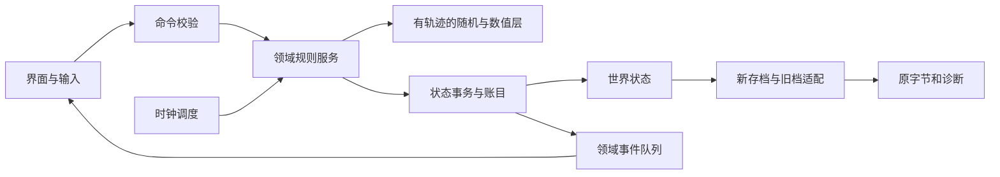

# 00 架构与实现契约

## 目标、模式及模块边界（N）

以单机、可暂停、确定性模拟实现。先交付无界面内核和回放，再接UI；不将DOS原地址或Windows修改器地址作为新引擎数据地址。原资源以640×480逻辑坐标呈现，输入缩放由表现层负责。

|模块|拥有的数据|输入|输出/边界|
|---|---|---|---|
|WorldStore|皇帝、地区、人物、库存、战斗、时钟|已验证MutationSet|状态版本与快照；不直接抽随机|
|Numeric/Rng|种子、整数/转换策略|明确宽度的运算、一次draw请求|结果、seed前后、调用标签|
|ClockScheduler|行动进度、阶段/月/年、计时槽、待处理事件|已完成行动|有序更新计划；UI帧不能推进游戏时间|
|Domestic/Economy|地区生产、工程与账簿规则|时钟触发、治理命令|资源差异、工程/灾害事件|
|Characters|皇帝/官员/后宫/子女规则|行动/年龄/事件触发|属性变化、出生、死亡、任免|
|Diplomacy|交谈会话、条约、贸易、国家关系|用户已确认命令|关系变化、账目、派生事件|
|Army/Battle|调兵、战斗状态、单位、AI|合法部署、单位/谈判行动|伤亡、动作状态、结果；不负责销毁UI|
|Settlement|兵装、领土、人员、历史、战斗移除|唯一BattleOutcome|结算明细、游戏结束事件|
|Persistence|新格式、旧档适配、opaque字节|快照/旧档原字节|导入报告或新文件；加载不依赖画面构造|
|Presentation|画面、动画、对话框、音效|领域事件+只读状态|Command；窗口关闭不直接扣款或删除人物|

## 模块调用关系（N）



## 命令生命周期（N）

```text
execute(world, command, expectedRevision):
  require expectedRevision == world.revision
  eligibility = validate(world, command)
  if not eligibility.ok: return Rejected(reasons), no mutation/no random draw
  candidate = snapshot_or_transaction(world)
  result = handler(candidate, command, tracedRng)
  verify_mode_specific_invariants(candidate)
  commit(candidate, revision+1)
  return Accepted(delta, ledgerEntries, domainEvents, randomTrace)
```

新模式校验失败不得消耗seed、资源或时间。这是N；原版某些成功率入口即使阈值0也耗seed，进入该判定后必须按其规则执行。不要将UI重复点击变成第二次提交：命令含requestId，并保存已结算战斗集合/结果版本。规则中途创建消息属于UI输出，不得导致数据库半提交。

原版存在先改领土再错删官员等部分结算；`legacyReplay`若研究其字节效应，用独立沙盒按原顺序执行并输出诊断，不能把任意内存破坏写进正常游戏状态。

## 关键接口

```text
DeployArmy(targetRegionId, commanderId, units[])
StartDiplomacy(targetRegionId) -> sessionId, allowedOperations
ProposeTreaty(sessionId, treatyKind) -> proposal / rejection
ConfirmProposal(proposalId, accept)
AdvanceAction(sceneId, completedActionId) -> ClockTransition
ActUnit(battleId, side, unitId, action, targetId?)
NegotiateBattle(battleId, actorSide, tacticKind, offer?)
SettleBattle(battleId, resultVersion) -> SettlementReceipt
ImportLegacySave(bytes, sourceVariant) -> World + OpaqueImage + Diagnostics
ExportLegacySave(world, opaqueImage, strategy) -> bytes + CompatibilityReport
```

所有按钮启用条件来自同一个 `canExecute`，提交时再次校验，UI不能自行判断“钱够了”而领域层不判断。领域ID稳定，显示次序单独存储；选将按钮序号、职务77、byte关联序号、人物ID是四种不同概念。

## 确定性与数值接口

`ArithmeticPolicy`至少提供s16/u16/s32/u32、向零除法、signed remainder、定点边界、float32舍入（需要时）；每个公式声明计算中间宽度。原LCG为32位无符号更新、15位输出，成功率门槛按signed16。

重放记录至少包含：规则版本、模式、输入快照哈希、命令序列、seed初值、每次抽样标签和前后seed、输出快照哈希。随机轨迹用“模块.规则.扫描序号”标记；不要假设一个用户操作只抽一次。

## 数据一致性（N）

- 现代模式人物只能有一个有效出战关联；活动战斗的commanderId必须存在。
- 保存时不保存窗口指针、虚表、焦点或UI显示标记。
- 库存增减使用显式的中央/地方/战斗库存位置，不将同一兵员重复计入两处。
- 领土变化统一更新所有权、属地数、职位、国家关系、工程/劳役等依赖；事务成功才显示胜利。
- 计时器和事件必须带触发频率。每帧UI更新、每次事件检查、每阶段、每月、每半年不是同一个周期。
- 模式边界：原版允许的负值、取模、溢出必须由legacy策略决定；modern输入下限/上限作为显式设计并配测试，不能悄悄夹断所有值。

## 日志与失败类型

返回明确错误：`InsufficientResource`、`IneligibleTarget`、`CommanderUnavailable`、`InvalidPhase`、`StaleProposal`、`AlreadySettled`、`LegacyAssociationAmbiguous`、`LegacyAssociationUnresolvable`、`UnknownRule`、`CorruptSave`。报错应带字段/规则ID，但面向玩家的文案不暴露调试地址。

底层算术异常如除0，在legacy诊断中记录原输入与PC；modern不能自行选一个“合理概率”冒充兼容。若采用替代值，必须有产品决策、规则版本和验收用例。

来源：[主规则索引](../rules-analysis/README.md)、[第六轮正常控件与生命周期](../validation-round6/callback/README.md)、[正常累计与调度](../validation-round6/reach/README.md)。本章架构和接口均为新实现设计，原有业务公式由后续章节约束。
