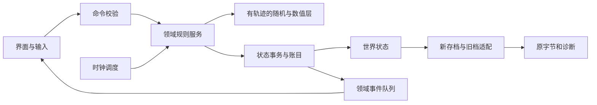

# 皇帝 DOS 功能复刻设计文档 合订本

整理日期：2026-10-15。适用边界和证据分级见[总入口](README.md)。本文件由分章自动合并，修改应回到分章后重建。

## 目录
- [00 架构与实现契约](#00)
- [01 数据模型与字段字典](#01)
- [02 存档与兼容设计](#02)
- [03 内政与经济：可实现的状态和结算契约](#03)
- [04 回合、事件与人物生命周期](#04)
- [05　战争、谈判与战后结算实现契约](#05)
- [06 界面状态机与事件契约](#06)
- [07 外交、贸易与外国事件](#07)
- [08 资源、编码与表现层](#08)
- [09 开发拆分、依赖和待决项](#09)
- [10 验收、回放与证据](#10)

<a id="00"></a>

# 00 架构与实现契约

## 目标、模式及模块边界（N）

以单机、可暂停、确定性模拟实现。先交付无界面内核和回放，再接UI；不将DOS原地址或Windows修改器地址作为新引擎数据地址。原资源以640×480逻辑坐标呈现，输入缩放由表现层负责。

|模块|拥有的数据|输入|输出/边界|
|---|---|---|---|
|WorldStore|皇帝、地区、人物、库存、战斗、时钟|已验证MutationSet|状态版本与快照；不直接抽随机|
|Numeric/Rng|种子、整数/转换策略|明确宽度的运算、一次draw请求|结果、seed前后、调用标签|
|ClockScheduler|行动进度、阶段/月/年、计时槽、待处理事件|已完成行动|有序更新计划；UI帧不能推进游戏时间|
|Domestic/Economy|地区生产、工程与账簿规则|时钟触发、治理命令|资源差异、工程/灾害事件|
|Characters|皇帝/官员/后宫/子女规则|行动/年龄/事件触发|属性变化、出生、死亡、任免|
|Diplomacy|交谈会话、条约、贸易、国家关系|用户已确认命令|关系变化、账目、派生事件|
|Army/Battle|调兵、战斗状态、单位、AI|合法部署、单位/谈判行动|伤亡、动作状态、结果；不负责销毁UI|
|Settlement|兵装、领土、人员、历史、战斗移除|唯一BattleOutcome|结算明细、游戏结束事件|
|Persistence|新格式、旧档适配、opaque字节|快照/旧档原字节|导入报告或新文件；加载不依赖画面构造|
|Presentation|画面、动画、对话框、音效|领域事件+只读状态|Command；窗口关闭不直接扣款或删除人物|

## 模块调用关系（N）



## 命令生命周期（N）

```text
execute(world, command, expectedRevision):
  require expectedRevision == world.revision
  eligibility = validate(world, command)
  if not eligibility.ok: return Rejected(reasons), no mutation/no random draw
  candidate = snapshot_or_transaction(world)
  result = handler(candidate, command, tracedRng)
  verify_mode_specific_invariants(candidate)
  commit(candidate, revision+1)
  return Accepted(delta, ledgerEntries, domainEvents, randomTrace)
```

新模式校验失败不得消耗seed、资源或时间。这是N；原版某些成功率入口即使阈值0也耗seed，进入该判定后必须按其规则执行。不要将UI重复点击变成第二次提交：命令含requestId，并保存已结算战斗集合/结果版本。规则中途创建消息属于UI输出，不得导致数据库半提交。

原版存在先改领土再错删官员等部分结算；`legacyReplay`若研究其字节效应，用独立沙盒按原顺序执行并输出诊断，不能把任意内存破坏写进正常游戏状态。

## 关键接口

```text
DeployArmy(targetRegionId, commanderId, units[])
StartDiplomacy(targetRegionId) -> sessionId, allowedOperations
ProposeTreaty(sessionId, treatyKind) -> proposal / rejection
ConfirmProposal(proposalId, accept)
AdvanceAction(sceneId, completedActionId) -> ClockTransition
ActUnit(battleId, side, unitId, action, targetId?)
NegotiateBattle(battleId, actorSide, tacticKind, offer?)
SettleBattle(battleId, resultVersion) -> SettlementReceipt
ImportLegacySave(bytes, sourceVariant) -> World + OpaqueImage + Diagnostics
ExportLegacySave(world, opaqueImage, strategy) -> bytes + CompatibilityReport
```

所有按钮启用条件来自同一个 `canExecute`，提交时再次校验，UI不能自行判断“钱够了”而领域层不判断。领域ID稳定，显示次序单独存储；选将按钮序号、职务77、byte关联序号、人物ID是四种不同概念。

## 确定性与数值接口

`ArithmeticPolicy`至少提供s16/u16/s32/u32、向零除法、signed remainder、定点边界、float32舍入（需要时）；每个公式声明计算中间宽度。原LCG为32位无符号更新、15位输出，成功率门槛按signed16。

重放记录至少包含：规则版本、模式、输入快照哈希、命令序列、seed初值、每次抽样标签和前后seed、输出快照哈希。随机轨迹用“模块.规则.扫描序号”标记；不要假设一个用户操作只抽一次。

## 数据一致性（N）

- 现代模式人物只能有一个有效出战关联；活动战斗的commanderId必须存在。
- 保存时不保存窗口指针、虚表、焦点或UI显示标记。
- 库存增减使用显式的中央/地方/战斗库存位置，不将同一兵员重复计入两处。
- 领土变化统一更新所有权、属地数、职位、国家关系、工程/劳役等依赖；事务成功才显示胜利。
- 计时器和事件必须带触发频率。每帧UI更新、每次事件检查、每阶段、每月、每半年不是同一个周期。
- 模式边界：原版允许的负值、取模、溢出必须由legacy策略决定；modern输入下限/上限作为显式设计并配测试，不能悄悄夹断所有值。

## 日志与失败类型

返回明确错误：`InsufficientResource`、`IneligibleTarget`、`CommanderUnavailable`、`InvalidPhase`、`StaleProposal`、`AlreadySettled`、`LegacyAssociationAmbiguous`、`LegacyAssociationUnresolvable`、`UnknownRule`、`CorruptSave`。报错应带字段/规则ID，但面向玩家的文案不暴露调试地址。

底层算术异常如除0，在legacy诊断中记录原输入与PC；modern不能自行选一个“合理概率”冒充兼容。若采用替代值，必须有产品决策、规则版本和验收用例。

来源：[主规则索引](../rules-analysis/README.md)、[第六轮正常控件与生命周期](../validation-round6/callback/README.md)、[正常累计与调度](../validation-round6/reach/README.md)。本章架构和接口均为新实现设计，原有业务公式由后续章节约束。


<a id="01"></a>

# 01 数据模型与字段字典

## 三层数据必须分开

1. **磁盘层（S）**：旧SAV逐字节结构，little-endian，BIG5原始文字。包括被加载器跳过的预留字节、重复副本与额外尾字节。
2. **领域层（N）**：稳定ID和命名字段；对象关系用ID，不用数组位置、角色编号或指针。未知字段带来源保留，不能赋予虚构业务名。
3. **表现层（N）**：窗口、焦点、选择索引、对话状态；退出画面不销毁领域人物和军队。

[机器字段目录](data/field-catalog.json)同时给实体、磁盘偏移/宽度、运行时偏移/宽度、转换、名称置信度和证据。地区77项语义见[完整表](data/region-fields.json)。布局映射不等于业务名全部已确认。

## 实体及容器

|实体|原磁盘/运行时长度|原容器|新实现字段|
|---|---:|---|---|
|Emperor|固定头块中的字段 / 非简单dump|单例|属性、资金、十项账、中央库存、事件计数、opaque|
|Official|47 / 37|双向节点12字节，next+8|id、name、role、state、age、attributes、rank、legacyAssociation、opaque|
|Consort|24 / 19|固定34槽|slot、present、name、age、appearance、experience、ability、pregnancyMonths、deathCounter、portraitId|
|Child|21 / 18|动态链表|id、name、age、sex、motherNameRaw/可解析母亲ID、opaque|
|Region|370 / 337|固定31条|slot、ownership、automation、occupations、army、economy、relations、events、opaque|
|Battle|1793 / 1796|8字节节点，next+4|id、sides、commanders、outcome、queueOrder、legacyImage|
|Unit|18 / 18|每方45槽|flags、type、origin、actionState、兵装、training、attack、defense、legacySpecialByte|
|Project|15 / 按尾表解释|固定20槽|slot、region、kind、perPeriodInvestment、required、progress|
|Other5ByteRecord|5 / 节点9|next+5的特殊链|保留有序raw记录，语义未证实前不命名为任务/事件|

不把31号地区一概叫中央国家。当前军事代码把country30用于中国一侧且军力汇总可遍历31条；其他经济/外交遍历通常只取前30。应定义 `RegionSlot(0..30)` 与 `ForeignCountrySlot(0..29)` 两种范围，并在每条规则声明范围。

## 核心标识（N）

```text
OfficialId: u64或UUID，创建后不随排序/任职改变
RegionId: 固定表slot，外部名称由region_names表解析
BattleId: u64/UUID，独立于legacy u16计数器
UnitId: BattleId + Side + Slot(0..44)
RoleCode: u8，77仅是原职务编码（闲散），不是人物ID或按钮索引
LegacyBattleAssociation: {personByte:u8, battleWord:u16, provenance}
```

官员byte0默认FF（D/S），它是旧战斗关联，**不是永久人物编号**。255会与默认FF碰撞；256保存到官员低byte为0，而战斗word仍256。新实现禁止拿byte0作字典主键，也不通过“第几个官员”恢复指挥官。导入旧档时只有唯一可证明匹配才建立commanderId，否则输出歧义诊断。

## 皇帝已确认公开字段

以下为SAV绝对偏移；运行时字段相对于E，而不是文件起点。

|字段|磁盘偏移/宽度|E偏移|语义|
|---|---|---|---|
|年龄|24 / u8|0E|年增长；25为独立状态字节|
|寿命上限/剩余|26、28 / 2|13、15|按使用指令决定signed语义，不能用年龄代替|
|最大/当前体力|30、32 / 2|17、19|行为成本与恢复分别处理|
|智慧/武术/魅力/才艺|34、36、38、40 / 2|1B、1D、1F、21|药效与行动函数交叉确认|
|健康/快乐|42、44 / 2|23、25|与体力不是同一资源|
|资金|72 / 4|45|保留signed32及原字节；KING1=1000000|

账项E+49..71每4字节：具体收入/支出分类与清账顺序见经济/回合章。E+2B8是外交军事相关指标，中文名仍需区分“已确认用途”和“界面名称”；不要误叫健康。完整头部90条复制映射随数据交付，未映射名称保持 `header@offset`。

## 官员与后宫字段

官员：磁盘+7→runtime+2（状态）、+8→+3、+9→+11（年龄）；+10/+12/+14/+16/+18的u16分别→+12/+14/+16/+18/+21（智慧、武力、清廉、忠诚、经验，名称有程序用途与历史标签的不同置信度）；磁盘+20→+20爵位、+21→+1职务、+22→+0战斗关联。名称7原始字节保存，显示解码不修改原串。

后宫存在标志+0必须先判断；空槽残留名称不能创建有效人物。磁盘+15为怀孕月计数，+16为老年死亡概率累计，+17肖像→运行时+18。完整复制转换按映射表，不按等偏移memcpy。皇后能力600是实际样本，不能强行套普通入宫模板。

子女年龄磁盘+7、性别+8（0男、1女），运行时+8/+9。母亲名称从磁盘+9开始；文本关联不保证唯一，现代模式解析失败时保留名称，不随意绑定同名后宫。

## 地区数据分组

所有规则用完整R为基准：R0 KING=C990C、EMPEROR=C99AC，步长337；文件第0字段→R+2。

|组|主要R偏移|实现要求|
|---|---|---|
|所有权/治理|+2/+4|不是同一字段；丢地更新二者及依赖|
|职业人口|+6/+A/+E/+12|四个职业，signed32运算语义由规则约束|
|军事/总量|+22士兵、+24职业合计、+88训练、+8C总人口|不得用总人口替代职业人口或兵员|
|财政/生产|财富积分、贫富等级、积粮、建筑、产出、税账|完整表按字段给偏移；财富可负|
|外交|+B0贸易额度、+B2贸易收入、+B6利润率、关系数组、友好度|磁盘贸易收入s16加载扩展到运行时s32|
|事件|+D3内乱、+D5暴动、+11B饥荒|旧“特殊工程”别名撤回|
|贡品/军力|+12D计数、+12F敌军力基数|调用频率与字段宽度独立|

库存用 `InventoryLocation` 区分中央、地方、战斗在途；数量字段保持原宽度，累加使用明确中间宽度。新模式不允许重复把在途兵计入可部署兵。

## 原始数据与模板

- 已有KING1–3是游戏进度，不是出厂新局；KING4/5原附件仅3字节空槽标记。
- EXE模板：30位历史美女、41条和100条人物模板、地区/药材名。只有用途证实后才用于“生成官员/后宫”；两套人物模板不能根据外形猜类别。
- 新局初始世界快照尚未完整恢复，建议阶段一只承诺“导入已验证旧档开局”。现代原创新局参数必须独立版本化，不能命名为原版初值。

来源：[存档报告](../save-analysis/README.md)、[布局复制证据](../save-analysis/layout_evidence.json)、[地区语义](../rules-analysis/region-semantics.json)、[第五轮关联序号](../validation-round5/association-reach/README.md)。


<a id="02"></a>

# 02 存档与兼容设计

## 外层布局（S，little-endian）

```text
prefix[10]
fixedHeader[746]
officialCount:u16
officials[officialCount][47]
harem[34][24]
childCount:u16
children[childCount][21]
regions[31][370]
battleCount:u8
battles[battleCount][1793]
other5Count:u16
other5[other5Count][5]
fixedTail[1523]
optionalPortraitCopies[33]
optionalExtra[remaining]
```

`officialCount`绝对偏移0x2F4，官员始于0x2F6。后续偏移必须递推，不能硬编码攻略中的后宫或药材绝对地址。令O、C、B、L为各数量：

```text
haremStart = 0x2F6 + 47*O
childCountPos = haremStart + 34*24
regionStart = childCountPos + 2 + 21*C
battleCountPos = regionStart + 31*370
other5CountPos = battleCountPos + 1 + 1793*B
fixedTailStart = other5CountPos + 2 + 5*L
parsedEnd = fixedTailStart + 1523
```

原解析器的 `tail_offset` 是战斗数量开始的位置，而 `tail_b_offset` 才进入后续固定尾块；实现时按本节明确命名，不能仅凭JSON旧键名猜区段。

## 导入过程（N，对照原格式）

1. 先识别3字节 `1\r\n` 空槽，不把它当损坏完整世界。
2. 检查每次读取的剩余长度；数量乘法使用不会溢出的宿主宽度，先验证所需长度再分配，限制文件总大小。
3. 保存原字节、每条记录起点、区段顺序和未知字段，随后依照复制映射生成领域对象。
4. 文字保存raw bytes、解码文本及解码异常位置；BIG5损坏字节可显示替代符，但不回写替代字符覆盖原数据。
5. 读取正式肖像使用20字节数组，再把未消费尾部33字节记为两个冗余副本状态。多余字节单独保留。
6. 检查数量、枚举/兵种、部队有效槽、关联冲突；合法旧异常是诊断，不自动改档。新模式修复需要显式迁移报告。
7. 不在纯解析过程中自动推进地区或时间。原界面读档有额外地区更新（S），若要兼容这种副作用，由 `LegacyLoadRestore`命令单独执行并记录，避免解析器、UI和世界各更新一次。

## 磁盘与内存转换

官员47→37、后宫24→19、子女21→18、地区370→337。必须逐字段转换；磁盘记录中的预留字段不是可删除填充。地区贸易收入磁盘s16→运行时s32，因此逆写需要检查s16可表示性：

- `preserve`：完全未编辑记录按原始字节输出。
- `strictCompatible`：编辑值不能表示时拒绝导出并列出字段；不能静默截断。
- `legacyTruncate`：仅显式选择时按原写入低位，报告实际落盘值。

## 战斗记录

1793字节不是1796字节运行时B整体。原加载分32块；两组810字节映射到B+0x65与B+0x3CE，每组45×18。中间控制字段及末尾多个u16必须按加载/保存序列独立存储，原加载可能连续写同一运行时+0x702；不要只保留最终覆盖值后丢掉前面的磁盘数据。

序列与长度见[尾部分块数据](../save-analysis/tail_layout_evidence.json)。旧附件的三份完整存档没有活动战斗，解析器战斗边界的合成样例验证与DOS新建战斗快照是不同证据，不得混称附件真实战役档。

u8当前战斗条数与u16累计关联计数不同。新模式可以有更大队列；导出旧格式若当前活动战斗>255，应拒绝，不能低byte截断后丢失节点。

## 固定尾与33字节

固定1523字节的依次分块：u16、8×u16药材、30×12数组、20×15工程、四u8、100字节、30字节、651字节、六u8、u16、u8、u16、20字节、两个u8、20字节、三个u8、4字节。具体字段来源按[分块表](../save-analysis/tail_layout_evidence.json)及解析导出tail_sections，未知数组保持有序raw。

33字节是正式20字节肖像使用数组的前13字节副本，再完整20字节副本。三个程序保存写出，加载不消费（S/D样本）：

```text
copies = portraitUsed[0:13] + portraitUsed[0:20]
```

读取状态为matches/differs/missing/incomplete，不把副本差异当校验和失败。`preserve`保留原尾，`canonical`重新生成副本但必须报告改写；追加Extra字节不能悄悄抛弃。

## 新格式（N）

建议以版本化JSON/CBOR/数据库快照存领域结构，并附可选旧格式OpaqueImage；旧档输出是适配层，不把旧固定长度限制扩散到所有新功能。

```text
SaveEnvelope {
 formatVersion, rulesetVersion, compatibilityProfile,
 sourceVariant, sourceHash, revision,
 world, rngSeed, pendingEvents, settledBattleVersions,
 legacyOpaque?: {sourceBytes, recordIdentityMap, importDiagnostics}
}
```

写入先生成完整临时文件、校验再原子替换，并保留上一版本；不覆盖输入原档。旧SAV的完整随机seed恢复/初始化契约尚未在本套资料收拢，不能把固定尾最后4字节猜成seed；原DOS对照用外部记录的seed初值。新格式必须显式保存seed。稳定ID不随导入列表排序变化；同名人物分别保留。新档不保存游戏窗口状态指针，但可以保存“待显示事件ID”以恢复交互。

## 验收

- O=40/83/85的KING1/2/3无编辑导入导出逐字节一致，SHA-256相同。
- 新增一官员时后宫及后续位置恰后移47；新增子女后移21。
- 截短任一可变区段应返回具体区段/期望长度，不越界读、不分配巨量内存。
- 插入一条1793字节战斗后两组45槽正确、后续尾位置恰+1793。
- s16贸易收入-1导入为s32 -1；导出40000严格模式报错，显式截断模式报告-25536。
- 尾33不一致不改变领域状态；无编辑保留异常尾；canonical重新生成可验证的33字节。
- 空槽、非BIG5文本、未知字段、未匹配的关联序号都必须可诊断且可保留原数据。

来源：[存档报告](../save-analysis/README.md)、[解析器](../save-analysis/parse_saves.py)、[可编译磁盘定义](../code-analysis/serialized_structs.h)、[尾33核实](../rules-analysis/tail33/README.md)。


<a id="03"></a>

# 03 内政与经济：可实现的状态和结算契约

本章按系统行为组织，目标是实现可与原版逐字段比较的内政内核。它不把修改器标签、攻略建议或理想化公式当作原版逻辑。时间入口与人物规则见 [04 回合与人物](04-turns-and-characters.md)。

证据等级：**[DOS]** 为 DOSBox-X 中原始程序函数执行；**[静态]** 为原始指令直接确认；**[指令模拟]** 为有限解释器执行原指令，不能代替 DOS；**[待证]** 为尚缺公式或正常入口；**[建议]** 为复刻实现方案，不声称原版如此。下列函数地址除特别注明外属于 KING；EMPEROR 不可直接复用 KING 地址。

统一总规范标记映射：**D=[DOS]，S=[静态]，I=推断，N=[建议]**；[指令模拟] 是 S 级解释器核查，不升级为 D；[待证] 不能作为已知原版公式。模式名统一为 **legacy/modern**。原不安全内存行为仅影子诊断，UI 重绘不提交业务或重复推进时间。

## 1. 数值与状态约定

- `D(a,b)`：有符号整数除法向零截断；`UD(a,b)`：对应指令宽度的无符号除法。不要使用语言默认的负数向下取整。
- `s16/u16/u8` 明确读入符号与低位写回；x86 32 位乘加与 16/8 位存储的溢出应由兼容数值层实现。把所有字段改成浮点或任意精度整数会改变边界行为。
- 完整地区对象 `R` 步长 337 字节；`R+0x02` 才是统治标记。旧存档布局表以统治标记为起点，偏移要减 2，不能直接照抄。
- 地区 `0..29` 为地区业务循环；槽 `30` 在相关军事路径用作中央特殊槽，其完整经济/国家身份不扩大推断。每个循环是否包含中央须分别实现，不能统一遍历 31 槽。
- `E` 为皇帝/国家主状态对象。`E+0x45` 是资金，`E+0x49` 本次半年税收，`+0x4D..0x71` 是收入/支出分类区。
- 原版灾害进度、计数、人口分母等不全有防零/防溢出。建议核心返回结构化 `CompatibilityFault`，不要在主机上执行未定义除法；legacy 模式保留可重现的低位结果，modern 模式才增加保护。

来源：[内政证据](../rules-analysis/domestic/README.md)、[地区字段导出](../rules-analysis/region-semantics.csv)、[存档解析器](../save-analysis/parse_saves.py)。

### 最小数据模型

|字段|原始位置/宽度|实现含义|
|---|---|---|
|playerControlled|R+02 s16|0 非玩家；勿擅改全部非 1 值为非法|
|governanceMode|R+04 s16|3 触发每月自动开发|
|workers[农,牧,商,工]|R+06/0A/0E/12 s32|四职业人口，独立于下述分母|
|corvee|R+1E s16|劳役人口；精确界面用词尚待证|
|soldiers|R+22 s16|地区兵员|
|productionPopulation|R+24 s32|产出与损失分母；不能用实时职业和替换|
|capacity[4]|R+28/2C/30/34 s32|行业开发容量|
|development[4]|R+40/44/48/4C s32|农田、牧原、运输、矿区开发量|
|efficiency[4]|R+54/56/58/5A s16|四行业效率|
|statusDisplay|R+5C s16|用于显示的状态码；不是唯一状态机|
|wealthLevel|R+5E s16|贫富等级 0..4|
|metrics[6]|R+6E/70/72/74/76/78 s16|安定、治安、体能、营业、积粮、防御|
|loyalty|R+7A s16|民忠|
|training|R+88 s16|训练，阶段推进会衰减|
|totalPopulation|R+8C s32|另一人口聚合字段，勿与 +24 合并|
|loyaltyExtra / loyaltyInput|R+94/96 s16|额外修正、公式输入；后者中文业务名待证|
|developmentTarget / migrationTarget|R+9A/9B u8|1 农、2 牧、3 商、4 工|
|yieldPerCapita|R+9C s16|半年计算结果|
|taxConversion|R+A4 s16|税额乘数；界面名待证|
|wealthPoints|R+A6 s16|财富累计积分，可负；不是可直接消费的地区现金|
|pendingRelief|R+CE u16|阶段结算分摊入账后清零|
|civil / riot / famine|R+D3/D5/11B u8|0 无，1 活跃，2 已结束待报告|
|civilTrigger / riotTrigger|R+D2/D4 u8|累计触发门限|
|disasterKind / progress|R+D7/D8 u8|灾害类型、解除门限进度|
|yieldRemain[农,商,牧,工]|R+11F/120/121/122 u8|半年剩余产出百分数，注意顺序|
|yieldPenalty|R+128 u8|半年产出累计扣减|
|famineRecovery|R+12E u8|饥荒结束门限累计|
|militaryBurden|R+12F s32|外邦兵力/军费估值，最低 1|
|recruitRatio|R+136 u8|外邦按总人口推兵比例|

字段命名订正以 [第三轮特殊字段](../validation-round3/special-fields/README.md) 为准：内乱/暴动/饥荒不可再称“特殊工程”；民忠读的是 `94/96`，不是 `9E/A0`。

## 2. 半年生产、税收、财富与人口

### 入口和前置条件

**[静态]** `settleHalfYear()` 对地区 0..29 中玩家统治者执行，调度在跨月后更新的月份 0 或 6；仅从上旬跨到下旬不会再执行。它晚于月支出及年更新，且在阶段推进后执行。不是每月收同一笔税。入口 `123E6`。

### 第一遍：产出与税收

严格按地区索引顺序；先清 `E+49`。每地区：

```text
for each remainByte: remainByte = u8(remainByte - yieldPenalty)
a = D(e农*n农,100) * m农
b = D(e牧*n牧,100) * m牧
c = UD((D(e商*n商,100)*m商)*(体能+50),100)
d = D(e工*n工,100) * m工
q = productionPopulation != 0 ? UD(a+b+c+d, productionPopulation) : 0
q = min(s16(q), 2*loyalty)
yieldPerCapita = s16(q)
remain[4] = 100; yieldPenalty = 0
wealthDelta = q - D(q*globalTaxRate,100) - (wealthLevel*15+60)
wealthPoints = s16(wealthPoints + wealthDelta)
if wealthPoints < -100: wealthPoints = -99
stepWealthLevel(region)
tax = D(D(productionPopulation,100)*q*globalTaxRate*taxConversion,100)
E.taxHalfYear += tax
```

随后 `E.money += E.taxHalfYear`。商人的加成读取 **体能 +50**，不是营业；分母为 `R+24`，不是总人口 `R+8C`。税额采用贫富升降前计算的 `q`。byte 产出扣减无下限钳制，低值减大值会回绕。无符号除法细节及乘积溢出须对照 [halfyear.asm](../rules-analysis/domestic/halfyear.asm)，上式不许擅自交换除法次序。

`stepWealthLevel()` **[静态]** 单次最多变动一级：

```text
UP   = [60,65,70,80,100]
DOWN = [-99,-40,-50,-60,-70]
if wealthPoints >= 0:
  if level < 4 and wealthPoints >= UP[level]: wealthPoints -= UP[level]; level++
else:
  if level != 0 and wealthPoints <= DOWN[level]: wealthPoints -= DOWN[level]; level--
```

不使用 `while` 一次连升数级。原始阈值见 [constants.json](../rules-analysis/domestic/constants.json)。

### 第二遍：人口增长及原版共享局部变量

**[静态 + 指令模拟]** 两遍循环不能合并。人口循环开始时，`sharedX` 是第一遍**最后处理的受统治地区**的 `wealthDelta`；人口循环中积粮达到 100 的地区将其改为 100，后续积粮低于 100 的地区沿用该值：

```text
for region in controlledRegionsInIndexOrder:
  if region.foodStockMetric >= 100: sharedX = 100
  r = D((region.loyalty + D(s16(sharedX),2))*15,10)
  for workerCount in region.workers:
    workerCount += D(D(workerCount,100)*s16(r),100)
```

这不是按本地区积粮直接计算增长的正常化公式；它是现有指令反映的原版缺陷。未有受统治地区时本地变量的初始值范围未充分验证，禁止虚构稳定值。建议把 `LegacyPopulationCarry` 显式建模，modern 模式可另设规则开关，不可悄悄修正兼容算法。此处不立即重算所有人口聚合字段。

验收数据来自 [population-verification.json](../rules-analysis/domestic/population-verification.json)：四行业初始各 1000、民忠 40；最后财富变化 -40，积粮 [20,80] → 各地区职业均 1003；积粮 [20,100,20] → [1003,1013,1013]；最后变化 60、积粮 [20,80] → 均 1010。它们是指令模拟通过，尚非 DOS 全半年端到端通过。

## 3. 每阶段内政推进

`advanceRegions()` **[静态]** 由阶段边界调用 `13825`。读档恢复也会调用一次，必须复用同一有副作用函数。完整顺序以 [regional_tick.asm](../rules-analysis/domestic/regional_tick.asm) 为准：

1. 若资金负且月份不是 5/11，执行资金不足补征：国家 `E+2BE--`，各受统治地区财富积分 -3、最低 -99，再判贫富；`Σ(productionPopulation*3)` 入国家 `+8E/+4D/+45`。
2. 顺序遍历地区。非玩家仅走外邦军事负担重算后跳过玩家损失路径；玩家处理内部计数、内乱、暴动、饥荒、灾害、训练、增援、分摊入账。
3. 推进 20 槽工程，再做工程表整理。

`R+134` 非零则自增，其中文意义未证，不可删去。正因为先后顺序可交互，报告消息的清账与纯显示必须分开。

### 灾害和民变状态机

状态显示枚举 **[静态]**：0 安定、1 旱灾、2 水灾、3 蝗害、4 瘟疫、5 严寒、6 地震、7 饥荒、8 战场、9 内乱、10 暴动、11 全国抗税暴动。灾害与民变拥有各自活跃字节，不可只存一个枚举。

内乱/暴动检查前置：受统治、对应状态 0、`s16(D(soldiers*100,productionPopulation)) <20`；内乱还要求安定 <50，暴动要求治安 <50。符合则相应触发 byte `+10`，调用随机门；首个成功地区设置状态 1、概率归零、显示 9/10、`loyaltyExtra--`，皇帝快乐 -5，清本事件 5 项损失账，立即返回。分母未防零；阈值相等不触发。

每阶段内乱/暴动活跃损失：死亡 `D(P,1000)`，转劳役 `D(2*P,1000)`，四项开发分别减 `D(development,1000)`。人口扣减调用原分摊算法，转劳役同时增加 `R+1E` 与国家 `E+A2`。内乱产出扣减每期 **1**，暴动 **2**；相应损失账累加，并执行建筑损毁。内乱账 `DF/E3/E7/EB/EF`；暴动账 `F3/F7/FB/FF/103`，依次死亡、流民/劳役、开发、产出、建筑。旧内政摘要的内乱账和产出扣减已被第三轮订正。

解除条件：状态 1 且兵占比 **>25** 或相应安定/治安 **>60** → 状态 2、显示 0；恰好 25 或 60 不解除。状态 2 在事件消息消费时清回 0，而不是立即恢复可触发。不要把 2 当永久完成态。

饥荒触发检查遍历 30 地区，**不检查统治权**：`famine==0 && disasterKind!=0 && disasterProgress>=30`，以进度作门限；首个成功置饥荒 1、显示 7、恢复进度 0、清账 `143/147/14B`。但非玩家不会进入上述玩家阶段损失段。

饥荒阶段损失：死亡 `D(5*P,1000)`、转劳役 `D(P,100)`、四开发各减 `D(5*value,1000)`；分别累计上述三账。结束进度 byte `+8` 后调用门，成功置状态 2、显示 0，报告消费再清 0。

灾害阶段处理：

|灾害类型|死亡‰ / 转劳役‰ / 开发损失‰|产出扣减|每阶段解除进度增量|
|---|---|---:|---:|
|1 旱灾|1 / 5 / 8|1|6|
|2 水灾|2 / 5 / 8|1|8|
|3 蝗害|此分支不调用人口/开发损失子程序|4|8|
|4 瘟疫|4 / 5 / 4|1|9|
|5 严寒|1 / 2 / 5|2|9|
|6 地震|本段清 D7 及 DE|不据此推定其他入口无损失|11（原始表）|

损失以当期字段计算并累计死亡 `107`、劳役 `10B`、开发 `10F`；累计产出罚值同时记 `128/113`。类型 6 清标志与后续进度路径应按指令顺序实现，不用此表代替控制流。解除门成功调用 `3B55E`。类型 3 的其他影响、地震一次性损失不能以本段没有调用损失函数推定为零。

来源：[第三轮状态机](../validation-round3/special-fields/README.md)、[灾害损失指令](../rules-analysis/domestic/disaster_loss.asm)。这些损失尚未全部逐项 DOS 差分；章节给出静态算法，不标为全部动态通过。

### 职业人口扣减

`deductWorkers(loss)`：先 `D(loss,4)` 均摊四业，再把余数轮流从正数行业扣除；低人口行业存在先清零、再读取旧值的指令次序问题。普通人口范围可按原片段恢复，但极小人口夹具尚待 DOS 核验；不得以“总人口守恒”断言此缺陷路径一定正确。实现时将其做独立 `LegacyWorkerDeduction`，参考 [regional_helpers.asm](../rules-analysis/domestic/regional_helpers.asm) 的 `3B3DD`，为异常分支保留兼容回放测试。

### 训练、增援、分摊财富

- 地区训练 >0 则每阶段 -1。中央训练命令开关 `CC9B5==1` 消费一次；有兵时增量为 `D(官员+0E*10 + 官员+12*10 + 皇帝魅力*4,中央兵数)+2`，无兵为 0，最高 100。官员原始字段 +0E/+12 不能在字段证据不一致时凭直觉改名。
- 每地区 `E+25C+i*2` 非零表示待增援，先清标记，再把训练改为 `D(oldTraining*oldSoldiers + pendingSoldiers*centralTraining,oldSoldiers+pendingSoldiers)`。分母原版无零保护。中央兵和装备按 `E+B8+i*14` 的 7 个 word 扣除，地区对应增加。保留此时训练已先 -1 的顺序。
- `pendingRelief!=0` 且 `P!=0`：财富积分加 `D(u16(pendingRelief),P)`；该字段随后归零，并判一次贫富。小额分摊被整数截断为 0 仍会消费待入账额。

## 4. 每月维护及开发

月更新仅对受统治且治理模式 3 的地区自动开发：找四行业效率最小值，平局保留较早行业；设开发方向后调用开发辅助，再以官员效果增加民忠、上限 100。`developmentTarget==1..4` 时对应开发量加 `8A86D(regionId,mode)` 的返回值并钳到容量；该官员任务效果函数的全部分支不在现有证据中，必须作为 `DevelopmentEffectProvider` 待补，不能造固定增量。

人口转业辅助：原始迁移率 3；通常分母 100，特殊模式 `CCC85!=0` 时为 10。先分别求 `D(n_i*3,denominator)`；指定目标 1..4 时，从其余三业扣对应量，目标加三者之和，目标自己的转移量不用。正常非负输入下职业总量守恒。开发和迁移函数本身不等于所有菜单操作的费用/耗时；命令提交入口尚需单独对应。

月维护 `13109` **[静态 + 指令模拟 + DOS 对应函数 13121]**：

```text
P = sum(玩家地区 productionPopulation)
N = sum(玩家地区 soldiers) + centralSoldiers
buildings = sum(玩家地区七建筑等级 * 模板月维护)
          + sum(16特殊设施中状态恰为1者 * 模板月维护)
population = D(P,2)
office = 40*在职人数 + 20*散官人数
nobility = sum(官员爵位工资)
corvee = 4*E.corveePopulation
army = 4*N
money -= buildings + population + office + nobility + corvee + army
ledger[6D,51,55,61,5D,59] += 对应项
```

资金可负，无余额不足拦截。在职/散官按官员职位字节，散官 `0x4D`；职位工资与爵位工资各计一次。爵位 [王,公,侯,伯,子,男,无] 工资 [600,300,160,80,30,10,0]。前六建筑月维护各 10，行宫 200；特殊设施只在状态 **==1** 计维护，不能用 `!=0`。

模板 23 条、每条 22 字节，应直接导入 [building-templates.json](../rules-analysis/turns/building-templates.json)。其中 `dword_4/8` 尚未全部证明等于菜单造价/总工期，禁止仅凭数值命名成“建筑售价”。

## 5. 工程队列

工程 20 槽，每槽 15 字节：`region:u8, kind:u8, percent:u8, increment:s32, required:s32, accumulated:s32`。地区值 255 空闲、100 待移除。普通种类 0 市集、1 义仓、2 寺庙、3 衙门、4 城墙、5 校场、6 行宫；>=7 为特殊设施。

`advanceConstruction()` **[静态]** 每阶段对有效记录 `accumulated += increment; percent=u8(D(accumulated*100,required))`。累计 >=需求即完成：普通建筑对应等级 word +1，未见等级上限钳制；特殊设施对应 `E+28A+kind*2=2`，另加模板效果到 `E+2C0`。完成后地区标记设 100，每阶段投入量加回 `E+9A`，再由 `39D0E` 压缩全表，空末槽补 255。不能把完成时的状态 2 误当维护判断的 1。

工程创建接口建议：`requestConstruction(region,kind,allocation)` 返回合法性与报价预览，再 `commit` 扣资源并插槽。**[待证]** 原菜单对重复建设、余额、最高等级、工程冲突的全部拦截条件与即时扣款尚未恢复；实现不得把上述建议校验冒称原版。当前可稳定复刻的是既有队列的推进、完成与整理。

建筑损毁 `3BB5B`：仅前六类，不含行宫；总量非零才处理，按原随机门决定损毁机会，随机选类最多 29 次找非零建筑，成功减 1 并累加损毁数。不要替换成每类独立均匀分配；调用次数影响后续随机序列。

另有 `93×7` byte 计时矩阵，独立于工程：旧值 100 跳过，>=3 减 1，旧值 2 调 `14F20` 后清 0，旧值 1 不推进。行的业务归属未完整对应，不可解释成 93 地区或 20 工程槽。

## 6. 民忠与外邦军事估值

民忠重算 **[静态]**，参考 `3B637..3BA74`：先按国家 `E+44*5` 扣体能、最低 0，再加已完成特殊设施对六指标的效果，之后：

```text
taxPart = (50-tax)*2
officerPart = wisdom<59 ? 0 : D((wisdom-59)*25,10)
average = min(D(安定+治安+体能+营业+积粮+防御,6),100)
loyalty = D(taxPart*35 + officerPart*15 + input96*10
            + average*20 + D(wealthLevel,4)*20,100)
loyalty += E.modifier2BE + extra94
loyalty = max(loyalty,0)
```

这里只证明下限，不为该公式擅加统一 100 上限。财富项是先除 `level/4`，0..3 均为 0，4 才贡献；原版粗粒度取整须保留。特殊设施逐个指标加成表应按原助手及模板补足，未核实部分暂不填数。

非玩家地区 `3BA79`：`soldiers=word(D(totalPopulation*recruitRatio,100))`；`burden=D(soldiers + D(unknown8A*soldiers,50) + D(training*soldiers,50),50)`，结果 0 改 1。此为外邦估值/征兵路径，不能使玩家地区每阶段按该比例凭空补兵。

## 7. 实现接口与验收清单

建议接口均接受显式 `WorldState, RuleProfile, RandomStream`，返回逐字段 `MutationLog` 与事件意图；UI 只发命令和消费事件，不直接改地区。接口：`settleHalfYear`、`advanceRegions`、`settleMonthlyExpenses`、`stepWealthLevel`、`advanceConstruction`、`moveWorkers`、`recomputeLoyalty`。随机门统一用 [04](04-turns-and-characters.md) 的实际 LCG，禁止每个子系统自建随机源。

|验收|输入 / 操作|期待|证据等级|
|---|---|---|---|
|贫富不连升|level 0, points 200，调用一次|level 1, points 140|静态，待移植测试|
|边界解除|活跃内乱，P10000，安定60，兵2500/2600|前者保持1，后者2|静态预测，未冒称DOS|
|低额赈济|P10000，pendingRelief9999|财富增0、待入账归0|静态预测|
|月支出合成|P1501，地方兵126，中央13，民夫11，一王在职、一男散官；建筑等级[1,2,2,2,1,1,0]及首特殊设施1|六项[290,750,60,610,44,556]，合计2310|指令模拟通过|
|月支出原档夹具|资金1000000，第三轮原档受控执行|扣19924，剩980076，六分类与记录一致|DOS原函数通过|
|建设恰完成|required100, accumulated90, increment10|percent100、完成效果一次、槽压缩|静态预测|
|转业守恒|四业1000，目标农，普通模式|农1090，其余970，总4000|静态预测|
|跨地区人口carry|见第2节三组输入|1003/1013 等，不随各自积粮理想计算|指令模拟通过|

DOS实测依据：[第三轮运行报告](../validation-round3/runtime/README.md)。完整半年贸易收支、投资创建/回收、全部内政菜单费用、特殊设施效果枚举及官员开发效果仍是功能复刻的显式待补项；现阶段不能仅凭本章宣称经济系统 100% 还原。


<a id="04"></a>

# 04 回合、事件与人物生命周期

本章定义复刻调度器和人物系统的接口、执行顺序与边界。**[DOS]** 指实际 DOSBox-X 原函数执行；**[静态]** 指原始机器指令确认；**[指令模拟]** 指解释执行有限原指令而非 DOS；**[建议]** 指实现方案；**[待证]** 不得当已知原版逻辑。经济和地区函数契约见 [03 内政与经济](03-domestic-and-economy.md)。除特别注明，地址属于 KING；运行时使用 EMPEROR 须重新定位。

统一总规范标记映射：**D=[DOS]，S=[静态]，I=推断，N=[建议]**；[指令模拟] 是 S 级证据的解释器核查，不升级为 D；[待证] 代表不能实现为已知原版规则。规则模式统一称 **legacy**（安全复现已证原行为）与 **modern**（显式改良）。原不安全堆/越界写仅影子诊断，绝不在宿主执行。UI 重绘不得重复提交时间或业务；只有显式命令提交、事件消费和 legacy 读档恢复可触发对应业务。

## 1. 时间模型与行动提交

### 状态

|字段|KING 原始位置|取值与作用|
|---|---|---|
|yearIndex|C9840 byte|年序号，年界递增|
|monthIndex|C9841 byte|0..11，界面月份需 +1|
|halfMonth|C9842 byte|0 上旬、1 下旬；原程序没有中旬|
|actionProgress|C9843 byte|阶段内行动累计，通常 0..2|
|sceneId|场景对象字段|行动耗时由原始场景表索引|
|specialMode|CCC85 byte|多处改变规则；精确菜单选项未证，不擅称难度|
|eventScanCursor|事件对象+29|1..60，分批扫描而非一次全触发|

**[静态]** 原版一年 12 月、每月两阶段，共 24 阶段；行动 3 个单位通常推进一阶段，但不是每个菜单点击都加 1。原表场景 0..27 基础耗时：

```text
[1,1,1,1,1,0,1,1,0,0,1,1,0,0,0,0,0,0,1,0,1,1,0,0,0,0,0,0]
```

scene 13/14 将进度直接设 3；specialMode==1 且 scene12 额外加 3。场景中文名尚未全部核验，不能把未识别编号改成自猜菜单名。耗时与体力/寿命是不同维度，不能由这张表推出每次耗体力。

### 普通行动结算顺序

入口 KING `11F65`，EMPEROR 动态对应 `11F7D`。**[静态；部分 DOS]**：

```text
onActionCompleted(scene):
  resetHalfYearLedgerIfApplicable()     # 月0或6，且上旬；每次调用都检查
  clearPendingEventCountAnd10Slots()
  applySceneTime(scene)
  if actionProgress < 3: return
  actionProgress = 0                    # 多出的进度丢弃，不循环补推
  clear(E.flags2C2, E.flags2C3)
  halfMonth += 1
  advanceTimerMatrix()                  # 13630，93×7计时
  advanceRegionsAndConstruction()       # 13825，内政章
  if halfMonth < 2: return               # 1205F直接返回；未跨月不做半年结算
  halfMonth = 0
  monthIndex += 1
  onMonthlyUpdate()                     # 120C7，含月支出
  if monthIndex >= 12:
    monthIndex = 0
    yearIndex += 1
    onAnnualUpdate()                    # 133C8，年龄等
  if monthIndex == 0 or monthIndex == 6:
    settleHalfYear()                    # 123E6
```

半年检查只位于**跨月路径**；`1205F` 在仅跨半月时直接返回。因此一月/七月上旬进入下旬不会再次半年结算，进入一月/七月时才结算。此处以原 [11f65.asm](../rules-analysis/turns/11f65.asm) 的跳转为准，不能将旧报告的扁平条目误抄成任意阶段推进都执行半年结算。分类账归零在行动开头：一月/七月上旬多次行动会反复归零 `E+4D..71` 十个 dword，但不清资金 `E+45`。legacy 模式须保留该统计缺陷。

年末精确顺序：旧年的地区阶段推进 → 月更新及工资 → 年龄更新 → 新年半年生产/税收。把税收提前可能使原本负资金路径消失。

### 强制到月界

`advanceToNextMonthBoundary()` 对应 `13485`，**[静态 + 指令模拟]**：上旬时执行两次阶段业务，下旬时一次，随后月/年/半年顺序同上，最后行动进度 0。主循环特定 scene3 状态和 scene15/18 成功分支调用它；哪些 UI 文案对应这些场景仍待完整映射。不可用该函数解释所有读档。

来源：[时间调度报告及 11 个原指令解释用例](../rules-analysis/turns/README.md)、[calendar-verification.json](../rules-analysis/turns/calendar-verification.json)。

## 2. 月、年与事件不是同一个周期

### 月更新

`onMonthlyUpdate()` **[静态]** 顺序职责：

1. 非零 `CC9B6` 计时状态产生官员相关效果并倒计数；减至 0 清 3 个关联计时字节。精确任务业务名待证。
2. 遍历全部 34 后宫槽，怀孕计数非零就 +1，不另外检查占用。
3. 遍历受统治且治理模式 3 的地区，自动选择最低行业效率开发，再按官员效果增加民忠、上限 100。
4. 月支出 `13109`，允许资金负，详见内政章。
5. 清到期行动/官员调用标记。17 项数组中索引 1/2/15/16 按月份匹配，3..14 按 `month/3` 季度匹配。索引业务名未全映射，应保留原索引及原始值。

### 年更新

`onAnnualUpdate()` **[静态]**：皇帝年龄、34 槽后宫年龄、官员链表年龄、子女链表年龄各 +1；未先检查空后宫槽，所以残留字节也增长。全为 byte，自增后低 8 位回绕，不饱和到 255。非受统治且贸易额度非零地区，贸易年数 word +1。年更新本身不等于疾病/死亡检查。

### 分批事件扫描

事件表 `C8230` 共 61 条、每条 5 个 word（第 0 条重复默认）；业务事件为 1..60。原始数据保存在 [tables.json](../validation-round3/special-fields/tables.json)。记录 +2 与当前 `actionProgress` 相等才检查，否则游标递增。命中一个事件后写事件对象 +1A、置 +26 为 1，把 +0/+4/+6/+8 四个 word 交给显示构造，然后停止本轮扫描。消费后再继续扫描。

事件 3 内乱、4 暴动、5 全国抗税、6 饥荒、7..11 旱灾/水灾/蝗害/瘟疫/严寒要求进度 0；事件 12 地震要求进度 2。其他外交/人物事件不可默认每月各调用一次，必须读取其表行及上层游标。

**[建议]** 设计 `EventScanner.next(state,cursor)` 返回 `NoEvent` 或 `PendingEvent`；保存 cursor 和消息待消费状态。消息产生、UI 展示、业务消费三阶段不要合成一个函数：例如民变状态 2 的清零发生在报告消费，出生则在命名确认才真正插入孩子。

## 3. 随机流统一契约

**[静态 + 第四轮 DOS 概率门验证]** EMPEROR `8A7FE(dummy,threshold)`、状态 `C9030`：

```text
seed = u32(seed * 0x41C64E6D + 0x3039)
rand15 = (seed >> 16) & 0x7FFF
roll = rand15 % 100
success = roll < s16(threshold)
```

KING 对应概率门 `8A70E`。threshold 为 0/负数必失败，100 及以上必成功；仍消费一次随机。严格 `<`，不是 `<=`；不在门内部将阈值改写为 0..100。计数字节回绕与 signed16 门限须分别处理。

15 位输出模 100 有偏差，roll0..67 每个对应 328 个输出，68..99 对应 327 个。所谓“20%”是阈值名，输出空间比例为 20.01953125%，不能换成现代浮点均匀随机后声称种子可重放。

**[建议]** 所有生产、民变、人物、战斗共用同一个可注入 `RandomStream`；记录 `seedBefore,roll,threshold,seedAfter`。调用提前返回也应精确保留是否消费随机。资料：[第四轮概率门](../validation-round4/negotiation/README.md)、[确定余数种子](../validation-round4/negotiation/seeds.json)。

## 4. 皇帝状态与属性辅助

E 为主对象，不是磁盘起点。**[静态]** 必须用逐字段导入映射：

|业务字段|E 运行时|存档绝对字节|类型|
|---|---|---:|---|
|年龄|0E|24|u8|
|身体/终局状态|0F|25|u8，独立于年龄|
|恢复/终局子状态|10|待按加载映射|u8|
|寿命上限 / 剩余寿命|13 / 15|26 / 28|word|
|最大 / 当前体力|17 / 19|30 / 32|word|
|智慧 / 武术 / 魅力 / 才艺|1B / 1D / 1F / 21|34 / 36 / 38 / 40|word|
|健康 / 快乐|23 / 25|42 / 44|word|

年龄必须读取 1 字节，不能 `u16(24)` 合并状态。`E+2B8` 是外交军事效果修正因子，不是健康。字段证据及原文字串见 [lifecycle/evidence.json](../rules-analysis/lifecycle/evidence.json)。

属性辅助在正常范围的契约：

|接口|读写及边界|副作用/返回|
|---|---|---|
|addStamina(delta)|current=min(maximum,current+delta)|返回实际增量|
|addMaximumStamina(delta)|maximum=min(500,maximum+delta)|不同比补当前体力|
|addRemainingLife(delta)|remaining=min(limit,remaining+delta)|受寿命上限限制|
|addHealth / addHappiness|各自最高100|不要扩大到所有人物属性统一100|
|subtractStamina(delta)|最低0|不足时状态1、子状态0；主循环也在恰0时设置该状态|
|subtractHealth(delta)|最低0|不足时状态2、子状态0|
|subtractLife(delta)|最低0|specialMode==1 且 delta<10 时，先 delta*=12|

这些 word 的极端溢出须按具体指令执行，表格只描述正常值。体力不足的状态 1 是过劳/休克恢复态，不是死亡。寿命归零由另一路 `31C18` 处理：年龄 <=29、30..49、50..64、>=65，分别置状态 `86/87/88/89` 十六进制，子状态 1，进入后续终局。不要把剩余寿命不足一步立即删除角色与 UI。

寿命显示估计：`age + D(remainingLife,48)`。这不证明每年固定扣寿命 48；实际耗费由行动/事件决定。

## 5. 休息与临幸

### 休息

原休息分支 `8D258` **[静态]**，先健康 +5，随后：

|前置身体状态|体力处理|寿命及状态|
|---|---|---|
|0 正常|+150，受最大体力限制|若 actionProgress==2 再扣寿命2|
|1 过劳|补满体力|寿命-30，状态+10进入恢复|
|2 健康不足|补满体力，额外健康+80|寿命-30，状态+10进入恢复|

扣寿命经过上节特殊倍乘规则，不能在休息分支绕开辅助函数。该表不是所有取消、自动休息或疾病事件分支的完整枚举。

### 临幸连续次数与费用

选择行动 1 时 `E+2CA++`，若干其他行动清 0；界面构造 `8CD8A` 读取该连续次数。寿命费用索引 0..6 为 `[0,2,4,8,16,24,32]`；>=7 把计数截为 7、费用 35。正常首次选择已先 ++，费用为 2，不是 0。actionProgress==2 另扣 3，快乐 +5。所有扣寿命仍走通用辅助；取消/中断是否清次数尚未覆盖。

已有后宫人物的体力恢复能力：`D(appearance*appearance,40) + experience + slotBonus[slot]`，写能力字段，然后经验 ++；以该能力增加皇帝当前体力并封顶。34 名分槽 bonus：槽 0..4 为 50、5..13 为 20、14..33 为 5。新遇女子另一分支只有 `D(appearance²,40)`，不能统一套已有人物加成。

**[建议]** `beginCohabitation` 与 `confirm/completeCohabitation` 分开建模；原版构造阶段已有扣费。对取消路径未核实前，不在现代 UI 每次重绘时重跑构造；兼容导入恢复则按读档流程明确执行其一次性副作用。

部分药物按年龄增寿命：`D(800,age)`、`D(3000,age)`、`D(1500,age)`，再封顶。药名枚举未全对应，年龄 0 的异常存档行为也未核实，不可把这三条扩写成完整药物系统。

## 6. 后宫、受孕与出生状态机

后宫运行时 34 槽×19 字节，存档槽 24 字节，不得做原始内存整块复制。关键字段：年龄 +9；怀孕计数运行时 +16/盘+15；老年死亡累计 +17/盘+16；肖像 +18/盘+17。

### 受孕

原入口 `10D45..10DCF`，**[静态]**：当前后宫索引取 E+12，女性年龄 **15..35 包含边界**；先 gate20，再按皇帝年龄 gate 以下阈值，成功 pregnancy=1：

|皇帝年龄|阈值|
|---|---:|
|<20|90|
|20..29|100|
|30..39|80|
|40..49|50|
|50..59|20|
|>=60|5|

不要合并成一次 gate18/gate20：两次消耗随机，模偏差不同。正常后宫菜单禁用未占用或已怀孕选项，但函数层与菜单校验层应独立；不能把菜单禁用反推每个内部函数都有同样校验。

### 月龄、出生事件与命名

- 受孕时计数 1；每次月更新非 0 就 ++，10 次月更新达到 11。
- `824E9` 按槽序扫描，首个 pregnancy>=11 者清 0，记录母亲名分，gate50 的结果作为性别标志；母亲能力 -20、最低0，皇帝快乐+10，返回事件 16。一次调用只处理首个到期者。
- 出生不是直接插入链表；进入命名流程。只有命名回调码 `0x65` 才分配 18 字节子女记录：年龄 1、复制性别和母亲名、追加链表 `C98F8`。
- 子女性别 runtime+9 / disk+8：0 男、1 女；年龄 runtime+8 / disk+7。保留未知枚举原值。外交和亲要求性别 1。

**[建议]** 状态类型：`Pregnancy(monthCounter)` → `BirthPending(mother,sex)` → `NamingPending` → `ChildCreated`。原版在命名前已清怀孕，取消后的准确后续尚未完整实测；不得自行断言必定创建/必定流产。modern 模式可把待命名对象持久化，legacy 模式保留原始 UI 状态转移。

## 7. 年老、死亡与人物管理边界

后宫老年检查 `827D9` **[静态]**：占用非零且年龄>=60 才有资格；每次资格检查时累计 byte +2，gate累计值。成功清占用，皇帝寿命-2、快乐-10，并返回首个事件。累计不封 100，可能 byte 回绕。**+2 是事件资格检查次数，不是已证明的每月 +2。**

子女老年检查 `8290C`：年龄>=60 的链表节点 runtime+17 以相同 +2/概率门；成功删节点，皇帝寿命-1、快乐-20。该 runtime+17 未见加载复制，不能把磁盘子女+17 擅命名为相同概率；导入保留原始未名区。

其他家庭事件：皇帝年龄>=35 的 `8268C`、皇帝>=60 且皇后存在的 `82730` 有各自累计门限；前者人物关系尚未独立核实，后者用皇帝年龄，不是皇后年龄。事件调度频次未完全恢复，不能写成年度固定死亡表。

官员年增龄已确认；完整任免、招聘、能力成长、封爵、官员死亡与药物枚举不由这些年龄函数证明。复刻接口应预留 `OfficerService`，但其未知命令不能用现代游戏常识补齐。所有链表删除需与战争关联记录联动，战争章节负责已知战后还职/误配边界。

## 8. 读档恢复是一次业务操作

**[静态]** KING UI `2BBDE` → 包装 `2BD7F`：设置读档控制对象 word+0=1 后调用 `91B6F` 读取，不直接调用强制月推进。主循环检查该标志：

```text
if loadController.pending == 1:
  advanceRegionsAndConstruction()  # 13825，一次完整内政阶段副作用
  scene = loadController.savedAction
  restoreScene(scene)             # 1187A，可有各场景构造副作用
  loadController.pending = 0
```

此路不直接自增年/月/半月，不能称“读档进一个月”；也不能称纯无副作用恢复。训练、工程、灾害、增援等可能再处理一次。恢复行动 1 还可能再次自增临幸连续次数/扣寿命。纯二进制 `load` 与主循环恢复两层要分开对比，不能把二者的差异都归因于存档格式。

**[建议]** 提供两个入口：`deserializeSnapshot()` 纯解码；`resumeLegacySave()` 执行上述恢复业务并输出日志。新复刻的原生存档用无副作用恢复；导入原档的legacy 模式明确选择原版恢复语义。建议不等于原版提供了这个选项。

## 9. 接口、实现顺序和验收

建议系统接口：

```text
TimeService.completeAction(sceneId) -> MutationBatch
TimeService.advanceToMonthBoundary() -> MutationBatch
EventScanner.next(cursor) -> PendingEvent | None
CharacterService.add/subtractStat(kind,delta) -> actualDelta
HaremService.tryConception(slot) -> result
HaremService.findNextBirth() -> BirthPending | None
ChildService.confirmName(pending,name,callbackCode) -> Child | None
SaveResumeService.resumeLegacySave(savedAction) -> MutationBatch
```

`MutationBatch` 至少包括字段 old/new、触发阶段、源规则 ID、随机消耗和待展示事件。建议先实现纯数值层/原始状态导入，再做回合内核、月年业务、事件游标、人物命令，最后绑定 UI。无需为未核实业务造一个看似完整的默认公式。

|验收ID|输入 / 操作|期待与证据|
|---|---|---|
|T01|[年0,月2,上旬0,进度0]，普通耗时1行动|[0,2,0,1]，训练年龄不变；DOS已通过|
|T02|[0,2,0,2]，普通耗时1行动|[0,2,1,0]，受控地区训练-1；DOS已通过|
|T03|[0,2,1,2]，普通行动|[0,3,0,0]，原档月支出19924；DOS已通过|
|T04|[0,11,1,2]，普通行动|[1,0,0,0]，年龄20→21；DOS已通过，半年全部金额归因未完成|
|T05|进度2，额外增加3或更多|仅推进一次，进度归0，超额丢弃；原指令解释通过|
|T06|上旬强制到月界 / 下旬强制到月界|阶段业务2次 / 1次，月年半年顺序相同；原指令解释通过|
|T07|一月上旬连续两次不跨阶段行动|分类账两次归0，资金不因此清零；静态/解释用例|
|C01|最大体力400、当前390，addStamina30|当前400，实际增量10；静态预测|
|C02|specialMode1，subtractLife2 / 10|实际扣24 / 10；静态预测，严格<10|
|C03|女性14/15/35/36岁|14/36无受孕资格，15/35进入两次随机门；静态边界|
|C04|pregnancy1，10次月更新|计数11，出生检查后0；命名前无新子女节点；静态预测|
|C05|两个槽同到11|单次出生扫描只取较早槽，另一个仍待处理；静态预测|
|C06|后宫未占用、年龄255，年更新|年龄低字节变0；不以此造真实人物；静态预测|
|R01|原档纯反序列化，再执行一次恢复|分离内政/场景副作用，不改变日期来模拟；静态契约，待端到端覆盖|

DOS证据见 [第三轮运行报告](../validation-round3/runtime/README.md) 与 [calendar-live.json](../validation-round3/runtime/calendar-live.json)。人物本章大部分为静态确认，尚不具备所有命名、取消、疾病、死亡 UI 的 DOS 端到端覆盖；验收表明确区分已通过与应在复刻器/DOS补做的案例。


<a id="05"></a>

# 05　战争、谈判与战后结算实现契约

本章以 EMPEROR.EXE 为地址基准。A 是敌方/目标国及其援军，B 是玩家中央军/属地军及其援军；`Battle` 是原0x704字节战斗记录，`W` 是战场窗口，两者不可混用。地区指针 `R` 指完整337字节对象，含前2字节前缀。本章偏移不沿用旧报告的“R+2为字段基准”约定。

证据标签：**[D]** 原 DOS 函数或有明确入口/终点的机器码片段实测；**[S]** 静态指令及原数据表恢复；**[I]** 基于证据的解释；**[N]** 新实现建议。函数级[D]不等于从正常菜单至战后退出的整条流程[D]。本章读取到的第六轮资料已包含正常菜单/宫廷调度进入原战场构造的进展，未取得完整战后退出通过证据，不将端到端列为通过。

## 1. 模块边界与数据模型

建议实现下列接口，UI只能提交事件，不能直接改兵数、关系或链表。接口名和稳定ID属于[N]，输入输出语义依据后续原规则。

```ts
type Side = 'A' | 'B';
type EndReason = 0 | 1 | 2 | 3 | 4;
type EndState = { winner: Side, reason: EndReason };
type RuleMode = 'legacy' | 'modern';

createExpedition(world, request, rng, mode): Result<BattleCreated, RejectReason>
beginBattleRound(battle, board): RoundStarted
submitUnitOrder(battle, board, side, slot, order): Result<ActionPlan, RejectReason>
resolveContact(battle, board, contact, mode): DamageDelta
scoreAICandidate(battle, board, candidate, mode): CandidateScore
negotiate(battle, option, direction, rng): NegotiationDecision
applyNegotiation(world, battle, decision): WorldDelta
settleBattle(world, battle, endState, rng, mode): SettlementDelta
finishBattleStage(world, queue, battleId, endStateOrNull): ExitTransition
```

每个Delta需有变化前后值、随机种子前后值和语义事件；回放必须只消费原分支实际抽取的随机数。`settleBattle` 返回官员/库存/人口/领土/历史变化，`finishBattleStage` 负责队列及场景，UI动画不得重复执行结算。[N] 建议由一次事务提交，但须保留原程序的逻辑顺序用于差分；原版异常后可能部分提交，见第8节。

### 1.1 18字节单位记录

[S] A数组 `Battle+0x65`、B数组 `Battle+0x3CE`，各45槽、810字节。序列化必须显式 little-endian、packed、无宿主对齐；slot0是主将特殊槽，普通队循环通常为1..44。

|偏移|类型|字段与约束|
|---|---|---|
|0|u8|初始化/记录标志；保留原值，尚无稳定UI业务名|
|1|u8|兵种0/1/2；FF为空。刀/枪/马供应链支持对应关系，但直接中文兵种标签证据仍不足|
|2|u8|来源地区；30为中央特殊地区，FF常作空国别|
|3|u8|本轮行动状态：0可行动；>=128完成；80已完成，81守备完成 [D]|
|4|s16|当前兵员N；正常队1..100，空队以typeFF标记；不要用N=0替代空标记|
|6/8/10|s16|头盔/甲/盾数量|
|12|u8|训练；由地区训练word取低byte|
|13|s16|攻击缓存|
|15|s16|防御缓存；unaligned读写|
|17=11h|u8|特殊减伤遗留字节，**仅值1有效**；不是守备状态 [D]|

[D] 特殊字节90槽经原存读完整保留，包括AF/CF/DF。[S+D] 原初始化84210及普通建队849FF未清它；第五轮主动菜单、自动及援军建队路径保留预置A5，支持“未初始化堆遗留”而非一个已恢复业务特技。未发现正常主动赋1的业务来源，禁止命名为伏兵/火攻/地形。[N] 新建战斗统一置0；兼容读档保留所有原字节，导出可逆；若需要模拟原堆行为，作为独立调试选项并记录来源，不能称确定性原规则。

### 1.2 战斗与窗口最低字段

|位置|字段|用途|
|---|---|---|
|Battle+12h|localDefense u8|0非属地战，非0属地受袭；也用于停战方向|
|Battle+1Ah|阶段计数字段|6564E递增，不应直接当世界月份|
|Battle+5Dh|enemyCountry u8|A主国|
|Battle+5Fh/61h/63h|三类初始A兵数word|敌主国战后人口扣减基数|
|Battle+390h|localCountry u8|属地索引，非属地常为30|
|Battle+391h/393h|B/A阵营能力word|进入攻击公式，精确对应人物属性UI名未定|
|Battle+3C2h/3C4h/3C6h|初始本地三类兵数word|本地人口扣减基数|
|Battle+6FCh/6FEh|将领关联word|首将领、属地第二将领；不是永久官员ID|
|Battle+700h/702h|B/A聚合军力word|85A60重算|
|W+5Dh|Battle指针|运行窗口所有权关系；不导出宿主指针|
|W+80h/81h|winner/reason u8|0未结束；1=A胜、2=B胜；原因下表|
|W+11Ah|末属地失败标志u8|6668F设，6564E后续消费|

原因码[S]：0主将消灭、1撤退、2交出领土投降、3条件投降/停战、4普通队耗尽分支。原因3不能统一显示成赔款，必须另存具体协议。66607只扫描普通槽，当两边普通槽都空仍可给B胜/4，并不表示两边主将全灭。

## 2. 创建出征、编队及生命周期

### 2.1 正常主动创建契约

`request={targetCountry, regularUnits[], commanderId}`。前置条件[S]：有合法散官（职务77、状态非4），有非属地且关系非5目标；中央兵不等于皇帝预留兵E+AA，三类武器不全0。`4B6E8`禁用标志生命周期尚需UI链核实，不能把以上视为所有控件状态条件。请求兵装须在库存和对话框上下限内，不允许复刻UI省掉数据校验。[N] 重构为显式检查函数。

后置条件[S]：每队兵装从来源库存立即转出；slot0配置主将，普通队从slot1起；选将person.state=4；计数关联按第8节分配；目标战争状态5，友好度向零除2，贸易年数/额度/利润率/利润清0；威望减10，目标原关系非0再减20，下限0；原创建动作扣体力30并设置动作计时2，完整普通战后退出再扣50。创建末尾将Battle节点追加队尾，不能以创建成功等同立即进入战场。

[S] 正常战场入口要经过官员行动结束、主调度3行动推进阶段和宫廷事件扫描；当前行动进度不是0时可能需要正常完成下一行动。扫描事件1将head设current并排队，提示回调与主循环再构造场景23。完整原链见 [第六轮累计与调度证据](../validation-round6/reach/README.md)。[N] 复刻可用显式状态机 `Draft→Queued→Scheduled→BattleOpen`，每一步产生一次事件。

### 2.2 自动队伍分配

[S] 原84F54分配器以word结果 `Q=min(刀+枪+马,4500)` 为分母。兵员>N容量时会使用三类库存作为出战量并清库；该分支只钳Q、不再次钳异常库存。否则先限制兵员4500，三类按 `T(N*stock_i/Q)` 分配并扣库，余数按刀→枪→马轮补。每100人为一普通队，容量45槽需结合slot0分别处理，不能把4500称全程序统一上限。

外援按人口×动员率/100，敌军辅助生成85273还包含随机20%区间减半、20%区间减至四分之一、再上限4400并均分三类。该随机生成流程应按原汇编逐分支移植，不能用一个均匀随机人数替代。[S] 装备逐队 `min(stock,N)` 扣库，先队优先；部分援军装备计数0、防御直接复制地区预置值，不能套用中央满装公式。

## 3. 回合、动作、战场AI

[S+D] `beginBattleRound` 对普通队行动状态清0；已完成判定为`u8>=128`，并非`==128`。命令菜单确实只有3项：返回0“進攻”、1“守備”、2“退後”；原WINDOW.PIC第92块为横排三列竖排两字，右进攻、中守备、左退后。

`submitUnitOrder`前置：slot有效、非空、属于当前侧、未完成、非待动画状态；后置：进攻/后退产生路线计划，动作结束写80；守备立即写81，不改变special17。后撤普通队2格、type2为3格，列边界1..9；仍需棋盘可达性，不是无视占位瞬移。前进/后退接敌都进入592B9/59437交战链。[S] 计时器按W+8B选择B进/退、A进/退路线步进器；应把路线和交战动画分离，但只在原接触时刻扣兵。

AI独立接口必须有输入board、候选起终位置、双方slot和行动侧，输出`s16 score`及候选次序，不以函数EAX为得分。原62905写 `W+8Ch+row*22+x*2`。[D] 一组1000兵、B攻击1000/A500、防御0、工事0的同槽候选：防守A特殊值0/2/255得49，1得43；只改进攻B特殊字节为1仍49。

[S] AI与实际损失存在已定位差异：AI原始损失不钳非负；把工事/special缩放到双方预测；相克表在保护逻辑前后各乘一次；62C69一处B兵数索引使用A槽号，后面又改B槽号。**不得用实际伤害函数直接替换legacy AI。** 未完整恢复最终评分的全部位置项与平分优先级，复刻发布前应按 [ai_battle.asm](../rules-analysis/war-diplomacy/ai_battle.asm) 逐指令移植并补不同slot/坐标黄金例；当前49/43只覆盖一个候选，不证明整个AI策略等价。[N] modern模式可复用真实伤害预测并修正索引，但应明确模式改变。

## 4. 数值及真实接触损失

`T(a/b)`为有符号向零取整；`s16/u16/u8`在原赋值点截断。正常范围公式如下[S]，局部DOS伤害及AI差分见[D]矩阵；不承诺所有修改器溢出输入。不要把连续整数除法合成浮点再round。

```text
attack = 250 + T(12*N*(100 + T(training*100/30)
                              + T(sideAbility*100/240))/1000)
centralOrLocalDefense = T((25*helmet + 45*armor + 30*shield)/N)
power(side) = u16(sum_over_nonempty_slots(
    T(N*(50 + training + defense)/50)))   # 每项累加word截断
r = s16(1000 if powerB==0 else T(100*powerA/powerB))
```

攻击来自85942，防御85BAC，军力85A60。[N] 防御函数N=0返回错误而非除零；legacy需限定有效非空队N>0并保留异常输入诊断，不能默默把除数0改1。单位被扣兵后攻击/防御缓存的重算时机需保持原调用链，不从缓存字段存在推断永远固定。

实际损失59437基本算法：

```text
la = max(0,T((10*b.attack - 25*a.defense)/130))
lb = max(0,T((10*a.attack - 25*b.defense)/130))
C = 500 - battlefieldRegion.fortificationRaw  # 完整R+13Ch
S = 85 if attackedUnit.special17==1 else 100
if acting_side==1: la=T(C*la*S/50000)   # 行动侧编码按原函数，防守A减损
else:              lb=T(C*lb*S/50000)   # 防守B减损
if slotA!=0 and slotB!=0:
    la=T(la*M[typeA][typeB]/100)
    lb=T(lb*M[typeB][typeA]/100)
deadA=(la>=a.N); deadB=(lb>=b.N)
overA=T((la-a.N)/3) if deadA else 0
overB=T((lb-b.N)/3) if deadB else 0
la=min(la,a.N); lb=min(lb,b.N)
if deadA and not deadB: lb=max(0,lb-overA)
if deadB and not deadA: la=max(0,la-overB)
a.N-=la; b.N-=lb
```

工事地区选择随localDefense分支；它不是通用双方防御倍率。相克表`M`保留原非对称项：

|损失方\施伤方|0|1|2|
|---|---:|---:|---:|
|0|100|75|115|
|1|115|100|75|
|2|100|115|75|

不能擅自把type2同型75改100。两边都拟消灭时直接双灭，不触发单方过量伤害保护。主将槽接敌跳过普通兵种相克。

## 5. 招降和停战的纯判定接口

输入包括重算军力、option、localDefense方向及32位seed；输出 `{success, protocol, endState?, seedAfter, rolls[]}`。失败分支不修改领土/资金；成功协议的副作用在单独apply函数执行一次。

[D] 原PRNG与8A7FE：

```text
seed=u32(seed*0x41C64E6D+0x3039)
roll=((seed>>16)&0x7FFF)%100
success = roll < s16(threshold)
```

即使threshold<=0或>=100，只要调用gate仍消费一次；外层直接成功/失败不消费。roll有取模偏差：0..67各328种15位原值、68..99各327种；不要用现代uniform(0,99)声称确定性兼容。

### 5.1 玩家向敌招降

|option|外层条件|gate阈值|成功结局|
|---|---|---|---|
|0割地|r<75|T((75-r)/2)|B胜/2|
|1藩属|r<100|100-r|B胜/3，关系协议|
|2赔款|总成功|不抽|B胜/3，收入=敌人口×10|

[D] r72/73割地阈值均1；r74阈值0仍抽，r75直接失败不抽。r99藩属阈值1，r100不抽失败。敌主动招降的r<=100直接选赔款；r>100先gate(T((r-100)/4))选割地，失败再相同阈值抽藩属，均失败赔款；连续两骰共享seed，不能假设独立重新播种。

### 5.2 七选项停战

|option|方向0|方向非0|
|---|---|---|
|0无条件|r<100直接成功|同左|
|1互不侵犯|r<75直接成功|失败|
|2防御同盟|r<90直接成功|失败|
|3敌藩属|r<75时gate(2*(75-r))|失败|
|4敌赔款|r<90时gate(2*(100-r))|失败|
|5我贡金|直接成功|r<=110直接成功；111..199 gate(220-r)；>=200 gate20|
|6我藩属|同5|同5|

[D] 111..120实际抽签但必成功，110不抽；r121阈值99、199阈值21、200阈值20。阈值传参也s16，极端比例为负时不能用“概率夹到100”代替原溢出。

成功停战W= A胜/3，清战争状态；1双向1/1，2双向2/2，3双向3/4，6双向4/3且E+2C0减1；4收人口×2，5付50000。收入写资金E+45与收入E+4D，支出写资金与E+71。称臣具体方向以协议两端国家显式表达，避免`relation=3`丢失方向。普通招降/停战结果及seed边界有152主体与73消费补测[D]；完整弹窗成功副作用并未据此全称端到端通过。

## 6. 完整结算契约

前置：endState非未结束；真实官员关联、地区关系对象和历史管理器已初始化；未重复settled；兵员初始总数与队伍国别有效。输出包括兵装归还、人口扣减、官员状态/删除、外交、领土与历史。原函数6668F处理这些业务，不负责释放战斗队列。[N] 业务模块不应持有W指针，转为EndState与Battle参数。

### 6.1 原先后顺序

|结局|先执行人口/回库函数|
|---|---|
|A胜/0|67E9D外援损失；不归还B兵装|
|B胜/0|6775F归B兵装→67D9E敌主国人口|
|reason非0|67E9D→6775F→67D9E|

随后查找两将领；reason1/3/4恢复状态（非属地0，属地恢复R+4低byte）；清地方战争状态，敌主国仍5则清0；再按胜方与原因执行吞并/失败表，最后按官职排序。清战争状态不会恢复已清的贸易额度。

### 6.2 兵装回库与人口

6775F只遍历B普通槽1..44，处理country30中央、country=local本地。Q=80仅A胜/撤退1，其余Q100。总返兵先按两类总数 `T(total*Q/100)`；每队武器/头盔/甲/盾分别 `T(item*Q/100)` 后求和，尾数不等价。

```text
newTraining = min(100,T((oldN*oldTraining
                  + returnedN*min(100,lastMatchingUnitTraining+10))
                  /(oldN+returnedN)))
```

分母0训练置0；训练取最后匹配队而非各队加权平均。中央库存是country30特殊地区，本地回库仅localDefense非0。本地人口减“本地初始三类兵数合计−本地返兵”；敌主国人口减“初始A三类合计−A同主国生还”，B胜/敌撤退1时该生还总数再乘80%。A武器没有对称回库。

67E9D援军损失按每匹配槽`100-currentN`累加而非`initialN-currentN`；非属地统计A除主国，属地统计B除本地与30，前置A国别FF检查是原实现细节。[D] 援军只剩15仍扣85人口已验证，复刻不能“修正”为未满百初队人数。归队正常、撤退与两队1+4尾数差有原函数[D]。

### 6.3 吞并与丢地

B胜且reason0/2→吞并；B胜1/3/4不吞并。A胜0/2→删除官员，属地战再丢地；A胜1/3/4不丢地。

吞并：E属地数+1；目标R+2/R+4置1，R+BF置1；按人口×四职业比例/100重建职业人口及职业合计，兵员按动员率；自动选派/生成地方文武官；生产基率每项加`rand()%10−5`，范围[-5,+4]；按年龄>20建设追加并重算生产；目标与30国双向关系清0，历史事件16h。[D] 人口10000、比例40/20/10/10、动员5得到职业4000/2000/1000/1000及兵500。

非属地失败：删除一名关联官员payload与双链节点。属地失败：先属地数−1，0时W+11A=1、历史胜国=侵略者；地方统治/职级/BF清0；侵略国→本地4、本地→侵略国3、侵略国对中国0、本地对中国6（以第四轮深测修正早期报告方向误述）；重建外国驻军；删两名官员；友好度向零除2；匹配投资项标100、扣E+96金额并原压缩队列；清灾害/饥荒/阶段累计，生产乘数恢复1.0，重算地区并记历史。[D] 两名合法关联40→38、负友好−5→−2、投资/灾害清理已测。不能只验证所有权就称整结算一致。

## 7. 战斗队列及战后退出

[S+D局部] 原队列8字节单链节点`[Battle*,next]`，head=CC5E0、current=CC5E8；官员则12字节双链`[payload,prev,next]`，不得混用删除函数。原6564E流程：阶段计数++→真实子窗口析构→6441B→若winner非0完整6668F→一般分支释放current.payload再current节点、修head/prev/current→扣体力50→还有下一战且条件允许则65CCA初始化→否则回上层场景并恢复控件。

[D] 头/中/尾/单节点删除原片段均捕获实际两个free参数。最后属地分支W11A=1跳过正常摘链，设置体力0、E+F=80h、E+10=0；实际片段已核对链保留，但后续游戏结束全场景销毁尚未全部验证。复刻[N] 终局时显式清队列、幂等销毁；legacy快照需能展示原“此阶段保留节点”，无需在安全语言中制造内存泄漏。

UI驱动的重要契约[S]：已显示提示必须经过原提示事件3039C，先清shown/移除窗口再通知owner；直接调用4967E跳过前处理是第五轮受控异常的具体原因候选，不能当作正常游戏bug。正常菜单、国家、兵装、选将应调用各控件事件以同步输入和选中人，不能把owner回调参数77误当按钮数组下标。[N] 重构UI使用事件队列，窗口销毁与业务事务各一次；模型测试与完整UI验收分开。

## 8. 255/256错误兼容与正常累计

[S+D] counter为持久u16；主动出征分配一次，属地受袭分配武官/文官两次；官员只存low8，Battle保留word。结算以s16(BattleWord)比较zeroExtend(personByte)，且不检查官职/出战状态。结算不清旧关联byte、不减少counter。

```text
assign(person,battleField):
    person.state=4
    person.associationByte=u8(counter)
    battleField=u16(counter)
    counter=u16(counter+1)
lookupOriginal(word): first officer in chain where u8(person.byte0)==s16(word)
```

从c0开始`counter=u16(c0+A+2D)`；0开始第256次分配取255，第257次取256，不需同时256战斗或官员。退却/金钱停战后同目标关系5清0且不吞并，允许重复；库存、体力、行动计时、金钱和随机事件仍制约完整自然路线。已证明代码累计和重复路径，未完成未改档自然开局257次全菜单实玩。

[D] 第五轮255匹配另一FF官员而真将仍4；256恢复分支读DOS线性0后向0xF000CA62写0，完整6668F仍返回。第六轮独立夹具结果还包括：吞并255/256、非属地失败255/256、属地254/255、255/256、256/257均原函数返回；255失败删除无关官，local254/255删两人但第二错配，local255/256只少一名无关官，local256/257未少真实官，两真将仍4。[D边界] 这些是受控关联配置+完整原结算，不是自然菜单走至该计数；函数返回不表示allocator/低内存无损坏。

[N] 两种明确模式：

- **legacy**：保留u16 counter/u8旧关联和原first-match选择，返回可审计`AssociationCollision`或`AssociationMissing`。可在影子模型显示原会错改/删谁；缺失匹配时停止提交并报告原非法内存操作，不能在宿主进程读写0或重现任意free。此项是安全边界，非逐内存破坏等价。
- **modern**：稳定OfficerId+BattleId关联，创建/加载时建立映射，宽度足够且唯一；结算必须两关联均存在且属于本战，删除/恢复幂等。旧档255歧义不能仅用byte猜；按slot0国别/将领职务/状态交叉校验，若仍多解交由兼容导入策略显式选择，保留原raw bytes。禁止静默把256取模0后认为修复。

验收modern连续至少65537次关联分配，无复用错配；同场双将关联必须不同，删除前先验证两者不同且存在。[N] 原始导出仍写格式规定word/byte并给出不可无损表达新稳定ID的说明，内部稳定ID用旁车版本化存档。

## 9. 验收矩阵与剩余阻断项

|范围|输入/边界|必须输出|现有证据与复刻验收要求|
|---|---|---|---|
|序列化|90槽各18字节、特殊0/1/2/255|原始字节可逆、两810块位置正确|[D] 原存读；新实现需逐字节roundtrip|
|行动|0/1/127、128/129/255|前三未完成、后三完成|[D] 12例；守81不写special|
|伤害|双方行动、special0/1/2/255、工事、slot0、相克全9项、单灭/双灭|每一步截断、兵数及空槽变化|[S] 全式，[D] 特殊缩放局部；全矩阵仍需原黄金例|
|AI|防守special变化、A/B不同slot、负raw、平分|score内存与选定路线|[D]49/43小场景；完整位置项/平分仍待核实|
|谈判|r72/73/74/75、99/100、110/111/120/121/199/200、PB0、s16溢出|结果+准确seed消费|[D] 审计主体152、seed73及PB0；不把1111静态预测计动态|
|回库|正常/撤退、每队1+4、不同训练、中央/地方/援军|总返兵与逐队装备尾数、训练最后匹配队|[D]6775F/67E9D；未匹配训练原栈边界仍待核实|
|领土|胜0/2、败0/2、非最后/最后|人口、关系、官员链、投资与历史|[D] 完整6668F多例；新实现逐字段diff|
|异常关联|255、256、local254/255、255/256、256/257|错配/缺失及部分变化审计|[D]受控原结算；宿主禁止非法free|
|队列|头/中/尾/单、末属地|两次free、保留/推进与游戏终态|[D]连续片段；完整UI析构/退出不据此通过|
|全流程|正常菜单输入→选将→阶段事件→真实战场→谈判或交战→消息→退出→再次同国出征|官员/库存/seed/时间/队列/窗口均一致|尚未取得整链通过证据，需保持阻断项|

交付复刻前还需：AI全部评分/路线平分黄金例；主将能力与工事精确中文标签；自动军队随机分支全样本；完整退出和下一战GUI生命周期；自然计数边界资源/寿命可达路线。未知字段继续保留raw，不用营销化“计谋”名称补洞。

## 10. 可复用证据

- [战争公式与汇编索引](../rules-analysis/war-diplomacy/README.md)、[可执行正常范围公式](../rules-analysis/war-diplomacy/formulas.py)：旧报告的action-state、AI返回位置等错误以第四轮订正为准。
- [特殊标记/动作](../validation-round4/unit-flags/README.md)、[谈判边界](../validation-round4/negotiation/README.md)、[第四轮DOS审计](../validation-round4/runtime/README.md)。
- [战后库存/人口](../validation-round3/postwar/README.md)、[第四轮领土与官员](../validation-round4/territory/README.md)：关系方向及随机[-5,+4]以较新实测为准。
- [第五轮标记来源](../validation-round5/flag-origin/README.md)、[关联累计](../validation-round5/association-reach/README.md)、[第六轮控件入口](../validation-round6/callback/README.md)、[分支地图](../validation-round6/branches/README.md)。
- 第六轮受控完整结算原始结果：[annex255](../validation-round6/runtime/annex255/result.json)、[annex256](../validation-round6/runtime/annex256/result.json)、[defeat255](../validation-round6/runtime/defeat255/result.json)、[defeat256](../validation-round6/runtime/defeat256/result.json)、[local254](../validation-round6/runtime/local254/result.json)、[local255](../validation-round6/runtime/local255/result.json)、[local256](../validation-round6/runtime/local256/result.json)。


<a id="06"></a>

# 06 界面状态机与事件契约

本章用于实现可运行的功能复刻，区分三种内容：**原程序证据**是地址及实际 DOS 记录支持的行为；**复刻设计**是为实现模块解耦提出的接口；**待验收**表示尚未用完整正常输入链核实。地址采用 EMPEROR 重定位静态 VA，不是 DOS 运行时线性地址。对象偏移与地址均为十六进制；仅含十进制数字的状态/数值按十进制解释，FF/FE为十六进制状态。

## 6.1 已验证范围与交付边界

第六轮 `runtime/flow2` 已通过原控件事件完成出征、兵员同步、合法将领选择、战斗追加，并经过结束官员行动、宫廷时间/事件链进入真实战场构造。这里的“原控件事件”指在 DOS 中调用真实控件入口，使用受控事件状态及编辑框值；并非每一步均由物理鼠标键盘完成。CUA 点击返回 `noWindowsAvailable`，不能宣称整套界面实点验收通过。

战场构造与原战后结算分别已有动态证据，但**从同一正常出征操作连续到战后退出、返回可操作上层的全链仍未完整连通**。本章给出有静态证据的退出设计与验收条件，不把这些条件写成已完成结果。

证据入口：

- [第五轮菜单/场景路线](../validation-round5/menu-flow/README.md)：主循环、场景构造、战场进入及退出地址。
- [第六轮原控件记录](../validation-round6/runtime/flow2/menus.json)：逐步骤状态、对象、计数及战斗链。
- [第六轮消息入口修正](../validation-round6/runtime/flow2/finish_message.py)：最终摘要经真实子控件事件后才能关闭。
- [第六轮宫廷与时间路线](../validation-round6/reach/README.md)：行动结束、阶段推进、宫廷扫描及战斗排队。
- [第六轮异常静态定位](../validation-round6/callback/README.md)：受控回调遗漏的生命周期步骤及限制。

## 6.2 必须分开的状态与对象

|原对象/状态|已知位置|作用|复刻模型|
|---|---|---|---|
|应用 A|global C98D8|运行永久主循环101EC|ApplicationController|
|保存控制器 C|global C9920|读档待恢复标志word0、加载场景word2|LoadCoordinator|
|皇帝 E|global C98AC|体力、健康、寿命等业务状态|EmperorState|
|顶层行动/场景|A.word2|如宫廷0、官员11|ApplicationScene enum|
|场景管理器 S|嵌入 A+8|调度子窗口3D82A|SceneRouter|
|战争管理 Wd|S+14|场景7的出征菜单，495EE构造|DeploymentController|
|战场 Wb|S+3C，即A+44|场景23，5C1B6构造|BattleController|
|官员界面|global CC5A0|官员列表及实际背景/绘图资源|OfficialsScreen|
|宫廷 P|global CC588|序列扫描、等待选择、行动返回|PalaceController|
|底部行动条 F|global CC598|结束当前行动与确认|ActionBarController|
|战斗队列/当前节点|CC5E0 / CC5E8|持久战斗链与正在处理战斗|BattleQueue / currentBattleId|

保存控制器的场景、应用当前场景、场景管理器的子窗口编号互不等价。例如 A.scene=11 下可以显示战争子窗口7或战场23。不能把载入 C+2 的数值直接当当前活窗口，更不能以 C+8 替代 S。

官员界面是出征菜单的真实先决条件：4967E 的首次出征选择会调用2DEC8(CC5A0,7)，后者重建、绘制官员列表。复刻实现应使用数据服务标记官员行动状态，并以事件刷新界面，避免业务函数必须解引用某个正在显示的背景对象。

## 6.3 输入分层

复刻的输入流分四层，测试应明确记录覆盖哪一层：

1. 设备输入：鼠标移动/新按下/释放、键盘确认/取消。
2. 控件输入：某按钮被激活、某数值编辑完成。
3. 页面意图：选择出征、提交兵员、选将、确认停战。
4. 业务事件：部队已创建、时间阶段已推进、战斗已结算。

原鼠标轮询1A5A2读取INT33 AX=3，raw新左键按下=2、持续按下=8、释放=4、默认移动=1。1D638转成type2/4/3/1；1C2E4将类型写事件word+10，坐标自+12复制，另有目标/转发指针+26。宫廷等待选择使用的是**新按下type2**，持续按下不能当作多个独立确认。这里的偏移不是复刻公共事件ABI。

推荐公共输入结构：

```text
InputEvent { kind, pointerPosition?, button?, key?, targetViewId?, sequence }
ControlEvent { viewId, controlId, kind, value?, generation, sequence }
```

`viewId`与`generation`用于拒绝已关闭窗口的迟到事件；`sequence`用于防止同一确认被处理两次。来源地址、职务字节、数组下标均不得直接作为稳定业务主键。

## 6.4 宫廷与官员行动状态机

宫廷原状态有序列号P+69、主状态P+50、子结果P+51、悬停行动P+16，复刻可采用明确枚举，不要求复制这些偏移。

|当前状态|输入/条件|动作|后续状态|证据|
|---|---|---|---|---|
|PalaceSequence|序列5进入事件扫描|7F454→7F871按当前行动进度扫描候选|等待事件提示或继续扫描|31948、3251C、7F887|
|PalaceSequence|进度0且出征事件匹配|current=head，追加战斗队列标识1|等待宫廷提示|7F8DF、7F918|
|PalaceSequence|序列6、进度0、head非空|P+52创建消息2CF，行动选择置11|AwaitBattleNotice|32564..32608|
|AwaitBattleNotice|提示完成|P+51=101，状态3返回行动11|OfficialsEntering|334C0、33192|
|PalaceAwaitChoice|新左键按下且热点可用|由四张位平面计算热点，校验时段|执行选择行动|33366、328A6|
|PalaceAwaitChoice|选择休息3|进入正常休息规则|ActionCompleting|3296C→328F2|
|PalaceAwaitChoice|选择8或9但进度不是1|拒绝该行动|PalaceAwaitChoice|宫廷分支静态证据|
|OfficialsActive|底条结束按钮|构造确认框，F+34=3|AwaitActionEndConfirm|7E201|
|AwaitActionEndConfirm|确认|CC59C=2；销毁官员画面；调用117E7→11F7D|PalaceEntering|7DE8F、7E0D5|
|OfficialsEntering|官员构造完成且队列游标项非零|3D82A(S,23)|BattleEntering|10970、10A74、112DB..11320|

时间不是“每选一次部队动作就一年”：11F7D以三行动推进一阶段；场景11/7基础耗时1，战场23基础耗时0。某出征确认时若进度已到1，结束官员行动只到2；还需正常行动推进到0后，宫廷事件1才匹配。不得在复刻调度中将“创建战斗”等同于立即显示战场。

复刻调度伪代码：

```text
on ActionEndConfirmed:
    closeActionViews()
    timeService.completeAction(currentAction)
    sceneRouter.enter(Palace)

on PalaceSequenceStep:
    for event in eventScanner.eligibleAt(time.actionProgress):
        handleEvent(event)
    if battleQueue.hasPending() and palaceBattleNoticeConfirmed:
        sceneRouter.enter(Officials)

on OfficialsReady:
    if battleQueue.dispatchCursorHasEntry():
        sceneRouter.openChild(Battle, battleQueue.currentId)
```

事件扫描产生“待处理战斗”，场景路由消费它；两个模块不各自创建一份battle。扫描期间的事件提示须按顺序完成，不能跨过消息直接改scene。

## 6.5 出征状态机

`Wd.state`对应原Wd+0C；同一数值可能因活子控件不同表示不同子步骤。复刻应采用枚举细分，保留原值作调试映射。

|复刻状态|原值/活控件|输入|动作与目标状态|
|---|---|---|---|
|DeploymentMenu|初始菜单Wd+10|选择菜单索引0|标记兵部官员行动，关闭菜单，显示说明；进入SelectTargetIntro（1）|
|SelectTargetIntro|1，Wd+8消息|说明完成|构造国家选择Wd+28|
|SelectTarget|1，Wd+28|合法国家按钮|保存targetCountry，关闭选择器，state=2，显示确认消息|
|TargetConfirmed|2，Wd+8|消息完成|构造兵员编辑Wd+1C|
|EditUnit|2，Wd+1C|提交合法兵员|首次分配8字节节点与0x704战斗，84210初始化；追加一队，关闭兵员，显示摘要，state=4|
|UnitSummary|4，Wd+8|摘要完成|打开继续增兵确认Wd+14|
|MoreUnits|4，Wd+14|继续且库存满足|重开兵员编辑；原有battle与已录入单位保留|
|MoreUnits|4，Wd+14|结束增兵|构造将领选择Wd+3E，state=6，显示选将说明|
|ChooseCommander|6，Wd+3E|合法显示将领按钮|原控件选择真实官员，写关联；初始化并追加战斗链，state=FF，显示最终摘要|
|DeploymentCommitted|FF，Wd+8|摘要内部确认控件事件|经30207后调用owner；state=FE，显示返回提示|
|ReturnNotice|FE，Wd+8|提示完成|重建战争菜单|
|DeploymentMenu|FE，Wd+10|关闭菜单FF|关闭战争子窗，保留已追加战斗，返回官员行动|

最后摘要与一般提示不同。flow2直接调用3039C两次时state仍FF；通过`30207(message, message.child16)`才进入FE。复刻不得以“所有消息的确定都调用同一owner回调”替代控件内部状态机。

提交事务伪代码：

```text
on TroopDraftSubmitted(draft):
    validateAgainstStock(draft)
    if deploymentDraft.battle is absent:
        deploymentDraft.battle = battleFactory.createDraft(targetCountry)
    reserveAndAddUnit(deploymentDraft, draft)
    showUnitSummary()

on CommanderChosen(stablePersonId):
    require eligible(stablePersonId)
    transaction:
        reserveCommander(stablePersonId)
        allocateAssociationAccordingToCompatibilityMode()
        initializeBattle(deploymentDraft)
        battleQueue.appendOnce(deploymentDraft.battle)
        applyCreationCosts()
    showFinalSummary()
```

原创建结束经38C10(E,7,0,FF,0)扣体力30并设置计时2；正常战后退出另扣50。复刻界面可显示预计消耗，但业务扣费必须由服务执行一次，不能在消息关闭和队列追加各扣一次。原非初始化字节及关联255/256缺陷属于兼容策略，UI不得默默修复后仍声称逐字节一致。

## 6.6 控件事件适配表

下列为调试/兼容适配器依据；新实现以语义事件对外，不暴露裸指针。

|控件|原入口|如何选择|语义事件|
|---|---|---|---|
|普通菜单|86468(menu,button)|按钮+A+4*i；关闭按钮+26映射FF|MenuChoiceSelected(index) / MenuClosed|
|国家选择|2A987(selector,button)|按钮+46+4*i；国家映射字节+A+i；数目+C6|TargetCountryChosen(countryId)|
|兵员编辑|27396(dialog,button)|确认按钮+1A；四编辑子对象+A/E/12/16的+43；防御+1E、兵种+20|TroopDraftSubmitted(draft)|
|继续增兵确认|flow2原23C34(confirm,button)|flow2选择confirm+A，得到结束增兵分支|MoreUnitsChoice(false)|
|选将|71E07(picker,button)|按钮+4A+4*i；显示数+B2；模式+B0|CommanderChosen(personId)|
|普通提示完成|3039C(message)|提示事件状态+6；内部处理shown及窗口移除|MessageCompleted(messageId)|
|最终摘要子控件|30207(message,child)|flow2 child=message+16所指对象|FinalDeploymentSummaryConfirmed|

必须按活控件实际虚表分派。第五轮曾按另一确认类291A7研究得到“只有确认1”；flow2的继续增兵确认实际经23C34返回结束分支，不能把一个类的按钮布局套给所有确认框。

选将回传的77是官员职务byte1，不是picker第77个按钮。模式1会过滤state4及特定职务，模式2按链位置；控件必须返回真实官员身份，业务层再进行资格校验。

## 6.7 战场状态机与退出顺序

|状态|输入/条件|原行为|复刻要求与验证级别|
|---|---|---|---|
|BattleEntering|主调度消费队列|5C1B6构造0x11E对象，65CCA绑定当前battle|flow2已到真实构造；使用队列中的同一battle|
|AwaitFormationConfirm|Wd与Wb不可混用；Wb+20事件|5CD22→58350创建Wb+3B，5A76C创建Wb+43|必须完成本步骤后才允许退出析构；全链待验收|
|BattleActive|单位进攻/守备/退后|推进战斗规则与动作标记|行动状态独立于特殊减损字节；本章不重定义战斗公式|
|BattleEnding|撤退/投降/停战/胜败条件|生成结束理由及消息|业务服务产出BattleOutcome，界面仅展示|
|AwaitEndNotice|Wb.state=15或17，消息完成|5DCA9→5DCD1→6564E|同一出征链连续退出尚待完成|
|NextBattleDecision|Wb.state=13或14|5DC28继续/切下一战|不得误当最终结算入口|
|Settlement|Wb+80非0|6668F执行战后结算|已有独立完整原函数测试，非UI全链通过|
|BattleDisposal|正常非末属地失败|free battle与8字节node，体力-50|分别释放一次，队列前后/单节点均验收|
|DispatchNext|存在下一战且体力非0|65CCA加载下一场|不得先销毁共享上层资源|
|ReturnToUpper|无下一场或体力耗尽|68031(Wb,7)、2DDAC/2D806/7E613|必须返回可操作官员/上层界面才算成功|
|LastTerritoryLost|Wb+11A判断末属地|设E+19=0、E+F=80、E+10=0，跳过正常清链|作为独立结束状态；不能套常规清队列规则|

复刻建议将原6564E拆成有顺序的可追踪步骤：

```text
finishBattle(outcome):
    require battleUi.phase >= FormationConfirmed
    disableBattleInput()
    closeBattleChildViewsOnce()
    clearTransientBattleState()
    if outcome.requiresSettlement:
        settlementService.applyOnce(battleId, outcome)
    if outcome.isLastTerritoryLoss:
        transitionToGameEnding(legacyPreservedQueuePolicy)
        return
    battleQueue.removeAndDisposeCurrentOnce()
    emperorService.chargePostwarStamina(50)
    if battleQueue.hasNext() and emperor.stamina != 0:
        enterNextBattle()
    else:
        refreshOfficialsAndEnableActionBar()
        sceneRouter.closeChild(Battle)
```

原代码在退出中无条件访问真实子窗口；“构造一个全零Wb直接调用退出”不是有效验收。新实现可用显式phase及可空句柄保护，但应保留行为兼容测试与健壮性测试的区别。

## 6.8 生命周期及模块事件契约

推荐模块边界如下，属于复刻设计：

|生产者→消费者|事件/命令|负载|处理约束|
|---|---|---|---|
|DeploymentView→DeploymentService|SubmitTroopDraft|draftId、类型、兵数、兵装、防御|服务按当前库存再次校验|
|CommanderPicker→DeploymentService|ChooseCommander|draftId、personId|拒绝已出战/不可选官员，禁止依赖显示索引|
|DeploymentService→BattleQueue|CommitBattle|battleId、association、参与者、目标|幂等追加；确认消息不再追加|
|ActionBar→TurnService|CompleteAction|actionId、确认序号|每行动仅推进一次时间|
|PalaceEventService→BattleDispatcher|BattleAvailable|battleId、事件序号|保持原事件顺序与游标|
|BattleRules→BattleView|OutcomeProduced|battleId、reason、settlementInputs|界面不随机重算结果|
|BattleView→SettlementService|AcknowledgeOutcome|battleId、outcomeId|只触发已经冻结的结果|
|SettlementService→SceneRouter|BattleFinished|battleId、nextBattleId?、gameEnding?|数据完成后再刷新/切换|
|WindowManager→页面控制器|ChildClosed|viewId、generation、result|窗口移除及焦点恢复完成后投递|

窗口关闭需要唯一所有者：撤销输入订阅→从显示/焦点链移除→标记closed→投递一次结果→延迟释放对象。新窗口可能在结果处理期间创建，因此旧窗口关闭后不能无条件把“当前窗口”设空。将ChildClosed排队到当前事件处理结束后，可避免递归回调中的对象替换问题。

原程序有提示+58 shown、+A真实窗口、+12 owner、+47消息槽、+6事件状态、+8返回码。它们不是同一“窗口是否存在”的标志。复刻可拆为`MessageModel`、`WindowHandle`、`CompletionPromise`，保存档只保存业务状态和必要的重建场景，不能序列化窗口地址。

## 6.9 DOS/4GW异常的证据边界

静态确定的是：直接owner回调遗漏3039C/30207的正常前处理；stateFF关闭会经3E245→307D2，后者根据shown决定是否再从窗口链移除，然后访问窗口虚表。flow2改用真实提示/子按钮事件后，完成了第五轮失败处的FF→FE→菜单退出，并继续进入战场构造。这支持“驱动入口与控件生命周期不一致”是测试异常的重要原因。

目前不能写成已确定的事实：所有异常都来自同一指令、原正常游戏必然释放后使用、固定合成栈已被证明安全、DOSBox有确定缺陷。历史retry协议开头已经处于实模式错误循环；旧LOGCPU尾部只含绘图，不足以定位首条非法指令。新驱动运行成功不等于完成所有异常原因的排他证明。

功能复刻不应复制调试合成栈。所有窗口操作由事件循环发出，存活判断使用句柄与generation，业务服务不通过界面虚表找官员/战斗对象。

## 6.10 验收用例

|编号|前置与操作|必须检查的结果|当前原程序证据|
|---|---|---|---|
|UI-01|从宫廷进入官员，再开军事子菜单|A.scene11、S.child7、官员对象有效，返回后可操作|构造/控件链已有；全物理点击未完成|
|UI-02|选择合法目标、一队兵、合法显示主将|一次关联分配、一次链尾追加；库存与体力只扣一次|flow2已通过受控原控件链|
|UI-03|最终摘要反复发相同确认事件|只追加一次battle；FF→FE→菜单；迟到旧事件无效|flow2单次链已通过；幂等策略属复刻验收|
|UI-04|从进度1创建出征并结束官员行动|先到进度2；正常再行动到0后才扫描、排队、构造战场|flow2与reach支持；不能直接改日期|
|UI-05|战场开战确认后停战，再确认结局|完整结算、释放当前数据及节点、扣50、回到可操作上层|同一条UI全链待完成|
|UI-06|队列含两场且体力足够/不足各一例|足够进入下一战；不足返回上层，剩余队列与游标正确|静态路线与独立函数证据，连通待验收|
|UI-07|吞并、属地败退、丢失最后属地|各分支官员、归属、资源、队列与结束状态符合结算章节|独立原函数测试；正常UI全链待验收|
|UI-08|累计关联255/256后正常选将与退出|记录错配/滞留的兼容行为；复刻修复模式禁止低内存访问|边界原结算已有受控实测；自然累计全程未完成|
|UI-09|点击持续按住、双击确认、关闭后迟到事件|新按下只处理一次，无重复扣费/追加/释放|设备映射静态证据；复刻需自动验收|
|UI-10|读档场景0与11、存有待处理战斗|先重建对应父场景，再恢复队列；不复用旧窗口地址|读档/父对象先决条件已有证据|

端到端成功日志应含：设备/控件事件、旧新状态、scene与子scene、battleId、关联计数、队列长度、官员状态、中央兵装、体力、时间/进度、消息生成与关闭序号。只有最终回到可操作上层，且下一次合法菜单动作成功，才能将UI-05标记通过；“结算函数返回”不足以替代这一条件。


<a id="07"></a>

# 07 外交、贸易与外国事件

## 数据与会话

使用完整地区R为基准（不是R+2）。F=友好度，P=E+2B8交涉威望用途指标（中文界面名未最终确认），M=E+2CC中国军力指标，K=R+12F外方军力基数。具体地区字段按[完整字典](data/region-fields.json)和原报告核对。

原交谈D含操作word+34、条约word+32、态度byte+4F、成功word+52、威慑缓存+54/+58及每操作已用byte+5C。它们是当前交谈会话状态，不是六个国家永久锁（S）。国家选择会把R+BE写1，长期影响未完整确认。

建议会话（N）：

```text
DiplomacySession {
 id, countryId, revisionOpened, availableActions,
 attitudeSnapshot, playerMilitarySnapshot, targetMilitarySnapshot,
 usedActions, pendingProposalId?
}
Proposal {id, kind, parameters, targetId, eligibilityVersion,
          rollReceipt?, acceptedByTarget, awaitingPlayerConfirmation}
```

会话持有的是缓存，不是独立世界副本。提交确认时重验目标、资金、人物是否仍有效；不再抽第二次成功率。取消提案不扣已确认结算的资源；已经发生的随机抽样不能回滚seed，以免通过取消重用同一抽样。原各取消分支的副作用未完全穷尽，legacy具体以原状态机为准。

六项原菜单索引：0缔约、1解约、2贸易、3和亲、4进贡、5勒索。现代UI可改布局，但不能把索引复用为永久业务ID。

## 军力计算（S）

遍历i=0..30且R+2非0：

```text
armorPart = T(2 * sum(helmets + armor + shields) / 3)
trainingPart = sum(T(training_i * soldiers_i / 50))
M = T((armorPart + trainingPart + E[0x9e]) / 50)
```

总人数不等于军力；职业人口、总人口、E+9E军事聚合量分别建模。K不是只能视为固定模板：内政辅助已恢复KING 3BA79按外国总人口/动员率推兵，并由兵数、R+8A与训练重算军事负担（最低1），见[经济章](03-domestic-and-economy.md)。保留其派生字段和原刷新入口，不在每次交谈时换成任意新实时公式；全部刷新调用时机尚需补齐。早期外交报告“未找到普通更新写”是当时限定搜索结论，不覆盖后来找到的该写入路径。

## 条约：先判定，再确认（S）

令 `T`为向零除法，`s16/s32`为相应宽度截断：

```text
inner = T(s32(P*M) / K)
B = T(s32(s32(F*F)*inner) / 10000)
```

|条约|对方接受判定|确认后友好变化|保护状态|
|---|---|---|---|
|互不侵犯(1)|gate(s16(B))|+2|由原关系刷新处理|
|防御同盟(2)|gate(s16(2*B))|+5|由原关系刷新处理|
|中国保护对方(3)|gate(s16(T(s16(B)/20)))|+20|关系矩阵中国项=3、国别状态=4|
|对方保护中国(4)|直接接受，不抽样|+30|关系矩阵中国项=4、国别状态=3|

友好结算钳0..99。保护条约写R+12D=1，供后续贡品周期使用。**关系矩阵中的方向值和“国别状态”不是同一字段，不能只存一个enum后丢掉镜像方向。** 互不侵犯/同盟的完整同步逻辑未收拢前，不仅凭文字推导所有国家间矩阵；可将原刷新函数作为必须恢复的适配规则。

K=0或32位有符号除法溢出：原运算可能异常。modern拒绝生成该提案并诊断军力参数；legacy报告原算术异常，不给出自创概率。

## 解约

原扣友好表 `[0,3,10,27,45]`，对类型1/2/3/4分别扣3/10/27/45，最低0；确认后中国关系项和国别状态清0。显示“会开战”的文案不能作为当场生成战斗的规则（S）。

新命令 `CancelTreaty(session, expectedTreatyKind, confirm)` 必须校验当前条约仍匹配；未确认不做条约结算。原会话取消、拒绝的全部边缘惩罚仍列入缺口，不能写“所有取消永远无副作用”。

## 贸易

正常接受门槛F>=41，不抽成功率；F<=40拒绝（S，整数模型验证）。输入额度经s16写R+B0；原开始贸易路径未发现利润率重置，构造初值R+B6=-20。

半年结算先按友好增长利润率，最高50，再计算收入；精确迭代见经济章。固定F99、额度1000、初始-20的十期收入应为：

```text
[-160,-120,-80,-40,0,40,80,120,160,200]
```

第5次单期0不等于累计回本：前5次累计-400，十次累计100。新UI应允许负利润及负收入，不能将其当显示bug强制0。

## 进贡和勒索

|操作|输入与前置|确认结算|随机|
|---|---|---|---|
|进贡|原输入s16 A；正常合法范围还受输入窗约束|F+=T(A/2000)，资金-=A，E+71支出+=A；F夹0..99|无|
|勒索|原s16 A；F>=41接受，<=40拒绝|成功资金+=A、E+4D其他收入+=A、F-=T(A/1000)；失败F-=5|无|

原勒索成功没有相应扣外国现金的路径，不可为“经济守恒”添加原版没有的扣款。1999进贡友好+0，2000→+1；999勒索成功友好-0，1000→-1。>20000的不同文案不是成功概率变化。

新UI默认拒绝负金额和超出可表示/资源范围的输入（N），范围要作为产品配置而不是声称恢复了全部原输入控件上限。legacy导入异常金额>=32768时先s16，可能反转副作用；这仅用于诊断，不列为正常玩法。

## 和亲

候选必须女性（子女运行时+9=1）且16<=age<29（S）。选择候选、展示提案、确认执行三步分开；确认1后友好+30、从子女链移除并记历史。没有证据支持“美貌决定成功率”或在这条确认路径另抽随机。

现代 `ChildId`代替名字/列表位置；确认时再次验证人物、性别、年龄与未被移除状态。原字段若母亲或身份不唯一，应保留来源而不绑定错误对象。

## 保护费和自然友好变化

半年结算只对非统治地区执行（S）：

- 关系状态3：中国收入 `2 * 目标R+24职业合计人口`，进入资金与其他收入。
- 关系状态4：中国支出 `2 * E+2F全国人口聚合`，进入资金与外交支出。多个国家逐个扣，不能去重成只付一次。
- 非0关系按 `[0,1,2,2,2,0,0]`增加友好，最高99：非侵犯+1，同盟/保护/被保护+2，战争0。频率是半年，不是每半月。

## 外国贡品与自动侵略

贡品事件51在行动进度0匹配扫描。对非统治国家按地区顺序：count>=25则count=1并选中；否则F>=90且rand%100<2选中。每阶段非0计数按byte递增，保护条约写初值1；从1再24次阶段递增到25是强制周期。一次仅第一个择中国家送礼，不是所有国家各独立送一次。

选中后抽rand%100：<30美女（待处理数<4才+1，但已4仍会产生事件），其余药材抽rand%8，并对库存u16的低byte加1，不向高byte进位。贡品回退选国分支存在疑似沿用地区30的问题：未动态确认前列为 `UnknownRule/GIFT-FALLBACK`，不能包装成均匀随机选友邦。

自动侵略在原候选过滤后，逐国计算：

```text
Q = T(s32((101-F)^2 * K) / M)
H = T(s16(Q) / 1000)
```

选H最大者，H>=1才调用gate(H)；不是逐国独立抽样。M=0无已见保护；候选地理/关系筛选尚未全部归纳，不得把所有未统治国家直接列为候选。

## 实现验收

1. F40/41：贸易与勒索分别拒绝/接受，两个操作均不消耗成功率随机。
2. 条约4不消耗seed；条约1/2/3判定各消耗一次，门槛0仍抽样。
3. B=32768时保护阈值须先s16(B)，不能先做正数/20再截断。
4. 进贡1999/2000、勒索999/1000得到上表变化；取消确认不重复执行资金结算。
5. 女性age15/16/28/29四例仅16、28可选，移除同名人物时按ID精确定位。
6. 固定输入贸易十期结果与上列数组一致；保护费多国支付按国家重复。
7. 贡品count24/25、F89/90，库存低byteFF→00高byte不变；验证扫描顺序和seed消费。
8. 侵略同H时的首/末优先需依据原比较指令实现并单列测试；尚未核实不得随容器排序改变。

来源：[完整外交证据](../rules-analysis/war-diplomacy/diplomacy.md)、[第三轮特殊字段](../validation-round3/special-fields/README.md)、[随机门槛DOS结果](../validation-round4/runtime/audit-summary.json)。本章除特别注明D数据外以S为主；第四轮战场谈判实测不能冒充所有普通外交操作已端到端通过。


<a id="08"></a>

# 08 资源、编码与表现层

## 适配接口（N）

```text
AssetCatalog.lookup(key) -> {sourceFile, block, dimensions, palettePolicy, hash}
PictureDecoder.decode(bytes, kind) -> IndexedImage/Planes + diagnostics
TextDecoder.decode(rawBig5) -> DisplayText + undecodableSpans
FontProvider.glyph(codePoint/rawBig5) -> bitmap / fallback
AnimationPlayer.play(id, onFinished) -> disposableToken
AudioPlayer.play(id, parameters?) -> disposableToken / UnsupportedFormat
```

领域事件只引用稳定资源key，不保存宿主文件路径和窗口指针。单纯动画完成只推进UI状态，不能重复执行付款、建战或结算。未恢复原动画/声音参数时允许用静态图和明确替代音效完成逻辑版，但不得将替代资源称原版还原。

## 原资源格式

|类型|已确认|实现规则/边界|
|---|---|---|
|PIC目录图|42文件、872块；u8 count后每项u32 offset/length|offset文件绝对位置；块头u16宽高，四个位平面|
|PIC整屏|66文件，640×480 4bpp，解码153600字节|128字节类PCX头，16色调色板；RLE阈值C0|
|FLC|28文件、声明2014帧，外层2070记录|AF12头、F100前缀、F1FA帧；4/7/15/18块；未完成完整像素解码|
|SOUND.BIN|u16 count37+37个offset/length，表长298|区段边界已验证，采样率/通道等未确认|
|CHINESE.FNT|2858个30字节字模|16×15，行2字节，高位先，1bpp|
|CHINESE.IDX|15105个u16|BIG5常用汉字候选映射已部分验证；标点/末字模未全确认|

整屏RLE：b<C0输出一个b；否则重复下一个字节 `b & 0x3f` 次。每行320字节=4×80，plane0对应像素最低位。严格检查输出长度和每次读取范围，禁止只凭被修改的PCX magic选解码器。

目录块常见长度 `4*ceil(width/8)*height`（不含4字节尺寸头），但44块有额外字节，必须保留和报告，不能截掉。目录图的EGA诊断色不是已恢复的游戏调色板；正式复刻需从真实装载调用与调色板状态恢复或显式使用替代配色。

## 文字与坐标

旧人物文字BIG5，攻略GB18030，导出文档UTF-8；不能把一个解码器应用到所有文件。旧档名称7字节可能含NUL、半个双字节或残留，raw串必须保留。

界面逻辑坐标640×480，现代窗口缩放后先把输入变换回逻辑坐标，再命中按钮/遮罩；信箱边距不能触发游戏。旧宫廷用四张1bit遮罩组合活动ID，视觉位置不能仅凭矩形猜所有热点。

经典模式使用竖排与原点阵字；可读性模式使用系统中文字体和现代布局（N），改变布局不改变动作规则。繁简转换只用于显示，不能回写旧档人物原字节。

## 资源交付与测试

原文件/哈希：[完整清单](../files.json)；外置资源清单：[manifest](../resource-analysis/manifest.json)；EXE人物/地区/药材模板：[tables](../code-analysis/tables)。建议构建时导出新引擎通用PNG、JSON及合法来源音效，并保存sourceHash和解码版本。

测试：所有目录块范围有效、RLE输出长度精确、bit-plane像素与已导出PNG比对、缩放后点击同一逻辑热点得到同一动作。FLC、PCM和字库标点未完成项列入表现层缺口，不阻止先交付无动画的逻辑验收版本。

来源：[资源恢复报告](../resource-analysis/README.md)、[真实战斗菜单位图核验](../validation-round4/unit-flags/README.md)。


<a id="09"></a>

# 09 开发拆分、依赖和待决项

## 交付模式决策（N）

建议先做现代修复版，保留legacy回放/对照选项。默认选择不能静默混搭：存档写profile与rulesetVersion。导入旧档不等于接受所有损坏字段；用户选择迁移后输出修改清单并另存新档。

|决策ID|legacy|modern建议|选择影响|
|---|---|---|---|
|POL-01 关联身份|u16/低byte及first-match影子诊断；不执行非法内存访问|稳定ID、检查两将领唯一|255/256存档必须有歧义/缺失处理|
|POL-02 特殊字节|载入原字节，==1减损；无可确定的未初始化新值|新队置0，旧值保留或显式迁移|不同堆历史无法确定性兼容|
|POL-03 人口carry|保持原地区顺序和跨地区沿用|每地区使用明确本地输入|半年人口结果改变|
|POL-04 AI缺陷|保留已恢复预测差异，剩余评分待恢复|可使用统一真实伤害模型|不得宣称与原AI策略等价|
|POL-05 财政宽度|指定位置16/32位截断|输入约束、扩大内部范围、旧档导出校验|极端负数和溢出行为变化|
|POL-06 读档业务|显式执行原额外地区更新，记录事件|加载仅恢复状态|工程/训练/事件推进差异|
|POL-07 原异常部分结算|安全影子回放原次序，失败不冒充成功|事务化、幂等结算|领土先变但官员未清的旧状态需要迁移|
|POL-08 零分母|报告原异常与输入|拒绝命令并提供诊断，替代值需另决策|不能任取100%或0%冒充已恢复|
|POL-09 时钟与统计|保留超额丢弃、特定月份反复清账|若改进，明示规则版本|时间和报表数值变化|

## 可以开工的任务包

|阶段|实现任务|依赖|完成标准|
|---|---|---|---|
|P0 数据基座|领域实体、旧档Reader、raw保留、数值和LCG、模板加载|01/02、reference|三完整旧档无编辑往返；234映射可追溯；随机/整数向量通过|
|P1 无界面经营循环|时钟、阶段/月/年调度、财政、已有工程推进、人物年龄|P0、03/04|固定输入命令回放可重现；月费与顺序匹配证据|
|P2 经营交互|官员/地区只读页面、已知配置、已有队列显示|P1、06|UI不重复推进；未知创建费用不准默默扣常数|
|P3 外交|会话、六操作、条约、贸易、保护费、贡品|P0/P1、07|临界F/年龄/金额/seed用例；确认取消可审计|
|P4 战斗内核|部署、45槽、伤害、动作、谈判、结算和队列|P0/P1/P3、05|黄金公式、七分支对照，身份安全、结算幂等|
|P5 全链交互|出征→时钟→事件→战场→退出→再次出征|P2/P4、06|完整E2E-01到可操作上层，不能以单函数通过替代|
|P6 长期与边界|累计65537关联、存读恢复、多战、末属地、极端数量|P5、10|modern无错配/重复释放；legacy有明确诊断|
|P7 资源与完整度|真实调色板、FLC、音频、特殊事件/缺口补齐|08及缺口清单|表现/规则分别验收，未覆盖功能不以占位实现冒充|

任务大小以一个可运行接口及其验收为单位，不按“一个页面”拆业务。每个PR/交付应写规则ID、受影响字段、截断位置、随机调用次数、验收及证据。

## 必须保留的功能缺口

|缺口ID|未完成内容|实现前需解决|允许的阶段性行为|
|---|---|---|---|
|GAP-NEWGAME|原始新局全部初始状态、生成流程|新局原函数/模板用途及完整快照|先支持导入旧档；原创预设必须标N|
|GAP-BUILD|建设菜单报价、重复/上限/冲突拦截|创建分支完整输入输出与成本|已有工程可推进；不发布假原价按钮|
|GAP-GOVERN|官员开发效果8A86D全部分支、部分特殊设施效果|逐分支移植、黄金输入|显式UnknownRule或暂禁该动作；不能固定+1|
|GAP-AI|完整位置评分、路径平分与所有AI索引|不同slot/坐标候选完整轨迹|modern使用公开替代AI；legacy策略等价不得通过|
|GAP-TACTIC|是否存在额外独立计谋/远程动作|实际菜单/入口、前置和效果|仅实现证实的進攻/守備/退後与已证谈判|
|GAP-EVENTS|61表全部扫描时机、每个特殊事件和取消分支|逐项事件契约、频率、seed、结果|按事件注册表标未支持；不当作“无事件”|
|GAP-LABEL|主将三属性、若干税率/系数中文名称|原文字到字段用途链|内部使用来源名，UI不暴露伪造名称|
|GAP-GIFT|贡品回退选国疑似沿用地区30|原DOS分支差分|legacy诊断；modern替代选国需另规则决策|
|GAP-END|同一原链战后退出、连续下一战、终局完整销毁|正常控件与状态全轨迹|第六轮到战场构造只标部分通过|
|GAP-NATURAL256|自然开局资源/寿命/事件下累计257场|无改档合法命令全程回放|累计公式已确认，不宣称自然路线实玩完成|
|GAP-PRESENT|FLC完整解码、PCM参数、部分调色板/字库映射|读取代码、原画面/声音对照|逻辑版使用静态/替代资源并标注|

## 新规则补录模板

```text
ruleId / variant / sourcePCs / evidenceLevel
trigger / allowedFrequency / eligibility
inputFields (type, width, base) / readOrder
randomCalls (branch, tag, count, order)
formulaSteps (signedness, truncation, overflow)
mutationOrder / moneyAndInventoryLedger
success / rejection / cancel / interruption / reload
uiEvents / persistence / invariants
fixtureInput / expectedOutput / originalObservation
legacyPolicy / modernPolicy / unresolved
```

未知项只有在补足此表和验收后才从Blocked升Ready。没有证据的功能可以作为原创扩展，但必须从兼容范围移出，而非把N变成S/D。

## 当前状态不是全兼容证明

本套文档把已确认逻辑推进到实现接口与测试粒度；源证据包含独立函数、有限解释器、合成存档及受控控件链四种不同方法。交付完整复刻仍须实现本章各任务包并解决对应缺口。对原程序物理鼠标点击的工具问题、保护模式调试启动约束，不应成为新游戏功能依赖。


<a id="10"></a>

# 10 验收、回放与证据

## 验收数据不是“全部已测试通过”

[acceptance-cases.json](data/acceptance-cases.json)定义实现者要运行的用例，并区分：

- `baseline_observed`：原DOS或原样本已有观察，需新实现重跑对照。
- `static_specification`：原指令/公式可预期，尚无该完整DOS用例。
- `new_contract`：新架构/修复承诺，没有原版等价声明。
- `blocked_original_e2e`：原链端到端仍未完成，不能算通过。

文档验证器检查引用、字段映射、原档字节哈希、七个分支原结果，以及基础数值向量；**不运行完整复刻游戏，也不将规格用例全部置Passed**。

## 分层验收

### A. 二进制与数据

KING1/2/3原档分别16527/18578/18752字节，官员40/83/85；先原始字节一致，再字段一致。无编辑往返必须整个文件SHA相同，不只人物可读值相同。已有解析器反转raw只是保真基线，新写入器还需真正重新编码再比对。

检查每个磁盘/运行时偏移基准，特别R与R+2、s16贸易收入扩为s32、年龄u8与旁边状态、33字节不消费冗余尾。战斗1793记录按32块序列，不把1796内存整体dump当旧档。

### B. 数值与随机

先运行 [numeric.py](reference/numeric.py)：负除法向零、signed16、32位LCG、成功率取模偏差、条约内层截断与金额门槛。门槛0/100都消费一次seed；阈值100不是“不用随机直接返回true”的优化。

原始成功率门槛DOS数据见第四轮probability、negotiation审计。152主体与73消费补测有重叠，不能相加成225种唯一分支。旧CF写入歧义已由明确三位字面量及seed读回重测替代，不能使用未审计旧结果。

### C. 模块差分

每条命令输出完整Delta和随机轨迹，与固定fixture比较：资金、分类账、地区、人数、兵装、人物状态、计时、队列和seed均检查。结果金额相同但seed多抽一次仍算失败。固定数组遍历顺序，打乱输入容器顺序不得改变依赖地区索引的legacy行为。

重点：工资从余额扣，分类账按原周期清；半年结算仅跨月进入0/6；人口carry案例需至少两个地区；兵装逐队尾数案例需至少两队；谈判除阈值还检查钱、条约方向、人口、官员与结束原因。

### D. 战后分支

[七例原DOS摘要](data/settlement-observations.json)：均为独立进程、受控绑定关联、完整原6668F返回。它们显示：

|用例|原结果|
|---|---|
|吞并255 / 256|领土取得；255错恢复无关官，实际将领仍4；256实际将领仍4|
|非属地失败255|官员40→39，删无关FF，实际将领仍4|
|非属地失败256|官员仍40，实际将领仍4；本环境完整原函数返回|
|属地254/255|领土丢失；删第一个实际将领和无关FF，第二实际将领仍4|
|属地255/256|领土丢失；只删无关FF，两实际将领仍4|
|属地256/257|领土丢失；无实际将领被删，两人仍4|

这些结果不证明非法free/低内存操作无害，也不证明必然崩溃；不可把宿主安全语言异常当作已经验证的DOS表现。modern应使用稳定ID得到正确人员结果，legacy影子诊断应能说明原版会错改谁。

### E. 端到端 E2E-01

同一份世界、同一进程/回放中：

```text
进入合法官员/战争菜单
→选择实际可选国家与可用官员
→合法兵装输入并确认出征（只扣一次）
→关闭摘要/返回菜单
→正常完成行动与阶段推进
→宫廷事件扫描设置current并排队
→真实战场构造，关闭开战提示，真实开始控件
→执行谈判或交战取得结果（不得直接写winner/reason）
→结局消息确认，完整业务结算及战斗清队
→体力、官员、库存、领土、关系、时间、seed一致
→返回可操作上层，再执行一个合法命令
```

第六轮flow2已经到真实战场构造；余下不能用静态调用图或单独6668F通过代替。原菜单可选国家没有10，本轮从合法列表选11；不能把第五轮手工传10的夹具称合法自然菜单。当前命令驱动是原控件事件入口的受控DOS验证，物理点击工具noWindowsAvailable不能算实际鼠标通过。

### F. 稳定性与修复模式

modern连续至少65537次分配关联、不同顺序读取存档、同场两将、重复确认/结算、战斗队列头中尾单节点、体力不足、最后属地均测试。验收稳定ID、幂等、库存不重复计入、世界关系无悬挂；不能只看是否崩溃。

## 证据复用

原静态报告、汇编及原样本保留在上级目录，本设计不重新覆盖它们。每个新失败样例保存：profile/rulesVersion、原输入哈希、seed、命令与选项、字段差异、原观察方法、未解决问题。修复后保留失败样例为回归用例。

运行 `python3 reverse/emperor/replica-design/validate.py` 可核验文档交付一致性；文件 `validation-report.json` 是这套文档/数据检查结果，不是游戏实现测试报告。

